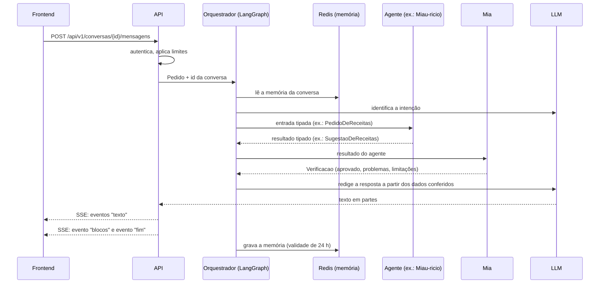
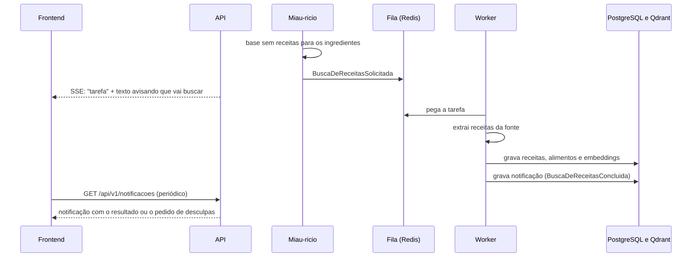
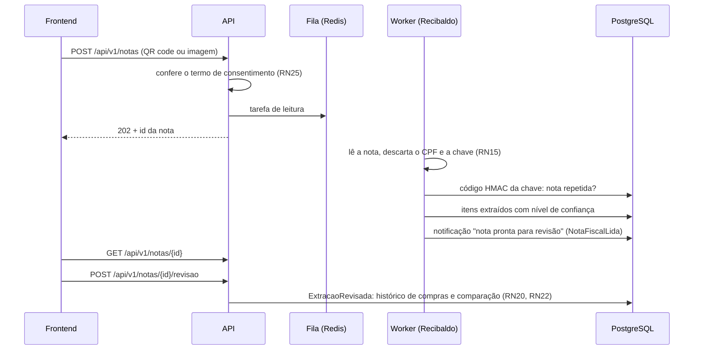

# Fluxos de dados e contratos

> **Status:** proposta inicial, decidida pela equipe em 03/11/2026 (#33). Complementa a [visão geral da arquitetura](visao-geral.md). As justificativas ficam em [decisoes.md](../decisoes.md).

## 1. Princípios

| Tema | Definição |
| --- | --- |
| Estilo da API | REST sob `/api/v1` para as telas guiadas (conta, perfil, lista, notas) e uma rota de conversa que passa pelo orquestrador. O contrato é o OpenAPI gerado pelo FastAPI, e o frontend gera o cliente TypeScript a partir dele |
| Resposta da conversa | Streaming por SSE: o texto chega aos poucos e, no fim, chegam os blocos estruturados (receitas, fontes, avisos). Como a mensagem vai num POST e o `EventSource` do navegador só faz GET, o frontend lê o stream com `fetch` |
| Verificação | A Mia confere os dados estruturados do agente **antes** de o texto ser redigido. Nada que não passou pela Mia chega à tela |
| Contratos entre agentes | Modelos Pydantic na camada `aplicacao` de cada contexto. Os agentes trocam dados tipados, nunca texto livre. Texto livre só na resposta final à pessoa |
| Memória da conversa | No Redis, por conversa, com validade de 24 horas. Depois disso a conversa recomeça. A validade é aplicada de novo a cada gravação, e a memória é apagada na exclusão da conta |
| Tarefas demoradas | A API enfileira no Redis, o worker executa e grava uma notificação. O frontend consulta as notificações periodicamente |
| Erros | Formato Problem Details (RFC 9457, `application/problem+json`) em todas as rotas |
| Dados pessoais | Os registros enviados ao Langfuse e os logs seguem a RN30 |

## 2. Fluxo da conversa

1. A API autentica, aplica o limite de requisições e confere o teto de gasto com o LLM.
2. O orquestrador lê a memória da conversa no Redis e usa o LLM só para identificar a intenção.
3. O agente recebe uma entrada tipada e devolve um resultado tipado. Cálculos, filtros e comparações são funções determinísticas (RN01).
4. A Mia confere o resultado: valores calculados, fontes citadas, regras de negócio atendidas (RN14). Se reprovar, o orquestrador devolve uma resposta de falha com a limitação, sem redigir o resultado reprovado.
5. O LLM redige o texto só a partir dos dados conferidos. A resposta vai em streaming.

### Eventos SSE

| Evento | Conteúdo |
| --- | --- |
| `texto` | Um trecho do texto da resposta |
| `blocos` | Dados estruturados para a tela: receitas sugeridas, fontes citadas, receitas ocultadas por restrição, avisos e limitações |
| `tarefa` | Uma tarefa foi enfileirada (ex.: busca de receitas), com o id para acompanhar |
| `erro` | Problem Details, quando algo falha no meio da resposta |
| `fim` | A resposta terminou |

## 3. Fluxo da busca de receitas (RN26)

> **A definir (05/11/2026):** com a troca do TudoGostoso pelos datasets afrodite.json e RecipeNLG, não há fonte para a busca sob demanda. O fluxo abaixo vale quando houver uma. Ver "Fonte de receitas" no [modelo de domínio](modelo-de-dominio.md).

## 4. Fluxo da nota fiscal

Itens com nível de confiança abaixo de 0,85 aparecem destacados na revisão (RN09). Se a nota já foi cadastrada, a tarefa termina com a notificação de nota repetida.

## 5. Rotas iniciais da API

Proposta para a #31. O formato final de cada rota fica no OpenAPI.

| Rota | Para quê |
| --- | --- |
| `POST /api/v1/auth/cadastro`, `POST /auth/login`, `POST /auth/renovar` | Conta, login e renovação do token |
| `GET/PUT /api/v1/perfil` | Perfil da casa: orçamento, preferências, restrições |
| `POST /api/v1/consentimento` | Aceite do termo de consentimento |
| `POST /api/v1/conversas`, `POST /conversas/{id}/mensagens` | Conversa com o orquestrador (SSE) |
| `GET/POST /api/v1/listas`, `.../listas/{id}/itens` | Lista de compras |
| `POST /api/v1/notas`, `GET /notas/{id}`, `POST /notas/{id}/revisao` | Nota fiscal e revisão |
| `GET /api/v1/notificacoes`, `POST /notificacoes/{id}/lida` | Central de notificações |
| `DELETE /api/v1/conta` | Exclusão da conta e de todos os dados (RN15, RN25) |
| `POST /api/v1/receitas/perguntas` | Pergunta ao Miau-ricio (RAG): resposta com as fontes, sem passar pelo orquestrador. Implementada para a demonstração da semana 2 ([spec 24](../../specs/24-endpoint-rag/spec.md)) |
| `GET /saude` | Rota de saúde |

## 6. Contratos dos agentes

Os nomes abaixo são modelos da camada `aplicacao`, montados com os termos do modelo de domínio. Os campos detalhados ficam na spec de cada agente.

| Agente | Recebe | Devolve |
| --- | --- | --- |
| Orquestrador | `Pedido` (texto, id da conversa, id da pessoa) | `Intencao` e o agente a acionar |
| Miau-ricio | `PedidoDeReceitas` (ingredientes disponíveis, só os informados?, usar notas recentes?, restrições) ou `PerguntaDeConhecimento` | `SugestaoDeReceitas` (receitas, ingredientes que faltam, substituições, receitas ocultadas, fontes) ou `RespostaComFontes` (trechos, fontes, não encontrou?) |
| Recibaldo | `DocumentoParaLeitura` (QR code ou imagem) | `LeituraDeNota` (itens extraídos com nível de confiança, estabelecimento, data, repetida?) |
| Planejamento | `PedidoDePlanejamento` (lista, orçamento, perfil) | `PlanoDeCompras` (custo estimado, origem de cada preço, ajustes sugeridos) |
| Cifrão | Bloqueado até a definição das fontes de salvaguarda | — |
| Mia | Resultado de qualquer agente | `Verificacao` (aprovado, problemas encontrados, limitações a informar) |

## 7. Eventos e fila

| Evento | Onde é tratado |
| --- | --- |
| `BuscaDeReceitasSolicitada` | Fila do worker |
| Leitura de nota fiscal ou encarte | Fila do worker |
| `SalvaguardaAtualizada` | Worker, pelo agendamento bimestral (RN19) |
| `BuscaDeReceitasConcluida`, `NotaFiscalLida` | Geram notificação para a pessoa |
| `ExtracaoRevisada`, `ListaCriada`, `OrcamentoExcedido` e os demais | No próprio processo, sem fila |
