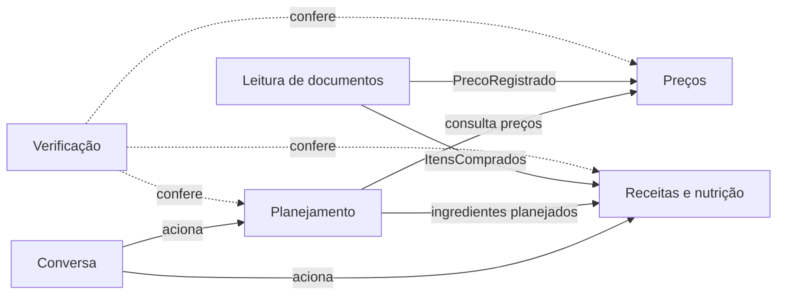

# Modelo de domínio do EconoMIA (DDD)

> **Status:** proposta inicial, para validação da equipe (épico #30).
> Base: proposta do projeto (PDF "Challenge 2 - econoMIA") e [análise de viabilidade](../semana-1/analise-viabilidade-e-justificativa-v2.md).

Este documento define a **linguagem ubíqua**, os **contextos delimitados** e as **regras de negócio** do EconoMIA. Specs, cenários BDD, código, testes e prompts usam os mesmos termos definidos aqui. Quando um termo novo surgir, ele entra primeiro neste documento.

## 1. O negócio

O EconoMIA é um assistente de planejamento de compras de supermercado. A pessoa informa o orçamento, as necessidades e as preferências da casa. O sistema organiza a lista de compras, compara preços, aponta oportunidades de economia e sugere receitas com o que já existe em casa.

**O que o sistema faz:** organiza informações, compara alternativas e explica os critérios usados.
**O que o sistema não faz:** não decide pela pessoa e não garante a menor despesa em todas as situações.

**Princípio de usabilidade:** a pessoa informa o mínimo possível. O que pode vir da nota fiscal ou ser deduzido pelo sistema não é pedido a ela. Funcionalidades que dependem de a pessoa informar dados extras (como a validade de cada alimento) ficam fora do MVP.

## 2. Contextos delimitados

| Contexto | Responsabilidade | Agente | Usa RAG? |
| --- | --- | --- | --- |
| **Planejamento** | Orçamento, necessidades da casa, lista de compras e ajustes quando a lista passa do orçamento | Agente de planejamento | Opcional (orientações de planejamento) |
| **Preços** | Produtos, estabelecimentos, preços com data e fonte, preços de salvaguarda, comparação por unidade de medida e promoções | Cifrão | Não. Preços vêm de banco estruturado |
| **Receitas e nutrição** | Receitas a partir dos ingredientes disponíveis, aproveitamento e conservação de alimentos, alimentação saudável, consumo e informação nutricional | Miau-ricio | Sim (receitas, Guia Alimentar, aproveitamento e conservação, consumo). TACO é consulta estruturada |
| **Leitura de documentos** | Leitura de notas fiscais e encartes, extração de itens e revisão pelo usuário | Recibaldo | Não. Multimodal |
| **Verificação** | Conferência de cálculos, aderência aos dados e comunicação das limitações | Mia | Não. Confere a fundamentação |
| **Conversa** | Interpretação do pedido, roteamento entre agentes e resposta final | Orquestrador | Não |

### Mapa de contextos



- **Planejamento consome Preços:** o planejamento pede preços, e Preços define o formato da resposta.
- **Leitura de documentos alimenta Preços e Receitas:** itens de nota fiscal revisados viram preços registrados e, quando a pessoa pede, ingredientes disponíveis para as receitas.
- **Verificação observa os outros contextos:** não altera dados, só aponta inconsistências.

## 3. Linguagem ubíqua

| Termo | Definição | Contexto | Nome no código |
| --- | --- | --- | --- |
| Orçamento | Valor disponível para compras de mercado num período | Planejamento | `Orcamento` |
| Período | Intervalo de tempo do orçamento (ex.: mês) | Planejamento | `Periodo` |
| Casa | Grupo de pessoas para quem as compras são feitas | Planejamento | `Casa` |
| Necessidade | Algo que a casa precisa comprar, com quantidade e prioridade | Planejamento | `Necessidade` |
| Preferência | Gosto ou escolha da casa (marca, tipo de alimento) | Planejamento | `Preferencia` |
| Restrição | Limite que não pode ser violado (alergia, dieta, orçamento) | Planejamento | `Restricao` |
| Lista de compras | Conjunto de itens a comprar, com prioridade e custo estimado | Planejamento | `ListaDeCompras` |
| Item da lista | Produto, quantidade e prioridade dentro da lista | Planejamento | `ItemDaLista` |
| Nível de prioridade | Importância de um item da lista: essencial, secundário ou supérfluo | Planejamento | `NivelDePrioridade` |
| Ajuste | Mudança sugerida para a lista caber no orçamento (reduzir a quantidade, substituir por equivalente mais barato, remover temporariamente) | Planejamento | `Ajuste` |
| Produto | Item vendido, com marca, categoria e embalagem | Preços | `Produto` |
| Embalagem | Quantidade e unidade de medida de um produto (ex.: 5 kg) | Preços | `Embalagem` |
| Produtos equivalentes | Produtos diferentes que atendem à mesma necessidade | Preços | `Equivalencia` |
| Estabelecimento | Mercado, atacarejo ou feira onde há preço | Preços | `Estabelecimento` |
| Preço | Valor de um produto num estabelecimento, sempre com data e fonte | Preços | `Preco` |
| Origem do preço | Confirmado, histórico, estimado ou informado pelo usuário | Preços | `OrigemDoPreco` |
| Preço por unidade | Preço por quilo, litro ou unidade, usado para comparar embalagens | Preços | `PrecoPorUnidade` |
| Preço de salvaguarda | Preço de referência de um produto, vindo de uma fonte pública e não de um estabelecimento. É usado quando não há preço cadastrado para o produto e para comparar com o preço de uma promoção | Preços | `PrecoDeSalvaguarda` |
| Fonte de salvaguarda | Base pública de onde vêm os preços de salvaguarda (ex.: cotações de atacado da Ceasa-DF), com instituição, link, região, tipo de preço (varejo ou atacado) e período de referência | Preços | `FonteDeSalvaguarda` |
| Promoção | Condição de preço temporária (desconto, leve X pague Y) | Preços | `Promocao` |
| Oportunidade de economia | Diferença de preço relevante encontrada nos dados | Preços | `OportunidadeDeEconomia` |
| Custo de deslocamento | Estimativa do custo de ir a um estabelecimento. Fora do MVP (ver seção 5) | Preços | `CustoDeDeslocamento` |
| Receita | Preparo com ingredientes e modo de fazer, sempre com fonte | Receitas e nutrição | `Receita` |
| Alimento | Alimento genérico (ex.: arroz branco tipo 1) que liga o produto da nota, o ingrediente da receita, a informação nutricional da TACO e os produtos equivalentes | Compartilhado entre Preços, Planejamento e Receitas e nutrição | `Alimento` |
| Ingrediente | Alimento usado numa receita, com quantidade | Receitas e nutrição | `Ingrediente` |
| Ingredientes disponíveis | Alimentos que a pessoa tem para cozinhar num pedido: os que ela diz na pergunta e, se ela pedir, os das notas recentes. Valem só para aquele pedido e não ficam salvos (não há despensa) | Receitas e nutrição | `IngredientesDisponiveis` |
| Busca de receitas | Extração de novas receitas na fonte, disparada quando a base não tem receitas para os ingredientes pedidos | Receitas e nutrição | `BuscaDeReceitas` |
| Termo de consentimento | Texto que a pessoa aceita antes de cadastrar notas fiscais, com os dados guardados e a finalidade de cada um | Planejamento | `TermoDeConsentimento` |
| Histórico de compras | Notas fiscais revisadas da casa, com itens, preços, estabelecimentos e datas. Completa o perfil da casa com o que ela compra de fato | Planejamento | `HistoricoDeCompras` |
| Informação nutricional | Calorias e nutrientes de um alimento, vindos da tabela TACO | Receitas e nutrição | `InformacaoNutricional` |
| Fonte | Documento de onde veio uma informação (título, instituição, ano) | Receitas e nutrição | `Fonte` |
| Trecho | Parte de um documento da base de conhecimento usada pelo RAG | Receitas e nutrição | `Trecho` |
| Nota fiscal | Comprovante de compra (NFC-e) com itens, valores, loja e data | Leitura de documentos | `NotaFiscal` |
| Encarte | Folheto de promoções de um estabelecimento | Leitura de documentos | `Encarte` |
| Item extraído | Produto, quantidade e valor lidos de uma imagem, com nível de confiança | Leitura de documentos | `ItemExtraido` |
| Revisão | Confirmação ou correção de itens extraídos pelo usuário | Leitura de documentos | `Revisao` |
| Recomendação | Sugestão final ao usuário, com critérios e limitações | Verificação | `Recomendacao` |
| Critério | Regra usada para chegar a uma recomendação | Verificação | `Criterio` |
| Limitação | O que o sistema não sabe ou não pode garantir numa resposta | Verificação | `Limitacao` |
| Pedido | Mensagem do usuário em linguagem natural | Conversa | `Pedido` |
| Intenção | O que o usuário quer fazer, identificado a partir do pedido | Conversa | `Intencao` |

## 4. Blocos de construção

### Objetos de valor

| Objeto de valor | Regra |
| --- | --- |
| `Dinheiro` | Valor em reais guardado em centavos (inteiro). Nunca usar ponto flutuante para dinheiro |
| `Quantidade` | Valor numérico mais `UnidadeDeMedida` (kg, g, L, mL, unidade) |
| `PrecoPorUnidade` | `Dinheiro` dividido por `Quantidade` normalizada (por kg, por L ou por unidade) |
| `Periodo` | Data de início e data de fim |
| `OrigemDoPreco` | Um entre: confirmado, histórico, estimado, informado pelo usuário |
| `TipoDePreco` | Varejo ou atacado. Diz se o preço de salvaguarda é de prateleira ou de atacado (ex.: Ceasa) |
| `NivelDeConfianca` | Valor entre 0 e 1 atribuído a um item extraído |
| `NivelDePrioridade` | Um entre: essencial, secundário, supérfluo |

### Entidades e agregados

| Agregado (raiz) | Contém | Contexto |
| --- | --- | --- |
| `ListaDeCompras` | `ItemDaLista`, `Orcamento`, `Ajuste` | Planejamento |
| `Casa` | `Necessidade`, `Preferencia`, `Restricao`, `HistoricoDeCompras` | Planejamento |
| `Produto` | `Embalagem`, `Equivalencia` | Preços |
| `Estabelecimento` | localização, `CustoDeDeslocamento` | Preços |
| `Preco` | `Produto`, `Estabelecimento`, `Dinheiro`, data, `OrigemDoPreco`, `Fonte` | Preços |
| `PrecoDeSalvaguarda` | `Produto`, `PrecoPorUnidade`, `Periodo` de referência, região, `TipoDePreco`, `FonteDeSalvaguarda`. Não tem `Estabelecimento` | Preços |
| `FonteDeSalvaguarda` | instituição, link, região, `TipoDePreco`, periodicidade de publicação | Preços |
| `Alimento` | nome genérico, categoria, `InformacaoNutricional` | Compartilhado |
| `Receita` | `Ingrediente` (cada um ligado a um `Alimento`), `Fonte` | Receitas e nutrição |
| `BuscaDeReceitas` | ingredientes pedidos, situação (em andamento, concluída, sem resultado), receitas encontradas | Receitas e nutrição |
| `NotaFiscal` | `ItemExtraido`, `Revisao` | Leitura de documentos |
| `Recomendacao` | `Criterio`, `Limitacao` | Verificação |

### Eventos de domínio

| Evento | Quando acontece | Quem reage |
| --- | --- | --- |
| `ListaCriada` | Uma lista de compras é montada | Preços (estimar custo) |
| `OrcamentoExcedido` | O custo estimado passa do orçamento | Planejamento (sugerir ajustes) |
| `PrecoRegistrado` | Um preço novo entra na base | Preços (histórico) |
| `SalvaguardaAtualizada` | A extração bimestral de uma fonte de salvaguarda termina (RN19) | Preços (substituir os preços de salvaguarda daquela fonte) |
| `NotaFiscalLida` | A extração de uma nota termina | Leitura de documentos (pedir revisão quando houver baixa confiança) |
| `ExtracaoRevisada` | O usuário confirma ou corrige os itens | Preços e Receitas e nutrição |
| `RecomendacaoGerada` | Uma recomendação fica pronta | Verificação |
| `BuscaDeReceitasSolicitada` | A base não tem receitas para os ingredientes pedidos (RN26) | Receitas e nutrição (extrair novas receitas da fonte) |
| `BuscaDeReceitasConcluida` | A busca de receitas termina, com ou sem resultado | Conversa (notificar a pessoa) |

## 5. Regras de negócio

| # | Regra | Contexto |
| --- | --- | --- |
| RN01 | Cálculos monetários, somas e comparações numéricas são feitos por funções determinísticas e testadas, nunca pelo LLM | Todos |
| RN02 | Todo preço tem data e fonte | Preços |
| RN03 | O sistema distingue preço confirmado, histórico, estimado, informado pelo usuário e preço de salvaguarda | Preços |
| RN04 | O LLM não é fonte de preço atual. Documentos recuperados por similaridade também não | Preços, Receitas e nutrição |
| RN05 | Comparações de embalagens usam o preço por unidade de medida | Preços |
| RN06 | O mais barato não é automaticamente a melhor escolha. Sugestões respeitam preferências e restrições | Planejamento |
| RN07 | Quando a lista passa do orçamento, o sistema sugere ajustes, e a pessoa decide | Planejamento |
| RN08 | Sem histórico suficiente, o sistema mostra só as oportunidades observadas e não afirma que um dia é sempre o melhor para comprar | Preços |
| RN09 | Itens extraídos com nível de confiança abaixo de 0,85 (85%) passam por revisão do usuário antes de entrar em cálculos ou recomendações | Leitura de documentos |
| RN10 | Respostas baseadas na base de conhecimento citam a fonte | Receitas e nutrição |
| RN11 | Quando a base não tem a informação, o sistema diz que não encontrou, sem inventar | Receitas e nutrição |
| RN12 | Calorias e nutrientes vêm da tabela TACO, não do LLM. Vale quando a informação nutricional entrar (fora do MVP, ver seção 5) | Receitas e nutrição |
| RN13 | Receitas priorizam os ingredientes disponíveis e, entre elas, as que não exigem comprar nenhum ingrediente. Se a pessoa pedir receitas só com os itens que informou, nenhuma receita sugerida usa outro ingrediente. A priorização por alimentos perto do vencimento foi cortada: exigiria que a pessoa informasse a validade de cada alimento, e a nota fiscal não traz essa informação (princípio de usabilidade, seção 1) | Receitas e nutrição |
| RN14 | Toda recomendação informa os critérios usados e as limitações conhecidas | Verificação |
| RN15 | Dados pessoais não são guardados sem necessidade. O CPF da nota fiscal é descartado na leitura. A chave de acesso é usada só durante a leitura e também é descartada: o banco guarda apenas um código derivado dela (HMAC-SHA256 com uma chave secreta do sistema), que serve para detectar nota cadastrada duas vezes. Se a nota já foi cadastrada, o sistema avisa e não a registra de novo. A imagem da nota é descartada depois da leitura, e os dados das notas são apagados quando a pessoa exclui a conta | Leitura de documentos |
| RN16 | Quando não há preço cadastrado para um produto, o sistema usa o preço de salvaguarda, inclusive na estimativa de custo da lista. A estimativa mostra quanto do total vem de preços de salvaguarda e de quais itens. Sem preço cadastrado e sem preço de salvaguarda, o sistema diz que não tem preço para o produto e informa quantos itens ficaram fora do total | Preços, Planejamento |
| RN17 | O preço de salvaguarda sempre aparece identificado como tal, com a fonte de salvaguarda, o período de referência e o aviso de que não é o preço de um estabelecimento. Nunca é apresentado como preço atual | Preços |
| RN18 | A comparação entre o preço de uma promoção e o preço de salvaguarda usa o mesmo produto e o preço por unidade. Quando o preço de salvaguarda é de atacado, a comparação avisa isso | Preços |
| RN19 | A cada 2 meses, o Cifrão extrai de novo os preços de salvaguarda de cada fonte de salvaguarda e registra o período de referência. A extração é feita por leitura determinística dos arquivos da fonte, sem o LLM ler ou calcular valores (RN01, RN04). Se a extração falhar, os preços anteriores continuam valendo com o período antigo à vista, e a falha fica registrada | Preços |
| RN20 | O perfil da casa junta o que a pessoa cadastra (casa, orçamento, preferências, restrições) com o histórico de compras vindo das notas fiscais revisadas | Planejamento |
| RN21 | O sistema não mantém despensa. Quando a pessoa pede para analisar as notas recentes, os itens revisados dessas notas viram ingredientes disponíveis para a sugestão de receitas. A pessoa pode tirar ou acrescentar itens antes da sugestão (princípio de usabilidade, seção 1) | Leitura de documentos, Receitas e nutrição |
| RN22 | No MVP, o preço de um item da nota fiscal é comparado só com as notas anteriores da própria casa, pelo preço por unidade e em dois níveis: primeiro com o mesmo produto (mesma marca); sem histórico dele, com produtos equivalentes de outra marca, sempre identificados como "outra marca". A variação de preço do mesmo produto e a diferença entre marcas aparecem separadas. A comparação com os preços do Cifrão está pendente (ver "Fontes de salvaguarda: a definir") | Preços, Leitura de documentos |
| RN23 | Todo item da lista tem um nível de prioridade: essencial, secundário ou supérfluo. O sistema atribui o nível pela categoria do produto, e a pessoa pode mudar | Planejamento |
| RN24 | Quando a lista passa do orçamento, os ajustes sugeridos seguem esta ordem: (1) reduzir a quantidade dos itens de menor prioridade, (2) substituir por produto equivalente mais barato, sem trocar marca que a pessoa marcou como preferida (RN06), (3) remover temporariamente itens opcionais. Os ajustes são sugestões da lista de compras, e a pessoa decide (RN07) | Planejamento |
| RN25 | Antes de cadastrar a primeira nota fiscal, a pessoa aceita o termo de consentimento. O termo informa que o sistema guarda o histórico de compras e um código derivado da chave de acesso de cada nota, para detectar notas repetidas, e que tudo é apagado quando a pessoa exclui a conta | Leitura de documentos, Planejamento |
| RN26 | Quando a base não tem receitas para os ingredientes pedidos, o sistema avisa que vai buscar novas receitas, dispara a busca de receitas na fonte e notifica a pessoa quando ela termina. Se a busca não encontrar receitas, o sistema explica que não encontrou e pede desculpas, sem inventar receita (RN11) | Receitas e nutrição, Conversa |
| RN27 | Receitas com ingrediente que viola uma restrição do perfil (alergia, dieta) não aparecem. O sistema informa quantas receitas ficaram de fora e por qual restrição, e a pessoa pode pedir para vê-las mesmo assim, com o ingrediente restrito destacado | Receitas e nutrição, Planejamento |
| RN28 | Uma receita pode ser sugerida quando faltam até 2 ingredientes, ou quando os ingredientes que faltam podem ser substituídos por outros disponíveis. A sugestão informa quais ingredientes faltam e quais substituições foram consideradas. Receitas sem nada faltando aparecem primeiro | Receitas e nutrição |
| RN29 | A pessoa pode adicionar os ingredientes que faltam numa receita à lista de compras com uma única ação | Receitas e nutrição, Planejamento |

As specs citam as regras pelo número (ex.: "Atende RN02 e RN03").

### Fontes de salvaguarda: a definir

> **Status: a definir.** O Cifrão está bloqueado por esta decisão: sem fonte de salvaguarda definida, não dá para especificar nem implementar a estimativa de custo (RN16) e a comparação com promoções (RN18).

| Opção | Situação |
| --- | --- |
| Cotações de atacado da Ceasa-DF | Viável. Boletim em PDF com cerca de 190 itens de hortifrúti e preço mínimo, mais comum e máximo. Só cobre hortifrúti, e o preço é de atacado por embalagem de atacado |
| Dataset complementar | Em discussão com o Paulo, para cobrir itens que a Ceasa não tem (arroz, feijão, óleo, carne, leite) |
| DIEESE | Fora por enquanto. Desde abril de 2018, o preço por produto de cada capital só sai com assinatura. A publicação gratuita traz o custo total da cesta e a variação de cada produto em porcentagem |
| Pesquisa manual de preços pela equipe | Último recurso, só se as outras opções não derem cobertura suficiente |

Também falta definir a idade máxima do período de referência: a partir de quando avisar que o preço é antigo e a partir de quando deixar de usá-lo.

Quando o Cifrão for implementado, falta decidir se o preço da nota fiscal passa a ser comparado também com os preços do Cifrão para o mesmo estabelecimento, com notas de outras casas ou com o preço de salvaguarda (hoje a RN22 compara só com as notas anteriores da própria casa).

### Ajustes ao orçamento: a definir

A RN24 vem do Relatório 1 e usa dois termos que ainda não estão definidos:

- **Item de menor prioridade** (passo 1): só os supérfluos, ou os secundários também? Se os dois, primeiro os supérfluos?
- **Item opcional** (passo 3): é o mesmo que supérfluo? Se for, o passo 1 pode reduzir e o passo 3 remover o mesmo item.

Também falta definir quem monta a tabela que liga cada categoria de produto a um nível de prioridade (RN23).

### Chave de acesso da nota fiscal

> **Decisão:** opção B, guardar só o código derivado da chave (03/11/2026). Está nas RN15 e RN25.

A RN15 descarta o CPF. O Relatório 1 pede também a anonimização das **chaves de acesso** da nota antes de salvar. O problema: a chave de acesso (44 dígitos) é o que identifica cada nota. Sem ela, o sistema não consegue saber se **a mesma nota foi cadastrada duas vezes**, pela mesma pessoa ou por duas pessoas da casa. Uma nota repetida duplica o histórico de compras, distorce o perfil (RN20) e as comparações (RN22) e, quando o Cifrão usar notas, conta o mesmo preço duas vezes.

A chave de acesso não traz o CPF, mas, junto com a conta da pessoa, mostra onde e quando ela comprou. Por isso é tratada como dado pessoal (LGPD).

| Opção | Como funciona | Detecta repetição? | LGPD |
| --- | --- | --- | --- |
| A. Guardar a chave | Salva a chave como está, só para detectar repetição, e apaga junto com a conta | Sim, exata | Exige finalidade declarada no consentimento. Quem tiver acesso ao banco pode consultar a nota na Sefaz |
| B. Guardar só um código derivado da chave (recomendada) | A chave é lida da nota, usada na hora e descartada. O banco guarda só um código gerado a partir dela com uma chave secreta do sistema (HMAC-SHA256), que não permite recuperar a chave original | Sim, exata | Pseudonimização (LGPD, art. 13, § 4º). Continua sendo dado pessoal, mas sem a chave no banco não dá para consultar a nota |
| C. Comparar dados da compra | Não guarda a chave. Detecta repetição pela combinação de CNPJ do mercado, data e hora e valor total, também guardada como código derivado | Quase sempre. Pode errar em compras iguais no mesmo minuto | Guarda menos dado, mas a detecção é aproximada |
| D. Guardar por pouco tempo | Guarda a chave só até a revisão da nota e depois troca pelo código da opção B | Sim | Igual à B depois da revisão. Útil se a revisão precisar consultar a nota de novo |

Em todas as opções, a imagem da nota não é guardada depois da leitura, e os dados da nota são apagados quando a pessoa exclui a conta.

### Receitas: a definir

- Quais ingredientes básicos (sal, água, óleo) contam como sempre disponíveis e não entram na contagem da RN28.
- De onde vêm as substituições de ingrediente da RN28: da própria receita, dos produtos equivalentes do mesmo `Alimento` ou de uma tabela da equipe.
- O que conta como "notas recentes" na RN21 (por exemplo, os últimos 30 dias).

### Fonte de receitas: risco a validar

> **Decisão da equipe:** extrair as receitas do TudoGostoso (extração inicial e buscas sob demanda, RN26) e validar o risco depois.

Riscos encontrados em 03/11/2026:

- Os [termos de uso](https://www.tudogostoso.com.br/termos-de-uso) proíbem copiar textos, imagens e materiais da plataforma sem consentimento prévio e dizem que o conteúdo é propriedade intelectual da Webedia. As receitas enviadas por usuários são licenciadas à Webedia.
- O [robots.txt](https://www.tudogostoso.com.br/robots.txt) bloqueia as páginas de busca (`/busca`), que seriam o caminho natural para buscar receitas por ingrediente sob demanda. As páginas de receita (`/receita/...`) não estão bloqueadas.

A primeira extração forma a **base inicial de receitas** do RAG. Separado dela, o projeto mantém um **conjunto de perguntas com gabarito** para medir a recuperação e comparar LLM × RAG (semana 3).

Caminhos para reduzir o risco, a avaliar: pedir autorização à Webedia para uso acadêmico; guardar só título, ingredientes e link, e mandar a pessoa ao site para o modo de preparo; trocar por fontes com licença aberta.

### Fora do MVP

Funcionalidades que fazem parte do produto, mas não entram no MVP:

| Funcionalidade | Regra prevista | Origem |
| --- | --- | --- |
| Informação nutricional estimada | Calorias e nutrientes de uma receita ou alimento são estimados a partir da TACO por cálculo determinístico, nunca pelo LLM (RN01, RN12), e a resposta deixa claro que é uma estimativa | Decisão da equipe, 03/11/2026 (fluxo F14) |
| Custo de deslocamento | O custo estimado do deslocamento (distância e consumo do veículo, ou tarifa de transporte) entra no custo final da compra e indica se vale trocar de estabelecimento | Relatório 1, RN-05 |

## 6. Organização do código

Proposta, a ser confirmada na #36:

```
src/economia/
  planejamento/
    dominio/          entidades, objetos de valor, regras (sem dependência externa)
    aplicacao/        casos de uso
    infraestrutura/   banco, LLM, APIs externas
  precos/
  receitas/
  leitura_documentos/
  verificacao/
  conversa/           orquestrador
  api/                rotas FastAPI
tests/
  <contexto>/         testes de unidade
  bdd/                passos dos cenários (pytest-bdd)
specs/                specs e cenários (.feature)
```

A camada `dominio` não importa nada de `infraestrutura`, de frameworks nem de LLM. Isso mantém as regras de negócio testáveis sem banco e sem chamadas de API.
