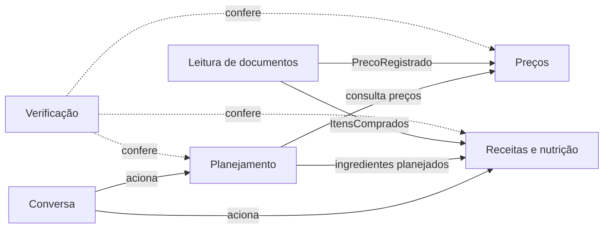

# Modelo de domínio do EconoMIA (DDD)

> **Status:** proposta inicial, para validação da equipe (épico #30).
> Base: proposta do projeto (PDF "Challenge 2 - econoMIA") e [análise de viabilidade](../semana-1/analise-viabilidade-e-justificativa-v2.md).

Este documento define a **linguagem ubíqua**, os **contextos delimitados** e as **regras de negócio** do EconoMIA. Specs, cenários BDD, código, testes e prompts usam os mesmos termos definidos aqui. Quando um termo novo surgir, ele entra primeiro neste documento.

## 1. O negócio

O EconoMIA é um assistente de planejamento de compras de supermercado. A pessoa informa o orçamento, as necessidades e as preferências da casa. O sistema organiza a lista de compras, compara preços, aponta oportunidades de economia e sugere receitas com o que já existe em casa.

**O que o sistema faz:** organiza informações, compara alternativas e explica os critérios usados.
**O que o sistema não faz:** não decide pela pessoa e não garante a menor despesa em todas as situações.

## 2. Contextos delimitados

| Contexto | Responsabilidade | Agente | Usa RAG? |
| --- | --- | --- | --- |
| **Planejamento** | Orçamento, necessidades da casa, lista de compras e ajustes quando a lista passa do orçamento | Agente de planejamento | Opcional (orientações de planejamento) |
| **Preços** | Produtos, estabelecimentos, preços com data e fonte, comparação por unidade de medida e promoções | Cifrão | Não. Preços vêm de banco estruturado |
| **Receitas e nutrição** | Receitas, despensa, aproveitamento de alimentos e informação nutricional | Miau-ricio | Sim (receitas, Guia Alimentar, conservação). TACO é consulta estruturada |
| **Leitura de documentos** | Leitura de notas fiscais e encartes, extração de itens e revisão pelo usuário | Recibaldo | Não. Multimodal |
| **Verificação** | Conferência de cálculos, aderência aos dados e comunicação das limitações | Mia | Não. Confere a fundamentação |
| **Conversa** | Interpretação do pedido, roteamento entre agentes e resposta final | Orquestrador | Não |

### Mapa de contextos



- **Planejamento consome Preços:** o planejamento pede preços, e Preços define o formato da resposta.
- **Leitura de documentos alimenta Preços e Receitas:** itens de nota fiscal revisados viram preços registrados e itens da despensa.
- **Verificação observa os outros contextos:** não altera dados, só aponta inconsistências.

## 3. Linguagem ubíqua

| Termo | Definição | Contexto | Nome no código |
| --- | --- | --- | --- |
| Orçamento | Valor disponível para compras de mercado num período | Planejamento | `Orcamento` |
| Período | Intervalo de tempo do orçamento (ex.: mês) | Planejamento | `Periodo` |
| Casa | Grupo de pessoas para quem as compras são feitas | Planejamento | `Casa` |
| Necessidade | Algo que a casa precisa comprar, com quantidade e prioridade | Planejamento | `Necessidade` |
| Preferência | Gosto ou escolha da casa (marca, tipo de alimento) | Planejamento | `Preferencia` |
| Restrição | Limite que não pode ser violado (alergia, dieta, orçamento) | Planejamento | `Restricao` |
| Lista de compras | Conjunto de itens a comprar, com prioridade e custo estimado | Planejamento | `ListaDeCompras` |
| Item da lista | Produto, quantidade e prioridade dentro da lista | Planejamento | `ItemDaLista` |
| Ajuste | Mudança sugerida para a lista caber no orçamento (substituir, reduzir, adiar) | Planejamento | `Ajuste` |
| Produto | Item vendido, com marca, categoria e embalagem | Preços | `Produto` |
| Embalagem | Quantidade e unidade de medida de um produto (ex.: 5 kg) | Preços | `Embalagem` |
| Produtos equivalentes | Produtos diferentes que atendem à mesma necessidade | Preços | `Equivalencia` |
| Estabelecimento | Mercado, atacarejo ou feira onde há preço | Preços | `Estabelecimento` |
| Preço | Valor de um produto num estabelecimento, sempre com data e fonte | Preços | `Preco` |
| Origem do preço | Confirmado, histórico, estimado ou informado pelo usuário | Preços | `OrigemDoPreco` |
| Preço por unidade | Preço por quilo, litro ou unidade, usado para comparar embalagens | Preços | `PrecoPorUnidade` |
| Promoção | Condição de preço temporária (desconto, leve X pague Y) | Preços | `Promocao` |
| Oportunidade de economia | Diferença de preço relevante encontrada nos dados | Preços | `OportunidadeDeEconomia` |
| Custo de deslocamento | Estimativa do custo de ir a um estabelecimento | Preços | `CustoDeDeslocamento` |
| Receita | Preparo com ingredientes e modo de fazer, sempre com fonte | Receitas e nutrição | `Receita` |
| Ingrediente | Alimento usado numa receita, com quantidade | Receitas e nutrição | `Ingrediente` |
| Despensa | Alimentos que a casa já tem | Receitas e nutrição | `Despensa` |
| Item da despensa | Alimento da despensa, com quantidade e validade quando conhecida | Receitas e nutrição | `ItemDaDespensa` |
| Informação nutricional | Calorias e nutrientes de um alimento, vindos da tabela TACO | Receitas e nutrição | `InformacaoNutricional` |
| Fonte | Documento de onde veio uma informação (título, instituição, ano) | Receitas e nutrição | `Fonte` |
| Trecho | Parte de um documento da base de conhecimento usada pelo RAG | Receitas e nutrição | `Trecho` |
| Nota fiscal | Comprovante de compra (NFC-e) com itens, valores, loja e data | Leitura de documentos | `NotaFiscal` |
| Encarte | Folheto de promoções de um estabelecimento | Leitura de documentos | `Encarte` |
| Item extraído | Produto, quantidade e valor lidos de uma imagem, com nível de confiança | Leitura de documentos | `ItemExtraido` |
| Revisão | Confirmação ou correção de itens extraídos pelo usuário | Leitura de documentos | `Revisao` |
| Recomendação | Sugestão final ao usuário, com critérios e limitações | Verificação | `Recomendacao` |
| Critério | Regra usada para chegar a uma recomendação | Verificação | `Criterio` |
| Limitação | O que o sistema não sabe ou não pode garantir numa resposta | Verificação | `Limitacao` |
| Pedido | Mensagem do usuário em linguagem natural | Conversa | `Pedido` |
| Intenção | O que o usuário quer fazer, identificado a partir do pedido | Conversa | `Intencao` |

## 4. Blocos de construção

### Objetos de valor

| Objeto de valor | Regra |
| --- | --- |
| `Dinheiro` | Valor em reais guardado em centavos (inteiro). Nunca usar ponto flutuante para dinheiro |
| `Quantidade` | Valor numérico mais `UnidadeDeMedida` (kg, g, L, mL, unidade) |
| `PrecoPorUnidade` | `Dinheiro` dividido por `Quantidade` normalizada (por kg, por L ou por unidade) |
| `Periodo` | Data de início e data de fim |
| `OrigemDoPreco` | Um entre: confirmado, histórico, estimado, informado pelo usuário |
| `NivelDeConfianca` | Valor entre 0 e 1 atribuído a um item extraído |

### Entidades e agregados

| Agregado (raiz) | Contém | Contexto |
| --- | --- | --- |
| `ListaDeCompras` | `ItemDaLista`, `Orcamento`, `Ajuste` | Planejamento |
| `Casa` | `Necessidade`, `Preferencia`, `Restricao` | Planejamento |
| `Produto` | `Embalagem`, `Equivalencia` | Preços |
| `Estabelecimento` | localização, `CustoDeDeslocamento` | Preços |
| `Preco` | `Produto`, `Estabelecimento`, `Dinheiro`, data, `OrigemDoPreco`, `Fonte` | Preços |
| `Receita` | `Ingrediente`, `Fonte` | Receitas e nutrição |
| `Despensa` | `ItemDaDespensa` | Receitas e nutrição |
| `NotaFiscal` | `ItemExtraido`, `Revisao` | Leitura de documentos |
| `Recomendacao` | `Criterio`, `Limitacao` | Verificação |

### Eventos de domínio

| Evento | Quando acontece | Quem reage |
| --- | --- | --- |
| `ListaCriada` | Uma lista de compras é montada | Preços (estimar custo) |
| `OrcamentoExcedido` | O custo estimado passa do orçamento | Planejamento (sugerir ajustes) |
| `PrecoRegistrado` | Um preço novo entra na base | Preços (histórico) |
| `NotaFiscalLida` | A extração de uma nota termina | Leitura de documentos (pedir revisão quando houver baixa confiança) |
| `ExtracaoRevisada` | O usuário confirma ou corrige os itens | Preços e Receitas e nutrição |
| `RecomendacaoGerada` | Uma recomendação fica pronta | Verificação |

## 5. Regras de negócio

| # | Regra | Contexto |
| --- | --- | --- |
| RN01 | Cálculos monetários, somas e comparações numéricas são feitos por funções determinísticas e testadas, nunca pelo LLM | Todos |
| RN02 | Todo preço tem data e fonte | Preços |
| RN03 | O sistema distingue preço confirmado, histórico, estimado e informado pelo usuário | Preços |
| RN04 | O LLM não é fonte de preço atual. Documentos recuperados por similaridade também não | Preços, Receitas e nutrição |
| RN05 | Comparações de embalagens usam o preço por unidade de medida | Preços |
| RN06 | O mais barato não é automaticamente a melhor escolha. Sugestões respeitam preferências e restrições | Planejamento |
| RN07 | Quando a lista passa do orçamento, o sistema sugere ajustes, e a pessoa decide | Planejamento |
| RN08 | Sem histórico suficiente, o sistema mostra só as oportunidades observadas e não afirma que um dia é sempre o melhor para comprar | Preços |
| RN09 | Itens extraídos com baixa confiança passam por revisão do usuário antes de entrar em cálculos ou recomendações | Leitura de documentos |
| RN10 | Respostas baseadas na base de conhecimento citam a fonte | Receitas e nutrição |
| RN11 | Quando a base não tem a informação, o sistema diz que não encontrou, sem inventar | Receitas e nutrição |
| RN12 | Calorias e nutrientes vêm da tabela TACO, não do LLM | Receitas e nutrição |
| RN13 | Receitas priorizam ingredientes da despensa e alimentos próximos do vencimento | Receitas e nutrição |
| RN14 | Toda recomendação informa os critérios usados e as limitações conhecidas | Verificação |
| RN15 | Dados pessoais não são guardados sem necessidade. CPF de notas fiscais é descartado na leitura | Leitura de documentos |

As specs citam as regras pelo número (ex.: "Atende RN02 e RN03").

## 6. Organização do código

Proposta, a ser confirmada na #36:

```
src/economia/
  planejamento/
    dominio/          entidades, objetos de valor, regras (sem dependência externa)
    aplicacao/        casos de uso
    infraestrutura/   banco, LLM, APIs externas
  precos/
  receitas/
  leitura_documentos/
  verificacao/
  conversa/           orquestrador
  api/                rotas FastAPI
tests/
  <contexto>/         testes de unidade
  bdd/                passos dos cenários (pytest-bdd)
specs/                specs e cenários (.feature)
```

A camada `dominio` não importa nada de `infraestrutura`, de frameworks nem de LLM. Isso mantém as regras de negócio testáveis sem banco e sem chamadas de API.
