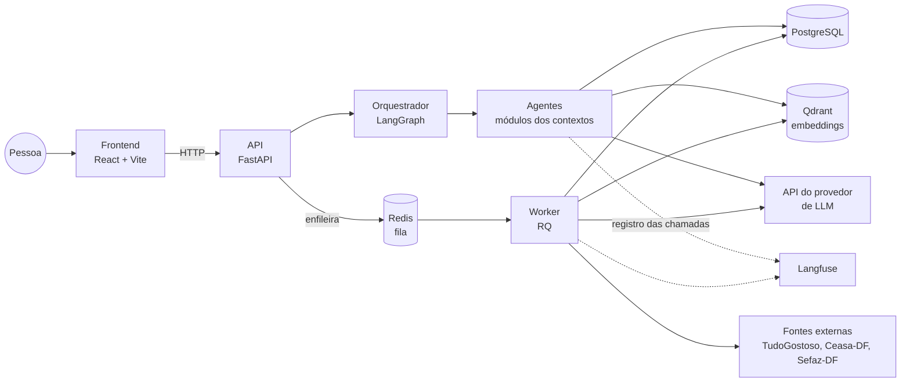

# Visão geral da arquitetura do EconoMIA

> **Status:** proposta inicial, decidida pela equipe em 03/11/2026 (épico #30). As justificativas de cada escolha ficam em [decisoes.md](../decisoes.md).
> Os contextos, termos e regras de negócio estão no [modelo de domínio](modelo-de-dominio.md).

## 1. Estilo: monolito modular

Um repositório e um backend em Python. Cada contexto delimitado é um módulo com as camadas `dominio`, `aplicacao` e `infraestrutura`. Os agentes são módulos do mesmo backend e se chamam dentro do mesmo processo, sem rede entre eles.

Do mesmo código saem dois processos:

| Processo | O que faz |
| --- | --- |
| **API** (FastAPI) | Atende o frontend: conversa, cadastro, lista de compras, notas fiscais |
| **Worker** (RQ) | Roda tarefas demoradas ou agendadas: busca de receitas sob demanda (RN26), extração bimestral dos preços de salvaguarda (RN19), leitura de notas fiscais e encartes |

Um contexto pode virar um serviço separado no futuro sem mudar o domínio, porque os contextos só se falam pelas interfaces descritas na seção 4.

## 2. Componentes



| Componente | Escolha | Papel |
| --- | --- | --- |
| Frontend | React + Vite, na pasta `frontend/` do mesmo repositório | Web responsiva que consome a API |
| API | FastAPI | Rotas HTTP, autenticação, enfileiramento de tarefas |
| Orquestração dos agentes | LangGraph | Grafo do orquestrador: interpreta o pedido, aciona os agentes e passa a resposta pela Mia |
| Fila e worker | Redis + RQ | Tarefas assíncronas e agendamento da extração bimestral |
| Banco relacional | PostgreSQL | Contas, perfil, listas, notas, preços, catálogo de alimentos, receitas estruturadas |
| Banco vetorial | Qdrant | Embeddings das receitas e da base de conhecimento do RAG, com payload para filtrar na busca por tipo, alimentos, ingredientes restritos e tema. O payload é sincronizado com o catálogo de alimentos do PostgreSQL |
| LLM | API de provedor, atrás de um adaptador | Interpretação, redação das respostas e leitura de imagens. O provedor e o modelo são decididos na #13 |
| LLMOps | Langfuse Cloud (plano gratuito), fora da VM | Registro de prompts, respostas, custo, latência e avaliações. Acesso das 2 pessoas de DevOps. Os registros não levam dados pessoais nem sensíveis (RN30) |
| Login | E-mail e senha no próprio backend | Senha com hash e token JWT |
| Implantação | Uma VM com Docker Compose | Sobe API, worker, Redis, PostgreSQL, Qdrant e o frontend. O Langfuse fica fora da VM |

## 3. Onde o LLM entra

O LLM só interpreta texto e imagens e redige respostas. Cálculos, comparações, filtros e a decisão de qual receita serve são funções determinísticas (RN01).

- O LLM fica atrás de um **adaptador** na camada de infraestrutura. Trocar de provedor ou de modelo não muda o domínio.
- Os **prompts** ficam em arquivos versionados na pasta `prompts/`, fora do código Python.
- Toda chamada ao LLM é registrada no Langfuse Cloud, com o modelo, a versão do prompt, os tokens, o custo e a latência. Como o Langfuse Cloud guarda os dados fora do Brasil, os registros não levam dados pessoais nem sensíveis: nome, e-mail, restrições de saúde e dados das notas são retirados ou mascarados antes do envio (RN30).
- O LangGraph fica em `conversa/infraestrutura`. Cada agente expõe seus casos de uso como ferramentas para o grafo, e o domínio dos agentes não importa o LangGraph.

## 4. Como os contextos se falam

- Cada contexto expõe **serviços na camada de aplicação**. Outro contexto chama esses serviços para consultas e comandos (ex.: o Miau-ricio adiciona os ingredientes que faltam à lista, RN29).
- Reações entre contextos usam **eventos de domínio** do modelo (ex.: `ExtracaoRevisada`, `BuscaDeReceitasConcluida`). Eventos que precisam de tarefa demorada vão para a fila do worker.
- Um contexto **nunca importa o domínio** de outro. O que é comum a vários contextos (`Alimento`, `Dinheiro`, `Quantidade`, os eventos) fica no módulo `compartilhado`.

## 5. Organização do código

```
src/economia/
  compartilhado/        Alimento, Dinheiro, Quantidade, eventos, adaptador do LLM
  planejamento/
    dominio/            entidades, objetos de valor, regras (sem dependência externa)
    aplicacao/          casos de uso e serviços expostos aos outros contextos
    infraestrutura/     banco, LLM, APIs externas
  precos/
  receitas/
  leitura_documentos/
  verificacao/
  conversa/             orquestrador (grafo do LangGraph em infraestrutura/)
  api/                  rotas FastAPI
  worker/               tarefas do RQ e agendamentos
prompts/                prompts versionados
frontend/               React + Vite
tests/
  <contexto>/           testes de unidade
  bdd/                  passos dos cenários (pytest-bdd)
specs/                  specs e cenários (.feature)
docker-compose.yml
```

A camada `dominio` não importa nada de `infraestrutura`, de frameworks nem de LLM.

## 6. A definir

- **Provedor e modelo do LLM, e modelo de embeddings** (#13).
- **Como a notificação chega ao frontend** quando uma tarefa termina (RN26): o frontend consulta a API de tempos em tempos, a API envia por SSE ou WebSocket, ou a notificação aparece na próxima vez que a pessoa abrir o app.
- **VM:** tamanho. A VM roda no Azure for Students e precisa aguentar PostgreSQL, Qdrant, Redis, API, worker e frontend.
- **Langfuse Cloud:** região dos dados (US, EU ou Japão).
- **Organização do código** a confirmar na #36 e **formato da API** na #31 e na #33.
