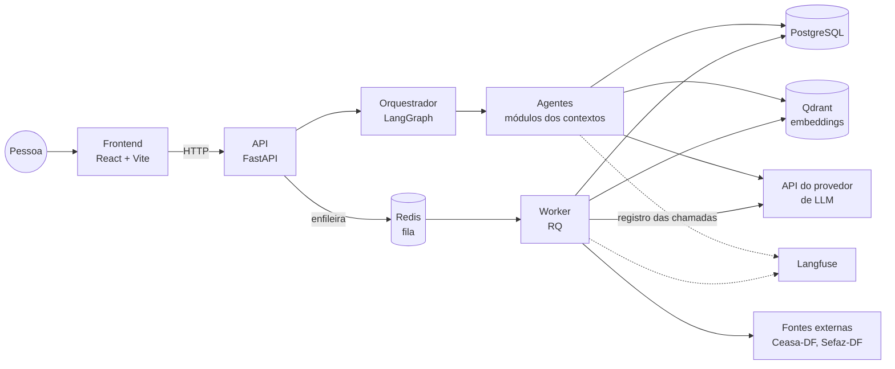

# Visão geral da arquitetura do EconoMIA

> **Status:** proposta inicial, decidida pela equipe em 03/11/2026 (épico #30). As justificativas de cada escolha ficam em [decisoes.md](../decisoes.md).
> Os contextos, termos e regras de negócio estão no [modelo de domínio](modelo-de-dominio.md).

## 1. Estilo: monolito modular

Um repositório e um backend em Python. Cada contexto delimitado é um módulo com as camadas `dominio`, `aplicacao` e `infraestrutura`. Os agentes são módulos do mesmo backend e se chamam dentro do mesmo processo, sem rede entre eles.

Do mesmo código saem dois processos:

| Processo | O que faz |
| --- | --- |
| **API** (FastAPI) | Atende o frontend: conversa, cadastro, lista de compras, notas fiscais |
| **Worker** (RQ) | Roda tarefas demoradas ou agendadas: busca de receitas sob demanda (RN26, a definir), extração bimestral dos preços de salvaguarda (RN19), leitura de notas fiscais e encartes |

Um contexto pode virar um serviço separado no futuro sem mudar o domínio, porque os contextos só se falam pelas interfaces descritas na seção 4.

## 2. Componentes



| Componente | Escolha | Papel |
| --- | --- | --- |
| Frontend | React + Vite, na pasta `frontend/` do mesmo repositório | Web responsiva que consome a API |
| API | FastAPI | Rotas HTTP, autenticação, enfileiramento de tarefas |
| Orquestração dos agentes | LangGraph | Grafo do orquestrador: interpreta o pedido, aciona os agentes e passa a resposta pela Mia |
| Fila e worker | Redis + RQ | Tarefas assíncronas e agendamento da extração bimestral |
| Banco relacional | PostgreSQL, acessado com SQLAlchemy Core (sem ORM) e migrações em SQL com Flyway | Contas, perfil, listas, notas, preços, catálogo de alimentos, receitas estruturadas |
| Banco vetorial | Qdrant | Embeddings das receitas e da base de conhecimento do RAG, com payload para filtrar na busca por tipo, alimentos, ingredientes restritos e tema. O payload é sincronizado com o catálogo de alimentos do PostgreSQL |
| LLM | API de provedor, atrás de um adaptador | Interpretação, redação das respostas e leitura de imagens. O provedor e o modelo são decididos na #13 |
| LLMOps | Langfuse Cloud (plano gratuito, região US), fora da VM | Registro de prompts, respostas, custo, latência e avaliações. Acesso das 2 pessoas de DevOps. Os registros não levam dados pessoais nem sensíveis (RN30) |
| Login | E-mail e senha no próprio backend | Senha com hash e token JWT |
| Implantação | Uma VM no Azure (2 vCPUs, 16 GiB) com Docker Compose | Sobe API, worker, Redis, PostgreSQL, Qdrant e o frontend. O Langfuse fica fora da VM |

## 3. Onde o LLM entra

O LLM só interpreta texto e imagens e redige respostas. Cálculos, comparações, filtros e a decisão de qual receita serve são funções determinísticas (RN01).

- O LLM fica atrás de um **adaptador** na camada de infraestrutura. Trocar de provedor ou de modelo não muda o domínio.
- Os **prompts** ficam em arquivos versionados na pasta `prompts/`, fora do código Python.
- Toda chamada ao LLM é registrada no Langfuse Cloud, com o modelo, a versão do prompt, os tokens, o custo e a latência. Como o Langfuse Cloud guarda os dados fora do Brasil, os registros não levam dados pessoais nem sensíveis: nome, e-mail, restrições de saúde e dados das notas são retirados ou mascarados antes do envio (RN30).
- O LangGraph fica em `conversa/infraestrutura`. Cada agente expõe seus casos de uso como ferramentas para o grafo, e o domínio dos agentes não importa o LangGraph.

## 4. Como os contextos se falam

- Cada contexto expõe **serviços na camada de aplicação**. Outro contexto chama esses serviços para consultas e comandos (ex.: o Miau-ricio adiciona os ingredientes que faltam à lista, RN29).
- Reações entre contextos usam **eventos de domínio** do modelo (ex.: `ExtracaoRevisada`, `BuscaDeReceitasConcluida`). Eventos que precisam de tarefa demorada vão para a fila do worker.
- Um contexto **nunca importa o domínio** de outro. O que é comum a vários contextos (`Alimento`, `Dinheiro`, `Quantidade`, os eventos) fica no módulo `compartilhado`.

## 5. Organização do código

```
src/economia/
  compartilhado/        Alimento, Dinheiro, Quantidade, eventos, adaptador do LLM, configuração (pydantic-settings)
  planejamento/
    AGENTS.md           instruções do contexto para pessoas e agentes de IA
    dominio/            entidades, objetos de valor, regras (sem dependência externa)
    aplicacao/          casos de uso e serviços expostos aos outros contextos
    infraestrutura/     banco, LLM, APIs externas
  precos/
  receitas/
  leitura_documentos/
  verificacao/
  conversa/             orquestrador (grafo do LangGraph em infraestrutura/)
  api/                  rotas FastAPI
  worker/               tarefas do RQ e agendamentos
prompts/<agente>/       prompts versionados
migracoes/              migrações SQL do Flyway (V1__descricao.sql)
frontend/               React + Vite com TypeScript
tests/
  <contexto>/           testes de unidade
  bdd/                  passos dos cenários (pytest-bdd)
specs/                  specs e cenários (.feature)
docker-compose.yml
```

A camada `dominio` não importa nada de `infraestrutura`, de frameworks nem de LLM.

Convenções para a equipe e para os agentes de IA:

- **`AGENTS.md` em cada contexto:** termos, regras de negócio e limites de importação daquele contexto, lidos por quem for mexer nele.
- **import-linter no CI:** barra o PR quando o `dominio` importa infraestrutura, framework ou LLM, ou quando um contexto importa o domínio de outro.
- **Configuração** lida das variáveis de ambiente num único lugar, com pydantic-settings.
- **Prompts** em `prompts/<agente>/`, um arquivo por prompt, com a versão no nome, para o Langfuse rastrear qual versão gerou cada resposta.
- **Cliente da API** no frontend gerado a partir do OpenAPI, em TypeScript.

## 6. Infraestrutura e operação

### Ambientes

| Ambiente | Onde roda | Para quê |
| --- | --- | --- |
| Local | Máquina de cada pessoa, com `docker compose` | Desenvolvimento e testes |
| Produção | VM no Azure for Students, com `docker compose` | Uso real e demo |

Não há ambiente de homologação. O que entra na `main` vai para a produção.

### Rede e HTTPS

- O domínio da equipe aponta para a VM. O **Caddy** fica na frente de tudo, obtém e renova o certificado HTTPS sozinho, serve o frontend (arquivos estáticos do build do Vite) e repassa `/api` para a API.
- O Caddy usa um **volume persistente** para os certificados. Sem ele, o certificado é pedido de novo a cada recriação do contêiner, e o Let's Encrypt limita a quantidade de pedidos.
- Na VM, só as portas 80 e 443 ficam abertas para a internet, além do SSH restrito. PostgreSQL, Qdrant e Redis só são acessíveis pela rede interna do Docker.

### Entrega contínua

```mermaid
flowchart LR
    PR[Pull request] --> CI[CI: lint, testes, import-linter]
    CI -->|merge na main| Build[Build das imagens Docker]
    Build --> GHCR[(GitHub Container Registry)]
    GHCR --> Deploy[Deploy por SSH na VM]
    Deploy --> Env[Grava o .env a partir dos GitHub Secrets]
    Env --> Mig[Roda as migrações do banco]
    Mig --> Up[docker compose pull e up]
    Up --> Saude[Confere as rotas de saúde]
```



- API e worker usam a mesma imagem, com comandos diferentes. O frontend é gerado no build e servido pelo Caddy.
- As migrações usam o **Flyway**: arquivos SQL numerados em `migracoes/` (`V1__descricao.sql`), aplicados pelo contêiner oficial do Flyway antes de a API subir, tanto no deploy quanto no `docker compose` local.

### Segredos

- Chave do provedor de LLM, chave secreta do HMAC (RN15), senha do banco, segredo do JWT e chaves do Langfuse ficam nos **GitHub Secrets**.
- O deploy grava o `.env` na VM com permissão só para o usuário do serviço. O `.env` nunca entra no repositório. Localmente, cada pessoa usa o `.env.example` com valores fictícios.

### Proteções da API

| Proteção | Como funciona |
| --- | --- |
| Limite de requisições | 10 mensagens por minuto por pessoa nas rotas que chamam o LLM e 60 requisições por minuto nas demais, também por IP |
| Limite de gasto com LLM | Teto diário de US$ 1 com o provedor, ajustável por variável de ambiente. Ao atingir o teto, o sistema avisa a pessoa e recusa novas chamadas ao LLM até o dia seguinte. Como segunda barreira, o painel do provedor também tem limite de gasto ou alerta de cobrança configurado (OWASP API4:2023) |
| CORS restrito | A API só aceita chamadas do domínio do frontend |
| JWT curto com renovação | Token de acesso de 15 minutos e token de renovação de 7 dias. Senhas com hash Argon2id |

### Monitoramento

- **Logs** em JSON, com um identificador por requisição, lidos pelo Docker. Os logs seguem a RN30: sem dados pessoais nem sensíveis.
- **Rotas de saúde** (`/saude`) na API e no worker, usadas pelo `docker compose` e pelo deploy.
- **Uptime Kuma** roda **fora da VM** (serviço externo ou máquina da equipe), consulta as rotas de saúde e avisa a equipe quando algo cai, inclusive a própria VM.
- As chamadas ao LLM são acompanhadas no Langfuse Cloud (seção 3).

### Backup

- Todo dia, um `pg_dump` do PostgreSQL e um snapshot do Qdrant são enviados ao **Azure Blob Storage**, com retenção de 7 dias.
- A restauração é testada pelo menos uma vez antes da demo.

## 7. A definir

- **Provedor e modelo do LLM, e modelo de embeddings** (#13).
- **Custo da VM:** conferir na calculadora do Azure quanto a VM de 2 vCPUs e 16 GiB consome dos US$ 100 de crédito e por quantos meses o crédito dura.
- **Onde roda o Uptime Kuma** fora da VM: qual serviço ou máquina.
- **Organização do código** a confirmar na #36 e **formato detalhado das rotas** na #31.

Os fluxos de dados, as rotas iniciais e os contratos dos agentes estão em [fluxos e contratos](fluxos-e-contratos.md).
