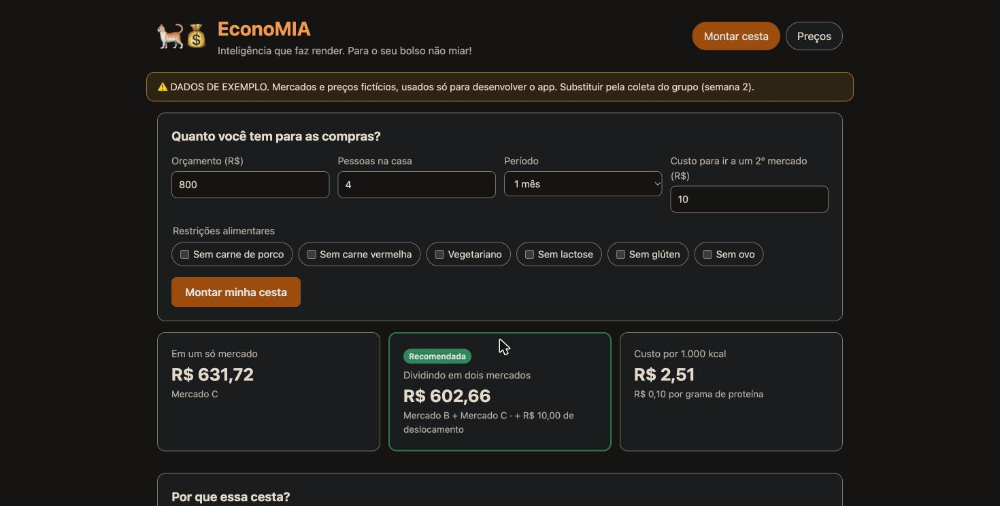
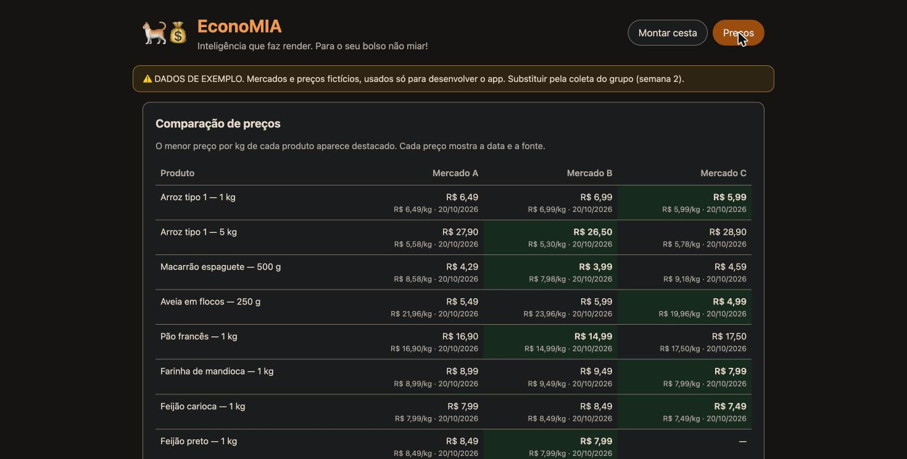

# Tópico 5 — Site (frontend)

**Status:** ✅ concluído em 29/10/2026

## O que foi feito

A tela da EconoMIA, feita com **HTML, CSS e JavaScript puros**: sem framework, sem `npm` e sem etapa de build. O próprio servidor FastAPI entrega os arquivos.

| Arquivo | Conteúdo |
|---------|----------|
| [src/web/index.html](../../src/web/index.html) | Estrutura da página: cabeçalho, abas, formulário e áreas de resultado |
| [src/web/estilo.css](../../src/web/estilo.css) | Visual: cores da marca, cartões, tabelas, modo escuro, celular |
| [src/web/app.js](../../src/web/app.js) | Lógica: chama a API e monta os resultados na tela |

## Como abrir

```bash
source .venv/bin/activate
uvicorn economia.api:app --app-dir src --reload
```

Abra <http://localhost:8000>.

## As telas

### Montar cesta



*Captura do tópico 5. Os valores mudaram com a meta de proteína animal do tópico 11, e a tela agora tem as abas Conversar e Enviar cupom.*

1. **Aviso de dados de exemplo** no topo, enquanto os preços forem fictícios. O texto vem da própria base (`aviso` em `precos.json`), então some sozinho quando a coleta real entrar.
2. **Formulário:** orçamento (vazio = sem limite), pessoas, período, custo para ir a um 2º mercado e as restrições alimentares (botões que podem ser marcados juntos).
3. **Resumo em 3 cartões:** a melhor opção em um mercado, a melhor em dois mercados (com o deslocamento) e o custo por 1.000 kcal. A opção recomendada ganha borda verde e o selo **Recomendada**.
4. **Por que essa cesta?:** as frases do `explicar()` (tópico 3).
5. **Metas nutricionais:** uma barra por meta (energia, proteína, fibra, frutas e hortaliças) com a % atingida.
6. **Lista de compras:** separada por mercado, com o subtotal de cada um. Cada item mostra quantidade, preço, **preço por kg**, subtotal e, embaixo do nome, **a data e a fonte do preço**.

Quando o orçamento não dá, a tela mostra só a explicação com o **mínimo necessário**.

### Preços



Tabela com todos os produtos × mercados. Cada célula mostra o preço, o preço por kg e a data. O **menor preço por kg** de cada produto fica destacado em verde. "—" indica que o mercado não tem o produto.

## Como funciona o `app.js`

```
carregou a página
   └─► iniciar()
         ├─ GET /api/opcoes  → mostra o aviso e cria os botões de restrição
         └─ GET /api/precos  → monta a tabela da aba Preços

enviou o formulário
   └─► POST /api/cesta  → mostrarPlano()
         ├─ cartões de resumo
         ├─ explicação
         ├─ mostrarMetas()  → barras
         └─ mostrarItens()  → uma tabela por mercado
```

- **`el(tag, atributos, ...filhos)`** cria elementos HTML. Todo texto entra como texto, nunca como HTML, então um nome de produto com `<` ou `&` não quebra a página nem abre brecha de segurança (XSS).
- **`api(caminho)`** faz o `fetch` e transforma erros da API (por exemplo o 422) em mensagem legível na tela.
- Valores em reais usam `toLocaleString("pt-BR", { currency: "BRL" })`, que gera "R$ 1.234,56".
- Enquanto calcula, o botão fica desabilitado e aparece "Calculando a melhor cesta…".

## Decisões de design

- **Cores em variáveis CSS** (`--marca`, `--ok`, ...) no `:root`, redefinidas em `@media (prefers-color-scheme: dark)`. O site segue o modo claro ou escuro do sistema.
- **Funciona no celular:** os campos e os cartões usam `grid` com `auto-fit`, as tabelas rolam na horizontal dentro do cartão, e as barras de metas mudam de layout abaixo de 560 px.
- **Acessibilidade básica:** abas com `role="tab"` e `aria-selected`, campos com `<label>` e `lang="pt-BR"`.

## Como foi testado

1. Servidor rodando com `uvicorn`. `curl` confirmou HTTP 200 em `/`, `/app.js` e `/api/saude`.
2. O site foi aberto no Chrome: o formulário foi enviado com os valores padrão (R$ 800, 4 pessoas, 1 mês, R$ 10 de deslocamento), a cesta, a explicação, as metas e a lista apareceram, e a aba Preços também foi conferida. As capturas acima são desse teste.
3. **Nenhum erro** no console do navegador.

Os testes automáticos da API (tópico 4) cobrem os dados que a tela usa. Testes automáticos da tela (por exemplo, com Playwright) ficam para o tópico 11, se der tempo.
