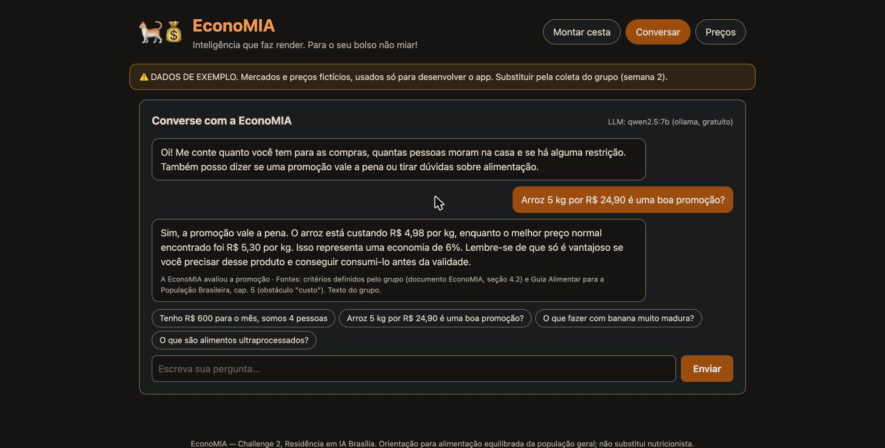

# Tópico 7 — LLM com ferramentas (chat)

**Status:** ✅ concluído em 29/10/2026

## O que foi feito

O **chat em linguagem natural** da EconoMIA. A pessoa escreve *"Tenho R$ 700 para o mês, somos 4 e não comemos porco"* e o LLM entende o pedido, chama o otimizador e responde. O LLM **só conversa**: preços, contas e a cesta vêm das ferramentas (código determinístico) e o conhecimento vem do RAG.



| Arquivo | Conteúdo |
|---------|----------|
| [src/economia/llm.py](../../src/economia/llm.py) | Cliente único para Ollama, Groq e Gemini (formato OpenAI-compatível) |
| [src/economia/assistente.py](../../src/economia/assistente.py) | Prompt, ferramentas, laço de chamadas, RAG e modo sem LLM |
| [src/economia/precos.py](../../src/economia/precos.py) | Ferramentas `consultar_precos` e `avaliar_promocao` ("essa promoção vale a pena?") |
| [src/economia/api.py](../../src/economia/api.py) | `GET /api/llm` e `POST /api/chat` |
| [src/web/](../../src/web/) | Aba **Conversar** com sugestões de perguntas |
| [tests/test_assistente.py](../../tests/test_assistente.py) | 20 testes, com um LLM **falso** (nenhum teste chama LLM de verdade) |

## Qual LLM? Todos gratuitos

| Provedor | Onde roda | Custo | Precisa de chave | Modelo padrão |
|----------|-----------|-------|------------------|---------------|
| **Ollama** (padrão) | no seu computador | grátis | não | `qwen2.5:7b` |
| Groq | nuvem | plano gratuito (com limite de requisições) | sim, grátis em console.groq.com | `llama-3.3-70b-versatile` |
| Gemini | nuvem (Google) | plano gratuito (com limite de requisições) | sim, grátis em aistudio.google.com | `gemini-2.5-flash` |
| nenhum | — | grátis | não | modo sem LLM |

Os três aceitam o **mesmo formato de requisição** (`/chat/completions` com `tools`), então um cliente só (`ClienteLLM`) atende todos. Os nomes de modelo padrão podem mudar com o tempo: confira no site do provedor e ajuste com `LLM_MODELO`.

**Escolhemos o Ollama como padrão:** é 100% gratuito, sem limite de uso, funciona sem internet e não envia dados do usuário (orçamento, hábitos) para fora. Nesta máquina ele já estava instalado com `qwen2.5:7b`, `qwen2.5:3b` e `llama3.1:8b`, todos com suporte a ferramentas.

### Como configurar

```bash
# Padrão: Ollama local
ollama pull qwen2.5:7b            # uma vez só
uvicorn economia.api:app --app-dir src --reload

# Modelo menor e mais rápido
LLM_MODELO=qwen2.5:3b uvicorn economia.api:app --app-dir src

# Groq ou Gemini (chave gratuita; nunca suba a chave para o GitHub)
export LLM_PROVEDOR=groq
export LLM_API_KEY=sua_chave
uvicorn economia.api:app --app-dir src

# Sem LLM
LLM_PROVEDOR=nenhum uvicorn economia.api:app --app-dir src
```

O site mostra no canto do chat qual LLM está ativo.

## Como funciona

```
mensagem do usuário
   │
   ├─ 1. RAG: busca 3 trechos na base e anexa à pergunta (se houver trecho relevante)
   │
   ├─ 2. LLM recebe: prompt de regras + histórico (6 últimas) + pergunta com trechos + 4 ferramentas
   │
   ├─ 3. LLM pede uma ferramenta? ──► executa em Python ──► devolve o resultado ao LLM ──► volta ao 3 (até 5 vezes)
   │
   └─ 4. LLM escreve a resposta final ──► tela mostra a resposta + o que foi usado + fontes
```

### As 4 ferramentas

| Ferramenta | O que faz | Código |
|------------|-----------|--------|
| `montar_cesta` | Roda `planejar()` e devolve a explicação; a lista de itens vai **só para a tela** | tópicos 2 e 3 |
| `consultar_precos` | Preços de um produto em cada mercado, com preço por kg, data e fonte | `precos.py` |
| `avaliar_promocao` | Compara o preço por kg da promoção com o menor preço normal do mesmo alimento: *vale a pena*, *empate* (±2%) ou *não vale* | `precos.py` |
| `buscar_conhecimento` | Busca extra na base, se o LLM quiser | tópico 6 |

### O prompt de regras (resumo)

0. Só falar de compras, preços, alimentação e receitas. Para o resto: *"Só consigo ajudar com compras, preços e alimentação."*
1. Português, no máximo 6 frases.
2. **Nunca inventar** preço, quantidade, caloria ou conta: usar as ferramentas.
3. Usar só os trechos recebidos e citar [n]. Se não responderem, dizer que a base não tem a informação.
4. Informar a data e a fonte dos preços, e avisar quando forem de exemplo.
5. Não é nutricionista: não prescrever dieta para doença.
6. Perguntar o que faltar (por exemplo, o número de pessoas).
7. Depois de montar a cesta, não repetir a lista: copiar os valores exatamente como vieram.

O texto completo está em `PROMPT_SISTEMA`, em `assistente.py`.

### Modo sem LLM (reserva)

Se não houver LLM configurado, ou se o LLM falhar (Ollama desligado, limite do plano gratuito estourado), o chat **continua funcionando**:

- `interpretar()` usa expressões regulares para achar a intenção (cesta, promoção, preço ou conhecimento) e os parâmetros (R$, nº de pessoas, período, restrições, peso da embalagem);
- chama a mesma ferramenta e monta o texto direto do resultado;
- a resposta vem com um aviso de que está no modo sem LLM.

Esse modo também serve de **linha de base** no experimento do tópico 8.

## O que aprendemos testando com o LLM real

Testamos com `qwen2.5:7b` no Ollama. Cada problema encontrado virou um ajuste:

| Teste | Problema | Ajuste |
|-------|----------|--------|
| "Quem ganhou a Copa de 2002?" | O modelo **inventou** que Coreia do Sul e Japão venceram (o campeão foi o Brasil) | Regra 0: recusar assuntos fora do tema. Depois do ajuste: *"Só consigo ajudar com compras, preços e alimentação."* |
| Cesta de R$ 700 para 4 pessoas | Reescreveu a lista de 11 itens e **trocou valores** (ex.: R$ 0,09 em vez de R$ 0,10); levou 95 s | A lista vai só para a tela; o LLM recebe só a explicação (regra 7). Caiu para **40 s** e os valores passaram a bater |
| "O que fazer com banana madura?" | Respondeu **de memória**, sem consultar a base | RAG antecipado: os trechos vão junto com a pergunta. Passou a responder com a base e citar [1] |
| Promoção de arroz | Respondeu certo, mas **não avisou** que o preço é de exemplo | Fica para a verificadora (Mia) no tópico 9 |

Tempos medidos nesta máquina, sem GPU dedicada: cerca de **8–20 s** para perguntas simples e **40 s** para a cesta. O modelo `qwen2.5:3b` é mais rápido, e Groq ou Gemini respondem em poucos segundos.

**Conclusão:** um modelo pequeno e local segue as regras **quase** sempre, mas não sempre. Por isso, preços e contas nunca dependem do texto do LLM: a tela mostra os dados das ferramentas, e o tópico 9 adiciona uma verificação automática da resposta.

## Testes

```bash
pytest tests/test_assistente.py -v
```

O `conftest.py` define `LLM_PROVEDOR=nenhum` para todos os testes, e os testes do assistente usam um `LLMFalso` que devolve respostas programadas. Assim os testes são rápidos, gratuitos e sempre dão o mesmo resultado.

Conferem: preços ordenados por preço/kg; promoção *vale a pena* / *empate* / *não vale* / *sem dados*; a interpretação de 5 frases típicas; o modo sem LLM (cesta, pedir nº de pessoas, resposta com fonte, fora do tema); com o LLM falso, que a ferramenta é chamada e a lista **não** vai para o LLM, que os trechos do RAG vão junto com a pergunta, que **sem RAG** não vão trechos nem a ferramenta de busca, que um LLM fora do ar cai no modo sem LLM, e que argumentos inválidos viram mensagem de erro para o LLM; e a configuração por variáveis de ambiente. Mais 2 testes da API (`/api/chat` e mensagem vazia).

**Resultado em 29/10/2026:** 73 testes passando no projeto.
