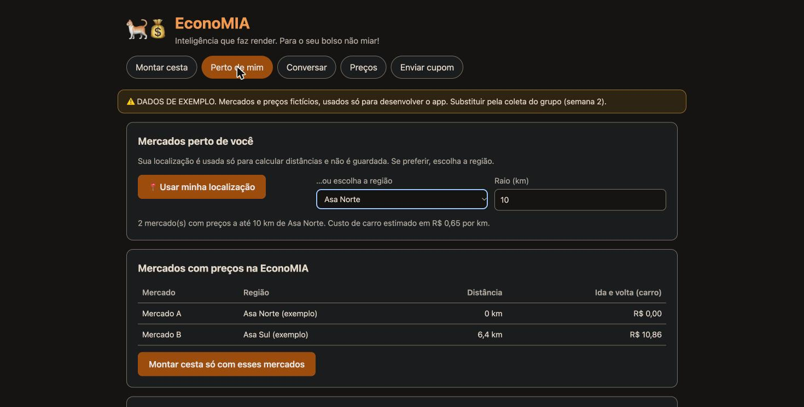
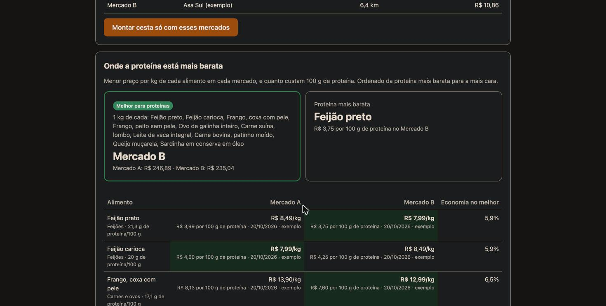

# Tópico 13 — Localização e ranking das proteínas

**Status:** ✅ concluído em 29/10/2026

## O que foi pedido

> "O site tem que pegar a localização do usuário e pesquisar quais mercados estão com os melhores preços, principalmente nos alimentos proteicos, como carne e frango."

## O que foi feito

A aba **Perto de mim**:

1. Pega a **localização** pelo navegador (com permissão) **ou** pela escolha de uma das 10 regiões do DF, para quem prefere não compartilhar a posição exata.
2. Lista os **mercados com preços na EconoMIA** dentro de um raio (padrão de 10 km), com a distância e o **custo estimado de ida e volta de carro**.
3. Mostra **onde a proteína está mais barata**: para cada alimento proteico (carnes, frango, ovos, peixe, leite, queijo e feijões), o menor preço por kg em cada mercado, quanto custam **100 g de proteína** e quanto se economiza no melhor mercado. Mostra também o **melhor mercado para um "carrinho de proteínas"** (1 kg de cada alimento que todos os mercados têm).
4. **Montar cesta só com esses mercados:** leva o filtro para a aba Montar cesta, já com o custo do 2º mercado calculado pela distância.
5. **Outros supermercados da região**, pelo **OpenStreetMap**: mostra os supermercados reais próximos e quais ainda não têm preços, com o convite para enviar um cupom.





| Arquivo | Conteúdo |
|---------|----------|
| [src/economia/geo.py](../../src/economia/geo.py) | Distância (haversine), mercados próximos, custo de deslocamento, ranking das proteínas, OpenStreetMap |
| [data/precos/precos.json](../../data/precos/precos.json) | Os mercados agora têm `lat` e `lon` |
| [src/economia/dados.py](../../src/economia/dados.py) | `Mercado` ganhou `lat` e `lon` (opcionais) |
| [src/economia/planejador.py](../../src/economia/planejador.py) | `planejar(..., mercados=[...])` compara só os mercados escolhidos |
| [src/economia/api.py](../../src/economia/api.py) | `GET /api/regioes`, `GET /api/proximos`, `GET /api/osm`; `POST /api/cesta` aceita `mercados` |
| [src/web/](../../src/web/) | Aba **Perto de mim** |
| [tests/test_geo.py](../../tests/test_geo.py) | 9 testes, mais 6 na API |

## ⚠️ O que o app NÃO faz: buscar preços na internet

**Não existe uma fonte pública e gratuita com os preços atuais dos supermercados do DF.** As alternativas foram descartadas:

| Alternativa | Por que não |
|-------------|-------------|
| Raspar os sites dos supermercados | Viola os termos de uso da maioria, quebra quando o site muda, muitos mercados nem vendem online, e o preço online pode ser diferente do da loja |
| APIs de comparadores de preço | Pagas ou fechadas |
| Pedir os preços ao LLM | Inventaria os valores (ver o experimento do tópico 8) |

**De onde vêm os preços, então:** da coleta do grupo e dos **cupons fiscais (NFC-e)** enviados pelos usuários (tópico 10). É o modelo colaborativo da proposta: *"cada compra alimenta a base para todos"*. A aba Perto de mim mostra o resultado disso por localização, e a lista do OpenStreetMap mostra **onde ainda faltam preços**.

## Como funciona

### Distância e custo de deslocamento

- **Distância em linha reta** pela fórmula de haversine (`distancia_km`).
- **Custo de ida e volta** = distância × **1,3** (fator para aproximar o caminho pelas ruas) × **2** (ida e volta) × **R$ 0,65/km**.
- R$ 0,65/km = gasolina a ~R$ 6,50/L ÷ 10 km/L. É um parâmetro do grupo (`CUSTO_POR_KM` em `geo.py`).
- O "custo para ir a um 2º mercado" da cesta é a ida e volta ao **2º mercado mais próximo**.

### Ranking das proteínas

Para cada alimento dos grupos *carnes e ovos*, *leite e queijos* e *feijões*, em cada mercado próximo:

- **menor preço por kg** entre as embalagens (ex.: ovos de 12 ou de 30);
- **custo de 100 g de proteína** = preço do kg ÷ (proteína por 100 g × 10) × 100. Exemplo: patinho a R$ 42,90/kg com 21,7 g de proteína por 100 g → **R$ 19,77 por 100 g de proteína**;
- **economia no melhor mercado** em relação ao mais caro.

A lista é ordenada pelo **custo da proteína**, e não pelo preço por kg. É assim que se vê que, com os preços de exemplo, 100 g de proteína custam **R$ 3,75 no feijão preto, R$ 7,60 no frango (coxa) e R$ 19,77 na carne moída (patinho)**.

O **carrinho de proteínas** soma 1 kg de cada alimento que **todos** os mercados próximos têm. Só esses entram, para a comparação ser justa (o feijão preto, que falta no Mercado C, sai quando o C está no raio).

### OpenStreetMap

- Consulta pública e gratuita à **Overpass API** do OpenStreetMap: lojas com `shop=supermarket` ou `shop=wholesale` (atacarejo) no raio (máximo de 10 km).
- Marca **"tem preços"** quando o nome bate com um mercado da base.
- Tenta 3 servidores públicos em sequência, porque é comum estarem sobrecarregados, e guarda o resultado em memória para não repetir a consulta.
- Atribuição exigida pela licença: "© colaboradores do OpenStreetMap", mostrada na tela.

## Privacidade (LGPD)

- A localização **só sai do navegador quando a pessoa clica** e aceita a permissão, ou escolhe uma região.
- O site envia a posição arredondada a **4 casas** (~10 m) para o nosso servidor, que a usa para calcular distâncias e **não a grava** em lugar nenhum.
- Para o OpenStreetMap, um serviço de terceiros, a posição vai arredondada a **2 casas (~1 km)**.
- Quem não quer compartilhar a posição escolhe a **região**, que usa o centro do bairro.

## Limitações

- **Os 3 mercados e as coordenadas são de exemplo** (centro da Asa Norte, da Asa Sul e do Guará). Na coleta real, anotar a localização de cada mercado (pelo Google Maps ou pelo OpenStreetMap: clicar no mercado e copiar a latitude e a longitude).
- **Mercados vindos de NFC-e não têm localização** e ficam fora do ranking por distância. Próximo passo: geocodificar o endereço da nota (o Nominatim, do OpenStreetMap, é gratuito).
- A **distância é estimada** (linha reta × 1,3), não a rota real. Uma rota de verdade exigiria um serviço de rotas, como o OSRM, que é gratuito.
- O casamento "OpenStreetMap × base" é **pelo nome**, então "Mercado A" e "Supermercado A" não batem.
- ⚠️ **A consulta real ao OpenStreetMap não foi validada ao vivo:** nos testes de hoje, o servidor principal respondeu 502 (sobrecarga) e os espelhos não responderam a tempo. O app mostra *"Não foi possível consultar o OpenStreetMap agora"*. A leitura da resposta está testada com dados no formato da Overpass. Vale tentar de novo em outro horário.

## Testes

```bash
pytest tests/test_geo.py -v
```

Conferem: a distância Asa Norte–Guará (~12,4 km); o custo de ida e volta; o filtro pelo raio e a ordenação; o custo do 2º mercado; coordenadas inválidas; o ranking (frango coxa mais barato no Mercado B; patinho a R$ 19,77 por 100 g de proteína; ordenação pelo custo da proteína; feijão preto fora do carrinho comum); o ranking só com os mercados pedidos; `planejar` só com os mercados próximos; e a leitura da resposta do OpenStreetMap (ignora os sem nome e os repetidos, e marca quem tem preços). Na API: mercados próximos, raio sem mercados, coordenadas inválidas (422), cesta só com os mercados escolhidos, regiões, e o OpenStreetMap fora do ar (502).

**Resultado em 29/10/2026:** 142 testes passando no projeto.
