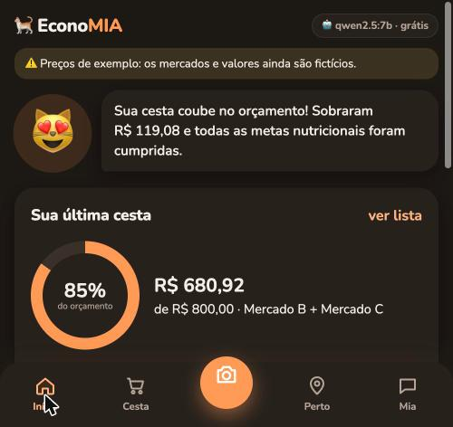
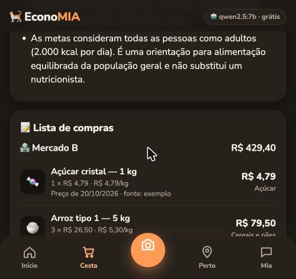
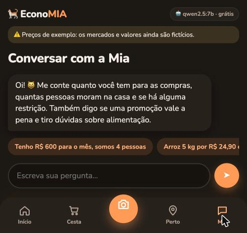
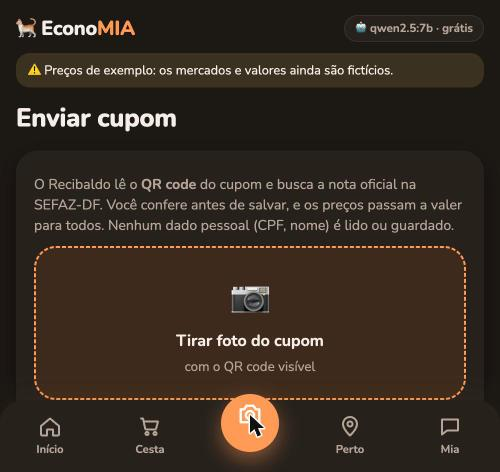

# Tópico 14 — Interface de app (UX)

**Status:** ✅ concluído em 29/10/2026

## O que foi pedido

> "Deixe a interface parecida com o app BitePal, para ficar melhor para o usuário."

O BitePal é um contador de calorias com mascote, listado no Guia 2 do documento da EconoMIA como app de referência. **Usamos o estilo dele como inspiração, sem copiar a marca, os ícones ou as telas.** A EconoMIA mantém a identidade própria: o gato 🐈, o laranja e o slogan.

Não foi possível abrir a página do app na Play Store pela ferramenta de navegador (o acesso ao domínio foi bloqueado). Por isso o redesenho segue os **padrões de UX comuns a esse tipo de app**, e não uma comparação tela a tela.

| Padrão de UX | Como ficou na EconoMIA |
|--------------|------------------------|
| Pensado primeiro para o celular | O app ocupa a tela do celular; no computador, aparece como uma "tela de celular" centralizada (até 520 px) |
| Navegação fixa embaixo | 5 botões: Início, Cesta, **📷 (cupom, botão central destacado)**, Perto, Mia |
| Mascote que reage | A Mia (😺) fala com o usuário e muda conforme o resultado: 😻 quando a cesta cabe no orçamento, 😿 quando falta dinheiro |
| Painel inicial com progresso | Anel do **orçamento usado** e 4 anéis das **metas nutricionais** da última cesta |
| Ações rápidas grandes | 4 cartões coloridos: Montar cesta, Achar ofertas perto de mim, Essa promoção vale?, Enviar cupom |
| Conteúdo diário | **Dica do dia** tirada da base (Guia Alimentar e critérios da EconoMIA), sempre com a fonte |
| Formulário fácil de tocar | Orçamento em destaque, contador − / + para as pessoas, período em botões (semana / 15 dias / mês), restrições como chips, "Mais opções" recolhido |
| Listas em cartões | A lista de compras virou cartões com emoji do grupo, quantidade × preço, preço/kg e fonte, em vez de tabela larga |
| Chat estilo mensageiro | Balões, sugestões que rolam na horizontal e campo de texto fixo acima da navegação |
| Câmera em evidência | Área grande "📷 Tirar foto do cupom", que no celular abre a câmera |
| Visual suave | Fundo creme, cartões brancos com sombra leve, cantos de 22 px, fonte Nunito (Google Fonts, gratuita), **modo escuro automático** |

## Telas

| Início (depois de montar a cesta) | Lista de compras | Conversar | Enviar cupom |
|---|---|---|---|
|  |  |  |  |

*Capturas no modo escuro do navegador, com a janela em largura de celular.*

## O que mudou no código

| Arquivo | Mudança |
|---------|---------|
| [src/web/index.html](../../src/web/index.html) | Nova estrutura: barra do topo, tela **Início**, navegação embaixo com ícones SVG desenhados à mão, formulário com contador e botões de período. **Os ids usados pelo JavaScript foram mantidos** |
| [src/web/estilo.css](../../src/web/estilo.css) | Reescrito: cores em variáveis (claro e escuro), cartões, anéis com `conic-gradient`, chips, botões grandes, navegação fixa, respeito a `prefers-reduced-motion` |
| [src/web/app.js](../../src/web/app.js) | `irParaAba()` central; contador −/+; `atualizarInicio()` (mascote + anel do orçamento); `aneisMetas()`; lista em cartões; dica do dia; nome do arquivo escolhido no cupom |

O backend não mudou: a API e os 142 testes são os mesmos.

## Decisões de design

- **Sem framework e sem build.** Continua HTML, CSS e JavaScript puros, tudo gratuito. Os anéis são só CSS (`conic-gradient`), sem biblioteca de gráficos.
- **Emojis no lugar de ilustrações**, para não depender de imagens nem copiar arte de ninguém. Os ícones da navegação são SVGs simples, desenhados para o projeto.
- **Acessibilidade:** botões com `aria-label`; navegação com `role="tablist"`; contraste dos textos sobre as cores claras; área de toque de pelo menos 48 px nos controles principais; animações desligadas para quem pediu "reduzir movimento" no sistema.
- **A Preços saiu da navegação** (5 botões é o limite confortável) e ficou como botão na tela Início.

## Como foi testado

No Chrome, com a janela em 420 × 860 px (tamanho de celular):

1. **Início** carregou com o mascote, as ações e a dica, sem erros no console.
2. **Cesta:** contador e período funcionaram; ao montar, apareceram os cartões de 1 × 2 mercados, os 4 anéis (100% / 102% / 112% / 100%) e a lista em cartões.
3. De volta ao **Início**, o mascote mudou para 😻 ("Sua cesta coube no orçamento! Sobraram R$ 119,08…") e o anel mostrou **85%** do orçamento.
4. **Conversar** e **Enviar cupom** (pelo botão central da câmera) abriram corretamente.

## Próximos passos de UX (sugestões para o grupo)

- Fazer o **teste com usuários** do tópico 11 já com esta interface.
- Transformar em **PWA** (manifest + service worker) para "instalar" na tela do celular. É gratuito.
- Guardar a última cesta no navegador (`localStorage`), para o Início continuar preenchido ao reabrir.
- Um botão para alternar entre claro e escuro manualmente (o CSS já aceita `data-theme`).

## Logo como atalho (05/11/2026)

Clicar na logo da EconoMIA volta para a tela Início e sobe ao topo da página, de qualquer tela. A logo é um botão com `data-ir="inicio"`, o mesmo atalho usado pelos outros botões de navegação.
