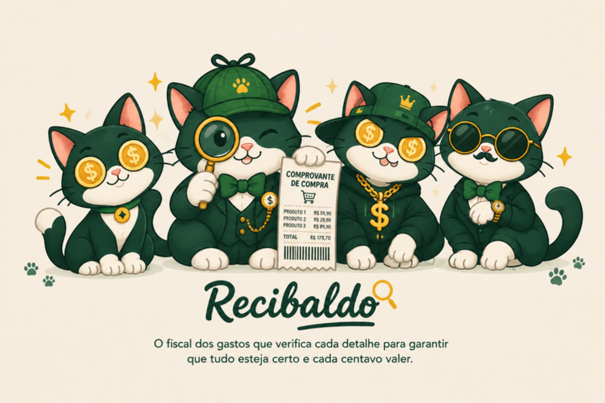

# Tópico 15 — Identidade visual (logo e personagens)

**Status:** ✅ concluído em 29/10/2026

## O que foi feito

O site passou a usar a **logo** e os **quatro gatos** criados pelo grupo, que são os próprios agentes do sistema (tópico 9), e a **paleta da marca**.

| Personagem | Papel no sistema | Onde aparece no site |
|------------|------------------|----------------------|
| **Mia** | Verificadora: confere cada resposta | Mascote da tela Início (com selo de humor ✨ / 🎉 / 😿), "Promoção vale?", avatar padrão do chat |
| **Cifrão** | Preços e ofertas | "Perto de mim", avatar do chat quando ele responde |
| **Miau-ricio** | Planejamento, nutrição e receitas | "Montar cesta", cardápio, avatar do chat quando ele responde |
| **Recibaldo** | Leitura do cupom (NFC-e) | "Enviar cupom" (no lugar do ícone de câmera) |

A tela Início também ganhou o cartão **"Conheça a turma"**, com a imagem dos quatro e a frase de cada um.

## De onde vieram as imagens

| Origem | O que tinha | Uso |
|--------|-------------|-----|
| Documento do grupo (Google Docs, início do Guia 1) | Logo EconoMIA, apresentação dos personagens, Recibaldo e os 4 gatos juntos | **Logo** e ícones |
| Canva do grupo ("Gato Recibaldo", 7 páginas) | **Um gato por página** (páginas 2 a 5) e a turma (página 6) | **Personagens** e turma |

Os arquivos originais estão em [docs/marca/](../marca/).

## Como as imagens foram preparadas

As imagens vieram com **fundo creme ou branco**. O plano gratuito do Canva não exporta PNG com fundo transparente. Para os gatos ficarem bonitos no modo claro e no escuro, o fundo foi removido por script:

1. **Preenchimento a partir das bordas** (flood fill): tudo o que tem a cor do fundo e encosta na borda vira transparente. O branco das patas e do peito não some, porque fica cercado pelo contorno escuro do desenho.
2. **Só o gato:** o script fica com a maior figura escura (contorno e pelagem) e preenche o que ela envolve (peito, patas, o cupom do Recibaldo). A sombra clara do chão sai.
3. **Borda suave** (desfoque de 0,7 px no canal de transparência) e **redução para 420 px** de largura.
4. Gera **WebP** (35–90 KB cada, usado no site) e **PNG** (usado na documentação).
5. Ícones do navegador e da tela inicial do celular (32, 192 e 512 px) a partir da cabeça do gato da logo.

Na primeira tentativa, com a imagem dos 4 gatos juntos, o Miau-ricio e o Recibaldo saíram grudados, porque o rabo de um encosta no chapéu do outro. Por isso os gatos foram refeitos a partir das páginas individuais do Canva.

Scripts (Python + Pillow + SciPy, gratuitos): [experimentos/marca_gatos.py](../../experimentos/marca_gatos.py) e [experimentos/marca_logo.py](../../experimentos/marca_logo.py). Para refazer depois de mudar uma imagem no Canva: exportar as páginas 2 a 6 em PNG e rodar `marca_gatos.py <pasta das páginas> src/web/img`.

## Paleta

Tirada da logo:

| Cor | Claro | Escuro | Uso |
|-----|-------|--------|-----|
| Verde da marca | `#1f6b45` | `#3fae6b` | Botões, item ativo da navegação, botão central |
| Verde-escuro | `#0f3d2a` | `#8fdcab` | Textos de destaque, cor do tema do navegador |
| Verde-claro | `#e3f0e5` | `#1d3a2b` | Fundos de cartões e ações |
| Dourado (moedas) | `#c9971c` / `#fbf0cf` | `#f2c14e` / `#3a3118` | Cartão "Promoção vale?", anel de proteína |
| Creme | `#f6efe2` | `#0d1a15` | Fundo |

No modo escuro, a palavra "EconoMIA" da logo é clareada por filtro CSS, para continuar legível.

## Arquivos

| Arquivo | Conteúdo |
|---------|----------|
| [src/web/img/](../../src/web/img/) | `mia`, `cifrao`, `miauricio`, `recibaldo`, `turma`, `logo`, `logo-gato`, `logo-nome` (.webp e .png) e `icone-32/192/512.png` |
| [src/web/index.html](../../src/web/index.html) | Logo no topo, favicon, gatos nas telas, "Conheça a turma" |
| [src/web/estilo.css](../../src/web/estilo.css) | Paleta verde e dourada; estilos de mascote, avatares e cabeçalhos com personagem |
| [src/web/app.js](../../src/web/app.js) | Selo de humor da Mia; avatar do gato que respondeu no chat (lido das etapas do orquestrador) |
| [docs/marca/](../marca/) | Imagens originais do grupo |
