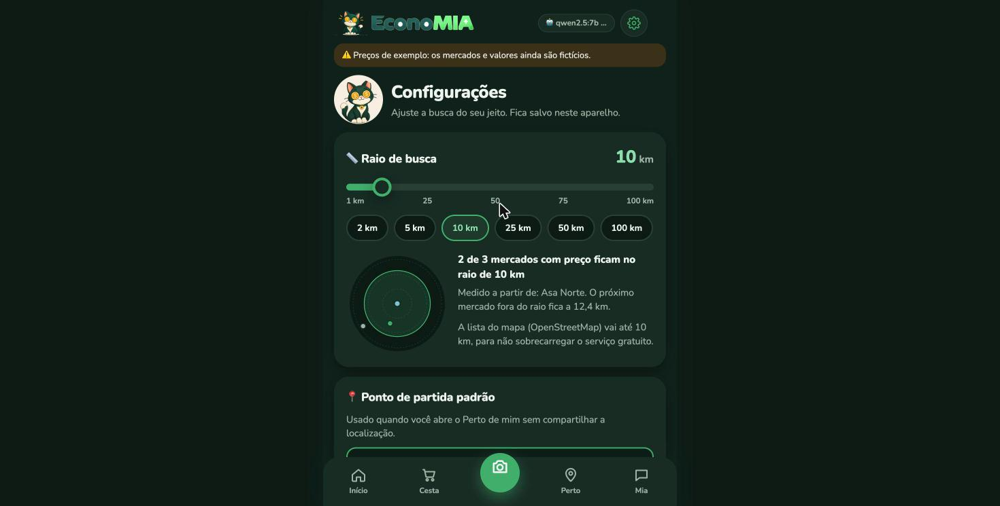
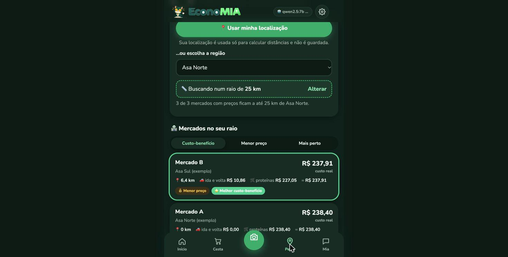

# Tópico 16 — Configurações: raio de busca e custo-benefício

**Status:** ✅ concluído em 29/10/2026

## O que foi pedido

> "Uma configuração para mexer na quilometragem. Por padrão, 10 km. A pessoa pode ir em Configurações e escolher de 1 a 100 km, para ver quais mercados estão perto e quais estão com o melhor preço. De forma profissional, pesquisando apps que fazem isso."

## O que a pesquisa mostrou

| App / fonte | Como faz |
|-------------|----------|
| **Too Good To Go** (app contra desperdício de comida) | O usuário define a distância em km; há um mapa em que se aumenta ou reduz o raio da busca; um usuário relata usar 2–3 km e que dá para chegar a 20 km ([fórum](https://www.hungryonion.org/t/toronto-too-good-to-go-app/35780), [teste da Verbraucherzentrale](https://www.verbraucherzentrale.de/umwelt-haushalt/nachhaltigkeit/apptest-too-good-to-go-wir-retten-lebensmittel-93411), [R5 Living](https://r5living.com/en/blogs/livingr5/too-good-to-go-l-app-pensata-per-evitare-lo-spreco-di-cibo)) |
| Localizadores de lojas ([Voxel](https://docs.getvoxel.io/articles/location-filter/), [Agile Store Locator](https://agilestorelocator.com/wiki/set-radius-value-distance-range-slider/), [Moovago](https://moovago.com/en/?p=47841)) | **Círculo no mapa** em volta do ponto, **controle deslizante** com passo configurável, **padrão sensato**, lista **sincronizada** e ordenada por distância |
| Discussão de UX no [Yext Hitchhikers](https://hitchhikers.yext.com/community/t/radius-filter-and-distance-setting-on-location-cards/782) | Problema comum: o raio é medido de um ponto e a distância nos cartões de outro, o que confunde. **Deixar claro de onde a distância é medida** |

Não encontramos documentação oficial do Flipp nem do Instacart sobre raio de busca, então eles não entraram como referência.

## Como ficou na EconoMIA

 

### Tela de Configurações (engrenagem ⚙️ no topo)

| Configuração | Padrão | Faixa | Para quê |
|--------------|--------|-------|----------|
| **Raio de busca** | **10 km** | **1 a 100 km** | Quais mercados entram na busca, no ranking das proteínas e na cesta "só com os mercados perto" |
| Ponto de partida padrão | perguntar sempre | 10 regiões do DF | O Perto de mim já abre buscando, sem pedir a localização |
| Custo do deslocamento | R$ 0,65/km | R$ 0,20 a R$ 2,00 | Gasolina ÷ consumo; entra no custo real e no custo do 2º mercado |
| Ordenar mercados por | custo-benefício | custo-benefício / menor preço / mais perto | Ordem da lista do Perto de mim |
| Aparência | automático | automático / claro / escuro | Tema do app |
| Restaurar padrões | — | — | Volta tudo ao padrão |

**Detalhes de UX que vieram da pesquisa:**

- **Controle deslizante + atalhos** (2, 5, 10, 25, 50, 100 km): arrastar para ajuste fino, tocar no atalho para ir direto.
- **Radar ao vivo:** um círculo mostra o raio, com os mercados como pontos na **direção e na distância reais**. Verde fica dentro do raio, cinza fica fora. Atualiza **enquanto arrasta**, sem esperar o servidor (os mercados de até 100 km são carregados uma vez só).
- **Resumo em frase:** *"2 de 3 mercados com preço ficam no raio de 10 km"*.
- **Ponto de medida explícito:** *"Medido a partir de: Asa Norte. O próximo mercado fora do raio fica a 12,4 km."*
- **Lista sincronizada:** ao soltar o controle, o Perto de mim refaz a busca com o novo raio.
- No Perto de mim, um **chip "📏 Buscando num raio de 10 km · Alterar"** leva direto às Configurações.
- Quando ninguém está no raio, o app **sugere aumentar**: *"O mercado mais próximo com preços fica a 6,4 km"*.

### "Quais estão perto e quais estão com o melhor preço"

Cada mercado do raio vira um cartão com:

```
Mercado B                                   R$ 237,91
Asa Sul                                    custo real
📍 6,4 km   🚗 ida e volta R$ 10,86   🛒 proteínas R$ 227,05   = R$ 237,91
[💰 Menor preço] [⭐ Melhor custo-benefício]
```

- **Preço** = o "carrinho de proteínas" (1 kg de cada alimento proteico que **todos** os mercados do raio têm, do tópico 13).
- **Custo real** = preço + ida e volta de carro (com o custo por km das Configurações).
- **Selos:** 📍 **Mais perto**, 💰 **Menor preço**, ⭐ **Melhor custo-benefício** (menor custo real). Um mercado pode ter mais de um selo. Os selos de preço só aparecem quando há 2 ou mais mercados para comparar.
- A lista pode ser ordenada pelos três critérios ali mesmo, e a escolha também fica salva.

O custo-benefício responde à pergunta que o usuário realmente tem: **vale atravessar a cidade pelo mercado mais barato?** Com o custo por km alto, o mercado mais perto passa a ganhar, e há um teste automático para isso.

## Como funciona por dentro

### API

| Endpoint | Mudança |
|----------|---------|
| `GET /api/configuracoes` | **Novo.** Padrões e limites: raio 10 (1–100), custo/km 0,65 (0,20–2,00), limite do mapa 10 km |
| `GET /api/proximos` | `raio_km` agora vai de **1 a 100** (fora disso: 422); novo parâmetro `custo_por_km`; cada mercado traz `rumo_graus`, `carrinho_proteinas`, `custo_real` e `selos`; a resposta traz `total_com_localizacao` e `mais_proximo_fora_do_raio_km` |

| Função (`geo.py`) | O que faz |
|-------------------|-----------|
| `rumo_graus()` | Direção do mercado vista do usuário (0° = norte, 90° = leste), para o radar |
| `custo_ida_volta(km, custo_por_km)` | Agora usa o custo por km do usuário |
| `comparar_mercados()` | Junta distância e preço, calcula o custo real e dá os selos |

### Site

- `config` fica no `localStorage` do navegador (chave `economia.config`), com `try/catch`: na navegação privada vale só durante a sessão. **A localização por GPS nunca é guardada**, só a região padrão, se a pessoa escolher.
- O radar é um SVG desenhado em JavaScript, sem biblioteca.
- A lista do OpenStreetMap continua limitada a **10 km**, para não sobrecarregar o serviço gratuito. A tela avisa quando o raio escolhido é maior.

## Testes

**152 testes passando** (10 novos):

- `test_geo.py`: direção (leste = 90°, sul = 180°); custo de ida e volta com o custo por km do usuário; raio de 1 km e de 100 km; selos de mais perto, menor preço e custo-benefício; custo real = preço + ida e volta; **o custo-benefício muda com o custo do km** (com R$ 5/km, o mais perto vence); um mercado sozinho não ganha selo de preço.
- `test_api.py`: padrões de `/api/configuracoes`; raio 100 aceito, 101 e 0,5 recusados; "mais próximo fora do raio"; o custo por km do usuário muda o custo de ida e volta.

Também testado no Chrome: o atalho de 25 km atualizou o radar para "3 de 3"; o Perto de mim abriu buscando pela região padrão; o Mercado B saiu com ⭐ e 💰 e o A com 📍; "Restaurar padrões" voltou para 10 km. Nenhum erro no console.
