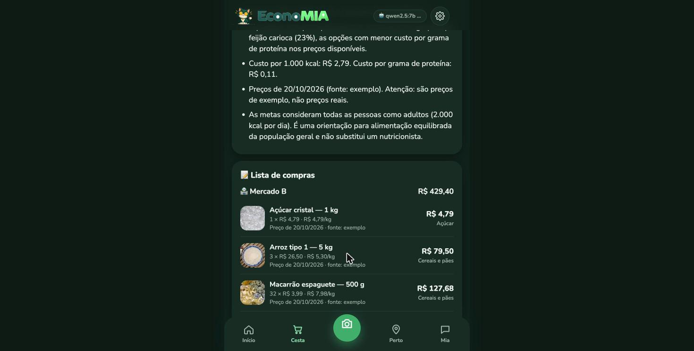
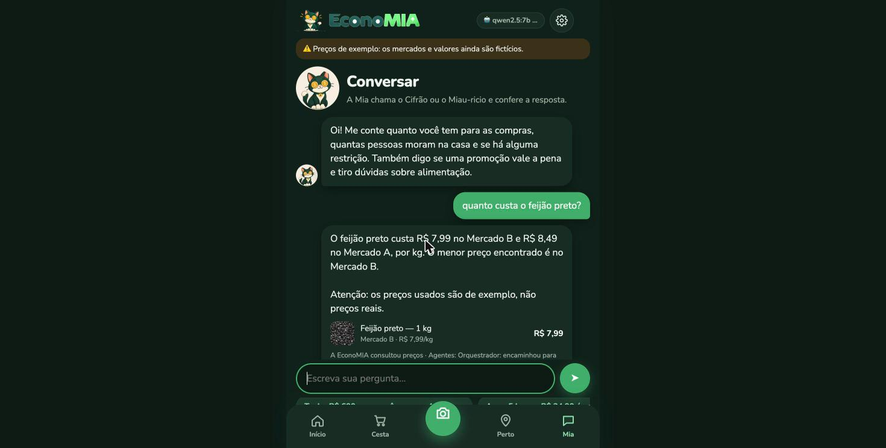
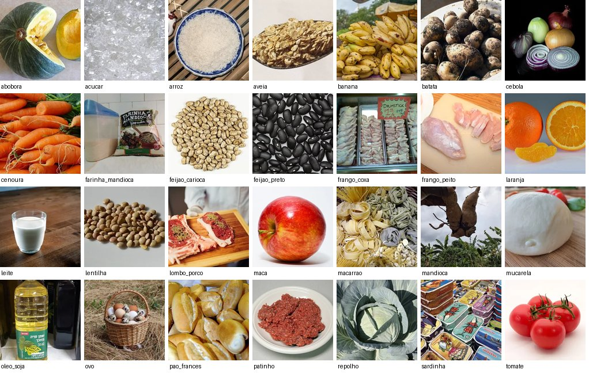

# Tópico 17 — Fotos dos alimentos

**Status:** ✅ concluído em 29/10/2026

## O que foi pedido

> "Todo alimento que for recomendar ou colocar o preço, pegue a imagem do alimento."

## O que foi feito

Cada um dos **28 alimentos** da base ganhou uma **foto real e de licença livre** do Wikimedia Commons. A foto aparece **em todo lugar onde o app recomenda um alimento ou mostra um preço**:

| Onde | Como aparece |
|------|--------------|
| **Lista de compras** (Montar cesta) | Foto de 52 px ao lado de cada item |
| **Cardápio** | Os ingredientes da cesta aparecem como etiquetas com foto, acima do cardápio |
| **Tabela de preços** | Foto ao lado de cada produto |
| **Ranking das proteínas** (Perto de mim) | Foto em cada alimento, e uma foto grande no cartão "Proteína mais barata" |
| **Chat** | Cartões com foto: os itens da cesta, o resultado de "quanto custa…?" e o de "essa promoção vale a pena?" |
| **Cupom fiscal** | A foto do produto escolhido para cada item da nota, atualizada ao trocar o produto |
| **Configurações → Créditos das fotos** | Lista com a miniatura, o link da foto original, o autor e a licença |

 

As 28 fotos:



## Por que o Wikimedia Commons

| Opção | Por que sim ou não |
|-------|--------------------|
| **Wikimedia Commons** ✅ | Gratuito; milhões de fotos com **licença explícita** em cada arquivo; API pública |
| Google Imagens / sites de mercados | ❌ As fotos têm dono; usar sem permissão viola direitos autorais |
| Bancos de imagens pagos | ❌ O projeto só usa ferramentas gratuitas |
| Gerar imagens com IA | ❌ Custo, e um alimento "inventado" pode confundir o usuário |
| Emojis | Usamos antes; são ícones, não fotos do alimento |

Só entram fotos com licenças que **permitem reuso e modificação**: **CC0**, **domínio público**, **CC BY** e **CC BY-SA**. As licenças "não comercial" (NC) e "sem derivados" (ND) ficam de fora, porque cortar e reduzir a foto já é uma modificação. As CC BY e CC BY-SA **exigem crédito**, que está no app (Configurações) e em [docs/marca/creditos-fotos-alimentos.md](../marca/creditos-fotos-alimentos.md).

## Como foi feito

Script: [experimentos/imagens_alimentos.py](../../experimentos/imagens_alimentos.py) (Python + httpx + Pillow, gratuitos).

1. Para cada alimento, uma **busca no Commons** (em inglês, alemão ou português, conforme o que achou fotos melhores).
2. A API devolve as fotos com a **licença, o autor e o link**; o script descarta as que não têm licença livre e as menores que 300 px.
3. Baixa a miniatura, **corta em quadrado** e reduz para **240 × 240 px em WebP** (~10–20 KB cada).
4. Grava o crédito em [data/alimentos/imagens.json](../../data/alimentos/imagens.json).

### A primeira foto da busca nem sempre serve

Na primeira rodada, várias vieram erradas:

| Alimento | O que veio |
|----------|------------|
| Carne moída | Um produto **vegetal** "ground beef" |
| Muçarela | Uma pizza |
| Batata | Flores de batata |
| Açúcar | Um prato indonésio |
| Macarrão | Uma fábrica de massas, e depois "pontes de espaguete" de feira de ciências |
| Peito de frango, leite, cenoura | Nenhuma foto livre na primeira busca |

Por isso, **cada foto foi escolhida olhando**: para os alimentos problemáticos, o script montou uma folha com as 6 primeiras fotos livres, e foi escolhida a que mostra **o alimento como se compra** (cru, inteiro). A busca e a opção escolhida ficam gravadas no script (`BUSCAS = {"lentilha": ("brown lentils", 1), ...}`), então dá para refazer igual.

Para trocar uma foto:

```bash
.venv/bin/python experimentos/imagens_alimentos.py mandioca=2   # testa a 3ª opção da busca
```

Depois, atualize o número em `BUSCAS`.

## Como funciona no site

- As fotos ficam em `src/web/img/alimentos/<id do alimento>.webp`.
- A função `fotoAlimento(id)` cria a imagem com `loading="lazy"`, que só carrega quando aparece na tela. Se a foto não existir, mostra 🛒 no lugar.
- A API passou a enviar o `alimento_id` em todo lugar onde há alimento: `/api/precos`, as ferramentas `consultar_precos` e `avaliar_promocao`, e `montar_cesta` (`itens_detalhe`, que vai só para a tela, não para o LLM).
- Novo endpoint `GET /api/creditos` com o autor e a licença de cada foto.

## Testes

**154 testes passando** (2 novos):

- `test_todo_alimento_tem_foto_e_credito`: todo alimento com preço tem o arquivo da foto **e** crédito (autor, licença, link).
- `test_cesta_no_chat_traz_alimento_para_a_foto`: a cesta do chat traz o `alimento_id` de cada item.

Também conferido no Chrome: fotos na lista de compras e no chat ("quanto custa o feijão preto?" → cartão com a foto e R$ 7,99 no Mercado B), sem erros no console.

## Limitações

- As fotos mostram o **alimento**, não a **marca** do produto: "Arroz 1 kg" e "Arroz 5 kg" usam a mesma foto. Fotos por produto exigiriam fotos de embalagens, que têm direitos das marcas.
- Alimentos novos (vindos da coleta ou de cupons) precisam de uma entrada em `BUSCAS`. Até lá, aparece 🛒.
