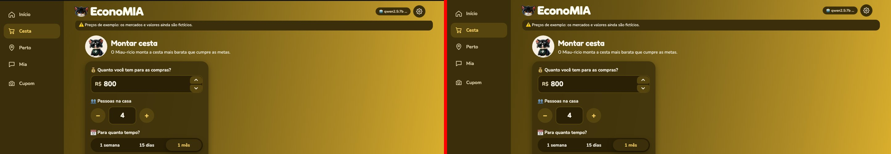

# Tópico 27 — Frontend em React, do jeito do grupo

**Status:** 🟡 pronto para revisão do Guilherme; o site antigo (`src/web/`) continua até a aprovação

## Por quê

O site de `src/web/` foi feito antes das decisões técnicas do grupo, em HTML, CSS e JavaScript puros, com chamadas à API escritas à mão. O visual foi aprovado, mas o código não segue a `main`: React + Vite + TypeScript em `frontend/`, cliente gerado do OpenAPI, `/api/v1`, Problem Details, SSE, login com JWT e código com os termos do domínio. A tarefa foi **o mesmo site, por dentro, do jeito do grupo**.

## Como foi feito

1. **Análise só de leitura** da `main` e da `feat/36-estrutura-backend`: `AGENTS.md`, `CONTRIBUTING.md`, decisões, arquitetura, escopo do MVP e modelo de spec. O merge da `main` ficou para depois, a pedido do Guilherme: a simulação mostrou 5 conflitos de texto, e a pasta `src/economia/api/` da `main` esconderia o `src/economia/api.py` do protótipo.
2. **Referência visual:** commit `e149814`, com a tag só local `referencia-visual-antigo`.
3. **Contrato provisório** em `frontend/openapi/provisorio.yaml`, com os campos que as telas usam hoje e dinheiro em centavos. Os tipos são gerados com `openapi-typescript`.
4. **Dados falsos** gravados das respostas do protótipo (`frontend/scripts/gravar-dados-falsos.mjs`), tipados pelo mesmo contrato e ligados por `VITE_DADOS_FALSOS=1`.
5. **Base comum:** cliente `openapi-fetch` com middleware de token e renovação, erros em Problem Details, leitor de SSE com `fetch`, sessão com token de acesso só na memória e consulta periódica de notificações.
6. **Efeitos:** a cena 3D foi portada com as mesmas linhas, falando com o React por uma "ponte" (`src/efeitos/ponte.ts`). Os gatos vivos viraram o componente `GatoVivo`, e as animações viraram funções chamadas pelas telas.
7. **Telas:** uma por commit, com o mesmo HTML e o CSS original importado: Início, Cesta, Mia, Cupom, Perto de mim, Configurações, Preços, e as novas Entrar e Criar conta.
8. **Comparação visual** com o Playwright.

## Problemas encontrados

| Problema | Causa | Solução |
| --- | --- | --- |
| Título da abertura quase invisível | O React monta o efeito duas vezes em desenvolvimento, e o `gsap.from` partia do estado já escondido | `gsap.context` com `revert` na limpeza do efeito |
| Ao trocar de tela, a página parava no meio | A rolagem ao topo começava antes de o React desenhar a tela nova | `flushSync` dentro da transição de tela |
| `npm install` falhou | O Playwright 1.65.0 tinha acabado de sair, sem o pacote do núcleo | Versões publicadas há pelo menos duas semanas |
| `openapi-typescript` não aceita TypeScript 7 | Dependência par `^5` | TypeScript 5.9.3 |

## Comparação visual

Rodada com o modo de menos movimento e com a cena 3D escondida, porque ela muda a cada quadro. São 8 capturas em cada largura (390, 768 e 1440 px), 24 no total.

| Resultado | Telas |
| --- | --- |
| Idênticas pixel a pixel | Início, Cesta, Perto de mim, Mia, Cupom, Configurações e Preços, nas três larguras (21 capturas) |
| Diferença de cerca de 1% | Cesta montada, nas três larguras: a barra do topo e o menu aparecem 2 px acima na captura da página inteira. Medido no navegador, os dois sites têm a barra e o menu no mesmo lugar (`top: 0`). É efeito de como o Playwright monta a captura inteira |
| Variação de 136 pixels | Configurações no tablet, em uma das rodadas: suavização das bordas. Na rodada anterior, a mesma captura foi idêntica |

## Conferência manual da cena 3D e das animações

No Chrome, em 1470 px, com movimento normal:

- O título entra palavra por palavra, e a Mia pula para a cena.
- A cena 3D roda a 62 quadros por segundo, com moedas, cesta e comida.
- Os 16 gatos vivos aparecem.
- Na cesta montada, o total sobe contando, os anéis e os itens entram e os alimentos caem na cesta 3D.
- No cupom, o recibo aparece com o feixe e o carimbo. No Perto, o mapa aparece com os pinos.
- Não houve erros no console.

**Defeito que já existia:** depois de montar a cesta, trocar de tela deixa a página parada no meio (188 px no site antigo, 123 px no novo), porque a rolagem suave do Lenis briga com o "voltar ao topo". Os dois sites se comportam igual; a correção espera a decisão do Guilherme.

## Ferramentas instaladas

| Pacote | Versão | Licença | Uso |
| --- | --- | --- | --- |
| react, react-dom | 19.3.1 | MIT | Interface |
| three | 0.187.0 | MIT | Cena 3D |
| gsap | 3.15.0 | Gratuita, com regras próprias ("Standard no charge") | Animações |
| lenis | 1.3.27 | MIT | Rolagem suave |
| openapi-fetch | 0.17.0 | MIT | Cliente da API |
| openapi-typescript | 7.13.0 | MIT | Tipos do contrato |
| typescript | 5.9.3 | Apache-2.0 | Linguagem |
| vite | 8.3.5 | MIT | Servidor e build |
| @vitejs/plugin-react | 6.1.2 | MIT | React no Vite |
| vitest | 4.1.12 | MIT | Testes de unidade |
| jsdom | 30.1.3 | MIT | Ambiente dos testes de unidade |
| @playwright/test | 1.64.1 | Apache-2.0 | Comparação visual |
| Chromium do Playwright (headless shell 156) | — | BSD | Navegador da comparação |
| @types/react, @types/react-dom | 19.3.0 | MIT | Tipos |
| @types/three | 0.187.0 | MIT | Tipos |

Todas estão em `frontend/package.json` e no `package-lock.json`.

## Para levar à `main` (não feito)

1. Criar a issue do frontend e renomear a spec `specs/sem-issue-frontend-react/` com o número dela.
2. Combinar os contratos da lista em `frontend/README.md` com a Isabel e trocar o contrato provisório pelo OpenAPI do backend.
3. Fazer o merge da `main` na `develop_gui`, resolvendo os 5 conflitos de texto e renomeando `src/economia/api.py`.
4. Abrir o PR a partir de uma branch no padrão `feat/<issue>-frontend-react`, já que o hook do grupo bloqueia o push de branches fora do padrão.
5. Tirar as linhas `Co-Authored-By` dos commits antigos da `develop_gui`, se o grupo exigir, o que reescreve o histórico.
6. Depois da aprovação, apagar `src/web/` e as imagens repetidas.
