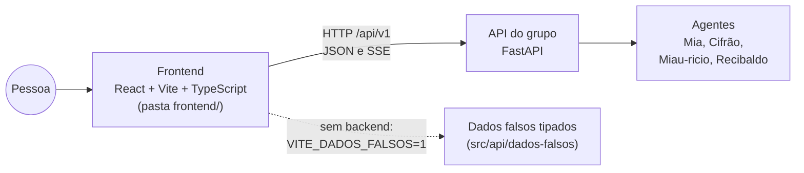
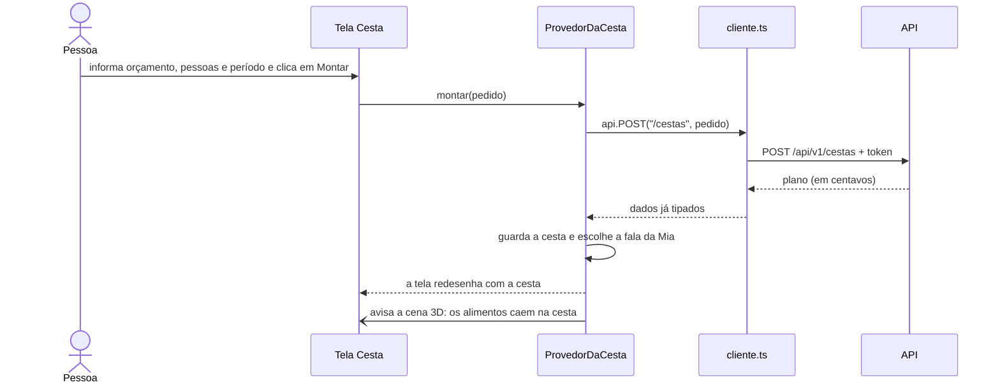

# Como funciona o frontend da EconoMIA

> Guia para apresentar o frontend: o que ele faz, como foi construído, que ferramentas usa e por quê.
> Autor: Guilherme Barros (AI Engineering e frontend). Código em [`frontend/`](../../frontend/).

## Sumário

1. [Em uma frase](#1-em-uma-frase)
2. [As ferramentas e por que cada uma](#2-as-ferramentas-e-por-que-cada-uma)
3. [Como o código está organizado](#3-como-o-código-está-organizado)
4. [O caminho de um clique até a tela](#4-o-caminho-de-um-clique-até-a-tela)
5. [As telas, uma a uma](#5-as-telas-uma-a-uma)
6. [Como o front conversa com o backend](#6-como-o-front-conversa-com-o-backend)
7. [Login e segurança](#7-login-e-segurança)
8. [Dados falsos: o front funciona sem o backend](#8-dados-falsos-o-front-funciona-sem-o-backend)
9. [Funcionalidades fora do MVP (flags)](#9-funcionalidades-fora-do-mvp-flags)
10. [Visual: estilo, gatos vivos, 3D e animações](#10-visual-estilo-gatos-vivos-3d-e-animações)
11. [Celular, tablet e computador](#11-celular-tablet-e-computador)
12. [Acessibilidade e desempenho](#12-acessibilidade-e-desempenho)
13. [Testes](#13-testes)
14. [Como rodar e demonstrar](#14-como-rodar-e-demonstrar)
15. [Regras de negócio que o front respeita](#15-regras-de-negócio-que-o-front-respeita)
16. [O que ainda falta (limitações honestas)](#16-o-que-ainda-falta-limitações-honestas)
17. [Perguntas que podem aparecer](#17-perguntas-que-podem-aparecer)
18. [Glossário](#18-glossário)

---

## 1. Em uma frase

O frontend é **um aplicativo web feito em React + TypeScript**, que roda no navegador do celular ou do computador, mostra as telas da EconoMIA (Início, Cesta, Cupom, conversa com a Mia, Configurações) e **conversa com a API do grupo** para buscar dados e respostas dos agentes de IA.

Ele **não calcula preço nem soma de compra**. Quem calcula é o backend, com código determinístico (regra RN01 do grupo). O front só pede, recebe e mostra.



---

## 2. As ferramentas e por que cada uma

Todas são **gratuitas e de código aberto**. As versões estão fixas no [`package.json`](../../frontend/package.json), para todo mundo da equipe instalar exatamente a mesma coisa.

### Para construir o app

| Ferramenta | Versão | Para que serve | Por que foi escolhida |
| --- | --- | --- | --- |
| **React** | 19.3 | Biblioteca para montar a interface em **componentes** (pedaços reutilizáveis de tela). | Decisão do grupo (issue #31). É a biblioteca de interface mais usada no mercado. |
| **TypeScript** | 5.9 | JavaScript com **tipos**: o editor avisa o erro antes de o código rodar. | Decisão do grupo. Com o contrato da API tipado, um campo com nome errado vira erro de compilação, não bug na tela. |
| **Vite** | 8.3 | Servidor de desenvolvimento e empacotador (*bundler*). | Abre em milissegundos e recarrega a tela na hora em que o arquivo é salvo. No build, gera os arquivos finais otimizados em `dist/`. |
| **@vitejs/plugin-react** | 6.1 | Ensina o Vite a entender JSX/TSX (o "HTML dentro do código" do React). | Plugin oficial. |

### Para falar com a API

| Ferramenta | Versão | Para que serve |
| --- | --- | --- |
| **openapi-typescript** | 7.13 | Lê o contrato da API ([`openapi/provisorio.yaml`](../../frontend/openapi/provisorio.yaml)) e **gera os tipos TypeScript** em `src/api/esquema.d.ts`. |
| **openapi-fetch** | 0.17 | Cliente HTTP que usa esses tipos: `api.GET("/opcoes")` já sabe o formato da resposta. |

Juntas, elas garantem que o front e o backend falem a mesma língua. Se o backend mudar um campo no contrato, o TypeScript aponta todos os lugares do front que precisam mudar.

### Para o visual

| Ferramenta | Versão | Para que serve |
| --- | --- | --- |
| **Three.js** | 0.187 | Cena **3D** da abertura: moedas que viram comida e caem na cesta. |
| **GSAP** (com ScrollTrigger) | 3.15 | **Animações**: título entrando palavra por palavra, valores contando, a Mia pulando. |
| **Lenis** | 1.3 | **Rolagem suave** com o mouse. |
| **WebGL 2** (do próprio navegador) | — | Os **gatos vivos**: respiram, piscam e olham para o cursor. Escrito à mão, sem biblioteca. |
| **Google Fonts** | — | Fontes **Fredoka** (títulos) e **Nunito** (texto). |

### Para testar

| Ferramenta | Versão | Para que serve |
| --- | --- | --- |
| **Vitest** | 4.1 | Testes de unidade (funções isoladas). |
| **jsdom** | 30.1 | Simula um navegador dentro do Node para o Vitest. |
| **Playwright** | 1.64 | Abre um navegador de verdade, tira **capturas de tela** e compara com o site antigo, pixel a pixel. |

### Imagens

| Origem | O quê |
| --- | --- |
| **Wikimedia Commons** | 28 fotos reais de alimentos, com licença livre (CC BY-SA, CC BY, domínio público). Autor e licença de cada uma aparecem na tela Configurações. |
| **FLUX.1 schnell** (gerador de imagem gratuito, rodado localmente) + remoção de fundo | Os quatro gatos (Mia, Cifrão, Miau-ricio, Recibaldo) e a comida da cena 3D. |
| Formato **WebP** | Todas as imagens: bem menores que PNG, com a mesma qualidade. |

---

## 3. Como o código está organizado

```text
frontend/
├── index.html                 a única página HTML: só tem <div id="raiz">, o React desenha o resto
├── package.json               dependências e comandos (npm run ...)
├── vite.config.ts             porta 5173 e repasse de /api/v1 para o backend
├── tsconfig.json              TypeScript no modo estrito
├── openapi/provisorio.yaml    CONTRATO da API (rotas, campos, erros)
├── public/                    arquivos servidos como estão: imagens e manifest (app instalável)
├── scripts/                   gravar-dados-falsos.mjs (gravou as respostas usadas nos dados falsos)
├── testes/visual/             teste de comparação visual (Playwright)
└── src/
    ├── main.tsx               ponto de entrada: liga o React na <div id="raiz">
    ├── App.tsx                decide o que mostrar: carregando, login ou o app
    ├── funcionalidades.ts     liga/desliga o que está fora do MVP
    ├── api/                   TUDO que fala com o backend
    │   ├── esquema.d.ts         tipos gerados do contrato (não se edita à mão)
    │   ├── cliente.ts           cliente da API, com o token e a renovação automática
    │   ├── transporte.ts        escolhe: API de verdade ou dados falsos
    │   ├── problemas.ts         tratamento único dos erros (Problem Details)
    │   ├── sse.ts               leitura da resposta da conversa em streaming
    │   └── dados-falsos/        backend de mentira, com respostas gravadas
    ├── autenticacao/sessao.ts login, cadastro, renovação e saída
    ├── estado/                "memória" compartilhada entre as telas (Context do React)
    ├── telas/                 uma tela por arquivo: Inicio, Cesta, Cupom, Conversa...
    ├── componentes/           peças reaproveitadas: barra do topo, navegação, anéis, gato vivo
    ├── efeitos/               cena 3D, gatos vivos e animações
    ├── estilos/estilo.css     todo o CSS
    ├── util/formato.ts        formatar reais, datas e distâncias
    └── testes/                testes de unidade
```

**Regra de dependência** (escrita em [`frontend/AGENTS.md`](../../frontend/AGENTS.md)): as telas podem usar componentes, estado, api, util e efeitos; os componentes não usam telas; e a pasta `api/` não usa nada de React. Assim, a parte que fala com o backend pode ser testada sozinha.

---

## 4. O caminho de um clique até a tela

### 4.1 Quando a página abre

1. O navegador carrega o `index.html`, que só tem uma `<div id="raiz">`.
2. O [`main.tsx`](../../frontend/src/main.tsx) liga o React nessa div e desenha o componente `App`.
3. O [`App.tsx`](../../frontend/src/App.tsx) tenta **recuperar a sessão** (`renovar()`): se a pessoa já entrou antes, o cookie de renovação devolve um token novo sem pedir a senha.
4. Sem sessão → mostra a tela **Entrar / Criar conta**. Com sessão → segue.
5. Carrega os **dados de referência** uma vez só (opções do formulário, preços, limites, modelo de LLM) em [`estado/dados-da-api.tsx`](../../frontend/src/estado/dados-da-api.tsx).
6. Monta os **provedores de estado** (um dentro do outro) e as telas:

```text
ProvedorDeNavegacao          qual tela está aberta
└── ProvedorDeDados          dados de referência da API
    └── ProvedorDeConfiguracoes   raio, custo por km, ordenação
        └── ProvedorDePosicao     ponto de partida da busca
            └── ProvedorDaCesta   cesta montada, o que a Mia diz, itens retirados
                └── Telas
```

**Provedor** (Context do React) é uma "memória" que qualquer tela abaixo dele pode ler. Por exemplo, a tela Início e a tela Cesta mostram a **mesma** cesta porque as duas leem o `ProvedorDaCesta`.

### 4.2 Trocar de tela

O app tem **uma página só** (SPA, *single-page application*): trocar de tela não recarrega o site. Em [`estado/navegacao.tsx`](../../frontend/src/estado/navegacao.tsx):

1. `irPara("cesta")` muda a aba aberta.
2. Usa a **View Transitions API** do navegador para a troca ter uma transição suave (se a pessoa não pediu menos movimento).
3. Avisa os efeitos visuais (`avisarAba`) e rola suavemente para o topo.

### 4.3 Exemplo completo: montar uma cesta



---

## 5. As telas, uma a uma

A navegação fica **embaixo no celular** e **na lateral no computador**. O botão do meio (câmera) é o **Cupom**.

| Tela | Arquivo | O que a pessoa faz | Rota da API |
| --- | --- | --- | --- |
| **Entrar / Criar conta** | [`telas/Acesso.tsx`](../../frontend/src/telas/Acesso.tsx) | Entra com e-mail e senha ou cria conta. | `POST /auth/login`, `/auth/cadastro` |
| **Início** | [`telas/Inicio.tsx`](../../frontend/src/telas/Inicio.tsx) | Vê a última cesta, a fala da Mia, atalhos ("Montar cesta", "Enviar cupom"), a apresentação da turma de gatos e a dica do dia. | `GET /cestas/ultima` |
| **Cesta** | [`telas/Cesta.tsx`](../../frontend/src/telas/Cesta.tsx) | Informa orçamento, pessoas, período e restrições; vê a cesta recomendada, "Por que essa cesta?", a lista de compras e o cardápio; tira um alimento ou informa o que já tem em casa, e a cesta é montada de novo. | `POST /cestas`, `POST /cardapios` |
| **Cupom** | [`telas/Cupom.tsx`](../../frontend/src/telas/Cupom.tsx) | Tira foto do cupom fiscal (abre a câmera traseira no celular) ou cola o link do QR code da NFC-e; revisa os itens lidos e salva os preços. | `POST /notas`, `POST /notas/revisao` |
| **Mia (conversa)** | [`telas/Conversa.tsx`](../../frontend/src/telas/Conversa.tsx) | Escreve uma pergunta ou toca numa sugestão; a resposta aparece **aos poucos**, com os agentes que participaram, as ferramentas usadas e as fontes. | `POST /conversas`, `POST /conversas/{id}/mensagens` (SSE) |
| **Configurações** | [`telas/Configuracoes.tsx`](../../frontend/src/telas/Configuracoes.tsx) | Ajusta raio de busca, ordenação dos mercados, ponto de partida; vê os créditos das fotos e o aviso sobre os dados. | `GET /creditos` |
| **Perto de mim** *(fora do MVP)* | [`telas/Perto.tsx`](../../frontend/src/telas/Perto.tsx) | Mercados no raio, onde a proteína está mais barata, outros supermercados do mapa. | `GET /mercados/proximos`, `/mercados/mapa` |
| **Tabela de preços** *(fora do MVP)* | [`telas/Precos.tsx`](../../frontend/src/telas/Precos.tsx) | Preço de cada produto em cada mercado. | `GET /precos` |

Detalhes que valem citar na apresentação:

- **A Mia fala de acordo com o resultado.** Se a cesta coube, ela diz quanto sobrou (🎉). Se não coube, diz quanto seria preciso (😿). Se a última cesta é de outro dia, avisa que os preços podem ter mudado (📅). Lógica em [`estado/cesta.tsx`](../../frontend/src/estado/cesta.tsx).
- **Cupom com revisão humana.** Os itens lidos com confiança "alta" já vêm marcados; os de confiança "revisar" a pessoa confere antes de salvar. A IA não grava nada sozinha.
- **Conversa mostra o "porquê".** Abaixo de cada resposta aparecem os agentes ("Cifrão: comparou o preço por kg → Mia: conferiu a conta"), as ferramentas e as fontes.

---

## 6. Como o front conversa com o backend

### 6.1 O contrato (OpenAPI)

O arquivo [`openapi/provisorio.yaml`](../../frontend/openapi/provisorio.yaml) descreve **todas as rotas** que o front usa: endereço, o que envia, o que recebe e os erros. O comando:

```bash
npm run tipos-api
```

gera `src/api/esquema.d.ts` com os tipos. É "provisório" porque foi escrito pelo front enquanto o backend do grupo ainda não tem essas rotas. Quando o backend do FastAPI estiver pronto, ele **gera o OpenAPI sozinho** e o front passa a usar o oficial.

### 6.2 O cliente

Toda tela chama a API **pelo mesmo cliente**, em [`api/cliente.ts`](../../frontend/src/api/cliente.ts):

```ts
const opcoes = await exigir(api.GET("/opcoes"));
```

O cliente tem um **middleware** (um "filtro" que passa por todas as chamadas) que:

1. põe o **token de acesso** no cabeçalho `Authorization: Bearer ...`;
2. se a API responder **401** (token vencido), **renova a sessão** e **repete a chamada uma vez**, sem a pessoa perceber.

### 6.3 Erros num só formato

O grupo decidiu que a API devolve erros no formato **Problem Details (RFC 9457)**: `{ "title": "...", "status": 422, "detail": "..." }`. O front trata todos no mesmo lugar, em [`api/problemas.ts`](../../frontend/src/api/problemas.ts): a função `mensagemDoProblema()` transforma qualquer erro em uma frase para a tela. Se a API estiver fora do ar, a frase é "Não foi possível falar com a API.".

### 6.4 Dinheiro em centavos

A API manda dinheiro como **número inteiro em centavos** (R$ 24,90 → `2490`). Assim não existe erro de arredondamento de número com vírgula. O front só formata na hora de mostrar, com `reais()` em [`util/formato.ts`](../../frontend/src/util/formato.ts):

```ts
reais(2490)  // "R$ 24,90"
```

### 6.5 Resposta em streaming (SSE)

Na conversa, o LLM pode demorar. Para não deixar a pessoa olhando para uma tela parada, a resposta chega **em pedaços**, por **SSE** (*Server-Sent Events*), e o texto vai aparecendo enquanto é gerado.

O navegador tem o `EventSource` para SSE, mas ele só faz `GET`, e a pergunta precisa ir num `POST`. Por isso [`api/sse.ts`](../../frontend/src/api/sse.ts) lê o stream com `fetch` e separa os eventos:

| Evento | O que traz |
| --- | --- |
| `texto` | Um pedaço da resposta (vai sendo somado na tela). |
| `blocos` | Agentes, ferramentas, fontes e aviso. |
| `tarefa` | Id de uma tarefa demorada (o aviso chega depois por notificação). |
| `erro` | Um Problem Details. |
| `fim` | A resposta acabou. |

### 6.6 Notificações

Tarefas demoradas (por exemplo, ler uma nota fiscal) avisam quando terminam. O front **consulta** `GET /notificacoes` **a cada 30 segundos**, e só quando a aba está visível ([`estado/notificacoes.ts`](../../frontend/src/estado/notificacoes.ts)). Decisão do grupo: é simples e funciona atrás de qualquer proxy.

---

## 7. Login e segurança

Implementado em [`autenticacao/sessao.ts`](../../frontend/src/autenticacao/sessao.ts), seguindo a decisão do grupo (login próprio com e-mail e senha e JWT):

| Item | Como funciona | Por quê |
| --- | --- | --- |
| **Token de acesso** | Vale **15 minutos** e fica **só na memória** (uma variável JavaScript). | Se ficasse no `localStorage`, um script malicioso na página poderia roubá-lo. Na memória, some ao fechar a aba. |
| **Token de renovação** | Vale **7 dias** e vem num **cookie `httpOnly`**, que o JavaScript **não consegue ler**. | Mesmo com um script malicioso, ninguém lê esse token. |
| **Renovação automática** | O front pede um token novo **1 minuto antes** de vencer. | A pessoa não vê a sessão cair no meio do uso. |
| **Renovações simultâneas** | Se várias chamadas recebem 401 ao mesmo tempo, todas esperam **a mesma** renovação. | Evita pedir 5 tokens de uma vez. |
| **`localStorage`** | Guarda só as preferências de busca (raio, ordenação). | Nada de dado pessoal no aparelho (LGPD). A localização nunca é guardada. |

---

## 8. Dados falsos: o front funciona sem o backend

O backend do grupo ainda não tem as rotas que as telas usam. Para o front não ficar parado esperando, existe um **backend de mentira dentro do próprio front**: [`api/dados-falsos/`](../../frontend/src/api/dados-falsos/index.ts).

- Liga com a variável `VITE_DADOS_FALSOS=1` (o comando `npm run dev:falso` já faz isso).
- O arquivo [`api/transporte.ts`](../../frontend/src/api/transporte.ts) decide: com a variável ligada, as chamadas vão para os dados falsos; desligada, vão para a API de verdade. **As telas não mudam nada**: elas nem sabem de onde vem a resposta.
- As respostas são **gravações reais** do protótipo (`scripts/gravar-dados-falsos.mjs`), tipadas pelo mesmo contrato. Se uma resposta falsa não bater com o contrato, o TypeScript reclama.
- Até o login, o cookie de renovação, os erros 401/404/422 e o streaming da conversa são simulados.
- **Limitação:** os dados falsos não calculam. Qualquer pedido de cesta devolve a cesta gravada.

Com dados falsos, qualquer e-mail e senha entram (ex.: `teste@exemplo.test` / `senha-de-teste`), e nada é enviado a servidor nenhum.

---

## 9. Funcionalidades fora do MVP (flags)

O grupo priorizou o MVP em [`docs/produto/escopo-do-mvp.md`](../produto/escopo-do-mvp.md). O front já tem telas de coisas que ficaram **fora do MVP**. Em vez de apagar, elas ficam **desligadas por padrão**, atrás de *feature flags* ([`funcionalidades.ts`](../../frontend/src/funcionalidades.ts)):

| Flag | O que aparece | Funcionalidade do escopo |
| --- | --- | --- |
| `promocao` | Atalho "Essa promoção vale?" | F6 |
| `deslocamento` | Custo do 2º mercado e custo por km | F7 |
| `nutricao` | Anéis de Energia, Proteína, Fibra e Frutas | F14 |
| `perto` | Tela Perto de mim | F5 e F7 |
| `precos` | Tabela de preços | F8 |

Liga com `VITE_FUNCIONALIDADES=todas` ou uma lista (`VITE_FUNCIONALIDADES=perto,precos`). Com a flag desligada, a tela some **e a rota nem é chamada**.

---

## 10. Visual: estilo, gatos vivos, 3D e animações

### 10.1 CSS

Todo o estilo está num arquivo, [`estilos/estilo.css`](../../frontend/src/estilos/estilo.css), com **variáveis CSS** para as cores (`--marca`, `--verde`, `--roxo`, `--azul`...). O tema é **escuro**, com a paleta mostarda e creme da marca. Os títulos usam a fonte Fredoka, e o texto, a Nunito.

### 10.2 Os gatos vivos (WebGL 2)

Cada gato é **uma imagem só**, deformada pela **placa de vídeo** em tempo real ([`efeitos/gatos.ts`](../../frontend/src/efeitos/gatos.ts)): a cabeça gira como uma esfera, os olhos seguem o cursor, o peito respira e as pálpebras piscam. Detalhes técnicos:

- Todos os gatos dividem **um só contexto WebGL**, porque o navegador limita quantos podem existir ao mesmo tempo.
- **Só os gatos visíveis** na tela são desenhados.
- O componente [`GatoVivo.tsx`](../../frontend/src/componentes/GatoVivo.tsx) começa com a **imagem parada** e só troca pelo canvas animado quando a imagem carrega. Sem WebGL 2, ou se a pessoa pediu menos movimento, a imagem parada fica.

### 10.3 A cena 3D (Three.js)

Na abertura, **moedas viram comida e caem na cesta** ([`efeitos/cena3d.ts`](../../frontend/src/efeitos/cena3d.ts)). Quando a pessoa monta uma cesta, os alimentos que **realmente estão na cesta** caem nela.

- O **Three.js só é baixado se o navegador tiver WebGL** (`await import("three")`). Sem WebGL, o site fica igual, só sem o 3D.
- Em **aparelho fraco** (tela estreita ou até 4 núcleos de processador), a cena fica mais leve: sem antialiasing e com menos resolução.

### 10.4 Animações (GSAP e Lenis)

[`efeitos/animacoes.ts`](../../frontend/src/efeitos/animacoes.ts): o título entra palavra por palavra, os valores sobem contando até o total, a Mia dá um pulinho com a cesta cheia, e a rolagem com o mouse fica suave (no toque, a rolagem do próprio celular é melhor, então o Lenis não liga).

### 10.5 A ponte entre o React e os efeitos

Os efeitos foram escritos fora do React. Para os dois se entenderem, existe [`efeitos/ponte.ts`](../../frontend/src/efeitos/ponte.ts): o React dispara **eventos** no `document` (`economia:aba` quando troca de tela, `economia:cesta` quando a cesta muda), e os efeitos escutam esses eventos.

---

## 11. Celular, tablet e computador

O layout é **responsivo**, feito só com CSS (`@media`):

| Largura | O que muda |
| --- | --- |
| Até 380 px | Ajustes para celulares pequenos. |
| A partir de 720 px | Navegação passa para a **lateral**, conteúdo em colunas. |
| A partir de 1024 px e 1280 px | Mais colunas no computador. |
| `pointer: coarse` | Ajustes para telas de toque (alvos maiores). |

Também é um **app instalável** (PWA): o [`manifest.webmanifest`](../../frontend/public/manifest.webmanifest) tem nome, cores e ícones, então no celular dá para "Adicionar à tela inicial".

---

## 12. Acessibilidade e desempenho

**Acessibilidade**
- Respeita **`prefers-reduced-motion`**: se a pessoa pediu menos movimento no sistema, as animações, o 3D e os gatos vivos param.
- Navegação com `role="tablist"`, `aria-selected` e `aria-label` nos botões de ícone, para leitor de tela.
- Gatos decorativos com `aria-hidden`; gatos com significado com `role="img"` e descrição.
- Página em `lang="pt-BR"`.

**Desempenho**
- Three.js baixado **só quando precisa** (importação dinâmica).
- Imagens em **WebP** e fotos com carregamento preguiçoso (`loading="lazy"`).
- Só os gatos visíveis são desenhados.
- Dados de referência carregados **uma vez** depois do login.
- Notificações só consultadas com a aba visível.

---

## 13. Testes

| Tipo | Ferramenta | O que testa | Comando |
| --- | --- | --- | --- |
| **Tipos** | TypeScript | Todo o código contra o contrato da API. | `npm run verificar` |
| **Unidade** | Vitest + jsdom | Formatação de reais, datas e distâncias; remoção de Markdown; leitura de erros Problem Details; leitura do streaming SSE, inclusive quando um evento chega quebrado em dois pedaços. São **7 testes**, em `src/testes/`. | `npm run teste` |
| **Visual** | Playwright | Cada tela em **3 larguras** (celular 390 px, tablet 768 px, computador 1440 px), comparada **pixel a pixel** com o site antigo. Tolerância de 1% de diferença. A cena 3D fica escondida, porque muda a cada quadro. | `npm run teste:visual` |

O teste visual existe porque a regra deste trabalho era **refazer o site por dentro sem mudar nada por fora**: o visual já tinha sido aprovado.

---

## 14. Como rodar e demonstrar

Pré-requisito: **Node.js** (gratuito).

```bash
cd frontend
npm install          # instala as dependências (uma vez)
npm run dev:falso    # abre em http://localhost:5173 com dados falsos e todas as telas
```

Entre com qualquer e-mail e senha (ex.: `teste@exemplo.test` / `senha-de-teste`).

Outros comandos:

| Comando | O que faz |
| --- | --- |
| `npm run dev` | Usa a API de verdade (o Vite repassa `/api/v1` para `localhost:8001`). Só o MVP aparece. |
| `npm run build` | Gera os tipos, confere o TypeScript e cria a versão final em `dist/`. |
| `npm run preview` | Abre a versão final gerada. |

### Roteiro sugerido para a demonstração (cerca de 5 minutos)

1. **Entrar** com o e-mail de teste. Comente: token só na memória, renovação por cookie que o JavaScript não lê.
2. **Início**: a abertura em 3D e os gatos olhando para o cursor. Comente a importação dinâmica do Three.js e o WebGL 2.
3. **Cesta**: monte uma com R$ 600, 4 pessoas, mês. Mostre a fala da Mia, "Por que essa cesta?" e a lista. Comente: o front **não calcula**, só mostra o que a API devolveu (RN01), e o dinheiro vem em centavos.
4. Tire um alimento da cesta e mostre que ela é montada de novo.
5. **Mia (conversa)**: toque em "O que fazer com banana muito madura?". Mostre o texto chegando aos poucos (SSE) e os agentes e fontes embaixo.
6. **Cupom**: mostre a leitura do QR code e a revisão dos itens antes de salvar.
7. Diminua a janela até a largura de celular: a navegação vai para baixo.
8. Feche com a arquitetura: contrato OpenAPI → tipos gerados → cliente → telas, e os dados falsos trocáveis pela API de verdade **sem mudar as telas**.

---

## 15. Regras de negócio que o front respeita

As regras vêm do [modelo de domínio do grupo](../arquitetura/modelo-de-dominio.md).

| Regra | Como o front cumpre |
| --- | --- |
| **RN01**: o LLM nunca calcula valores; contas são código determinístico | O front não soma nem calcula preço. Só formata o que a API manda. |
| **RN02 e RN03**: todo preço tem data, fonte e origem | Na lista de compras, cada item mostra "Preço de 20/10/2026 · fonte: ...". Na tabela de preços, cada valor mostra o preço por kg e a data. |
| **RN10 e RN11**: respostas citam a fonte; sem informação, dizer que não encontrou | A conversa mostra as fontes de cada resposta. |
| **RN13**: o que a pessoa tem em casa vale só para aquele pedido | "O que tenho em casa" fica na memória da página e vai junto do pedido, sem ser gravado. |
| **LGPD** | Nada de dado pessoal no aparelho; localização nunca é guardada; token de acesso só na memória. |

---

## 16. O que ainda falta (limitações honestas)

- **O backend do grupo ainda não tem as rotas** das telas. Hoje o front roda com dados falsos. A primeira rota real é a do Miau-ricio (`POST /api/v1/receitas/perguntas`), que está na branch `feat/24-endpoint-rag` e ainda não entrou na `main`. Ela vai ligar a conversa ao RAG de verdade.
- O **contrato é provisório** e precisa ser combinado com o backend. A tabela de rotas que faltam está em [`frontend/README.md`](../../frontend/README.md).
- Alguns **termos do protótipo** ("Cesta", "metas nutricionais") ainda não estão no modelo de domínio do grupo, que usa "Lista de compras" e "Plano de compras".
- A tela Configurações ainda diz que "a EconoMIA não tem login", herdado do site antigo para manter o visual idêntico.
- A cena 3D (`cena3d.ts`) está sem tipagem completa (`@ts-nocheck`).
- Ainda **não foi testado num celular real**, só em navegadores do computador nas três larguras.

---

## 17. Perguntas que podem aparecer

**Por que React e não HTML, CSS e JavaScript puros?**
O primeiro protótipo foi em HTML, CSS e JS puros. O grupo decidiu React + TypeScript (issue #31) para trabalhar em equipe com componentes, tipos e um contrato com o backend. O visual foi mantido igual, conferido pelo teste do Playwright.

**Por que TypeScript?**
Porque os tipos vêm do contrato da API. Se o backend mudar um campo, o erro aparece ao compilar, não para a pessoa usando o app.

**Como o front sabe o formato das respostas?**
Pelo OpenAPI: `openapi-typescript` gera os tipos e `openapi-fetch` usa esses tipos em cada chamada.

**O que acontece se a API cair?**
O erro é convertido numa mensagem clara ("Não foi possível falar com a API.") em um só lugar, `api/problemas.ts`.

**Onde fica a senha? E o token?**
A senha só vai no pedido de login, nunca é guardada. O token de acesso fica só na memória (15 min); o de renovação fica num cookie `httpOnly` (7 dias) que o JavaScript não lê.

**Por que dinheiro em centavos?**
Número com vírgula no computador tem erro de arredondamento (`0.1 + 0.2 = 0.30000000000000004`). Inteiro em centavos não tem.

**Por que SSE e não WebSocket?**
A resposta só vai do servidor para o navegador. O SSE é mais simples que o WebSocket e passa pelo proxy (Caddy) sem configuração extra. Foi decisão do grupo.

**O 3D não deixa o site pesado?**
O Three.js só é baixado se o navegador tiver WebGL. Em aparelho fraco, a cena fica mais leve. Com "menos movimento" ligado no sistema, ela não roda.

**Como vocês testam o visual?**
O Playwright tira capturas de cada tela em três larguras e compara pixel a pixel com o site antigo, com tolerância de 1%.

**A IA decide pela pessoa?**
Não. O app explica o critério ("Por que essa cesta?"), mostra agentes e fontes, e no cupom a pessoa revisa os itens antes de salvar.

---

## 18. Glossário

| Termo | Significado |
| --- | --- |
| **Frontend** | A parte do sistema que roda no navegador e que a pessoa vê e usa. |
| **Backend / API** | A parte que roda no servidor: regras, cálculos, banco de dados e agentes de IA. |
| **Componente** | Pedaço reutilizável de tela no React (ex.: a barra do topo). |
| **Context / Provedor** | Memória compartilhada do React, lida por qualquer componente abaixo dele. |
| **SPA** | *Single-page application*: uma página só, que troca o conteúdo sem recarregar. |
| **OpenAPI** | Formato padrão para descrever as rotas de uma API. |
| **JWT** | *JSON Web Token*: o "crachá" digital que prova que a pessoa entrou. |
| **Cookie `httpOnly`** | Cookie que o JavaScript da página não consegue ler. |
| **SSE** | *Server-Sent Events*: o servidor manda a resposta em pedaços pela mesma conexão. |
| **Problem Details** | Formato padrão (RFC 9457) para erros de API. |
| **Feature flag** | Chave que liga ou desliga uma funcionalidade sem apagar o código. |
| **WebGL** | Desenho com a placa de vídeo dentro do navegador. |
| **PWA** | *Progressive Web App*: site que pode ser instalado como app. |
| **MVP** | *Minimum Viable Product*: a menor versão útil do produto. |
| **Bundler** | Ferramenta que junta e otimiza os arquivos do app para publicar. |
