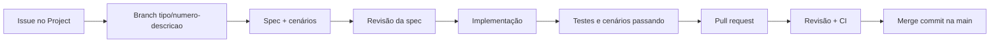

# Fluxo de trabalho (SDD, BDD e DDD)

Como a equipe transforma uma tarefa em código, com ou sem ajuda de IA. O objetivo é que qualquer integrante, ou qualquer assistente de IA, siga os mesmos passos e produza código no mesmo padrão.

## Visão geral

| Prática | Papel no projeto | Onde fica |
| --- | --- | --- |
| **DDD** (Domain-Driven Design) | Define a linguagem do negócio, os contextos e as regras | [docs/arquitetura/modelo-de-dominio.md](../arquitetura/modelo-de-dominio.md) |
| **SDD** (Spec-Driven Development) | Toda funcionalidade começa por uma spec aprovada antes do código | [specs/](../../specs/) |
| **BDD** (Behavior-Driven Development) | Os critérios de aceitação da spec são cenários Gherkin executáveis | `specs/<issue>-<nome>/cenarios.feature` e `tests/bdd/` |

## Passo a passo



1. **Issue.** Toda tarefa existe como issue no GitHub Project antes de qualquer branch. Se a issue não existe, ela é criada primeiro.
2. **Branch.** Criada com `scripts/nova-branch.sh`, que só cria a branch se a issue existir e estiver aberta.
3. **Spec.** Para funcionalidades (`feat`), escrever `specs/<issue>-<nome>/spec.md` a partir do [modelo](../../specs/_modelo/spec.md), usando os termos do modelo de domínio e citando as regras de negócio (RN).
4. **Cenários.** Escrever os critérios de aceitação em `cenarios.feature` (Gherkin em português).
5. **Revisão da spec.** Um commit `docs(spec): ...` com a spec e os cenários, revisado por outra pessoa antes da implementação. Pode ser um PR próprio ou os primeiros commits do PR da funcionalidade.
6. **Implementação.** O código segue a spec. Se a implementação revelar algo que a spec não previa, a spec é atualizada no mesmo PR.
7. **Testes.** Testes de unidade para as regras de domínio e passos BDD (`tests/bdd/`) para os cenários.
8. **Pull request.** Usa o modelo de PR, com `Closes #N`.
9. **Merge.** Sempre com **merge commit**. Squash e rebase não são usados.

## Uso de IA na codificação

Os assistentes de IA (Claude Code, GitHub Copilot, Cursor, Codex) leem as instruções do projeto em [AGENTS.md](../../AGENTS.md). Ao pedir código para uma IA:

- **Dar a spec como contexto.** O pedido aponta para `specs/<issue>-<nome>/spec.md` e para os cenários.
- **Usar a linguagem ubíqua.** Nomes de classes, funções e variáveis seguem a coluna "Nome no código" do modelo de domínio.
- **Gerar os testes junto.** O código gerado vem acompanhado dos testes e dos passos BDD.
- **Revisar antes de commitar.** Quem commita é responsável pelo código, inclusive o gerado por IA.
- **Não colocar dados sensíveis no prompt.** Chaves de API, dados pessoais e notas fiscais reais com CPF ficam fora.

## Convenções

### Branches

Formato: `tipo/numero-da-issue-descricao`

- **Tipos:** `feat`, `fix`, `docs`, `refactor`, `test`, `chore`, `ci`, `perf`, `build`, `style`
- **Descrição:** letras minúsculas sem acento, números e hífens
- **Exemplos:** `feat/24-endpoint-rag`, `docs/32-diagrama-arquitetura`, `ci/26-pipeline-testes`

```bash
scripts/nova-branch.sh feat 24 endpoint-rag
```

### Commits

[Conventional Commits](https://www.conventionalcommits.org/pt-br/v1.0.0/), com a descrição em português, no imperativo da 3ª pessoa e em minúsculas:

```
tipo(escopo): descrição curta

Corpo opcional explicando o porquê.

Refs #24
```

- **Escopos sugeridos:** os contextos (`planejamento`, `precos`, `receitas`, `leitura`, `verificacao`, `conversa`), e também `api`, `rag`, `spec`, `infra`, `deps`
- **Exemplos:**
  - `feat(precos): adiciona comparação por preço por unidade`
  - `fix(planejamento): corrige soma do custo estimado da lista`
  - `docs(spec): adiciona spec do endpoint do RAG`
  - `test(receitas): adiciona cenários de resposta sem fonte`
- **Mudança incompatível:** `!` depois do tipo (`feat(api)!: ...`)
- **Coautoria:** commits e PRs não levam linha de coautoria de ferramentas de IA

### Pull requests

Para entrar na `main`, um PR precisa de:

- **1 aprovação** de outra pessoa da equipe
- **CI passando:** convenções, lint, testes e cenários BDD
- **Issue vinculada** com `Closes #N` na descrição
- **Spec atualizada** quando o PR for de funcionalidade (`feat`) e alterar `src/`

O título do PR segue o mesmo padrão dos commits.

### Merge

Sempre **"Create a merge commit"**. Squash e rebase ficam desabilitados no repositório (ver [configuracao-github.md](configuracao-github.md)).

## Qualidade do código

| Ferramenta | Função | Onde roda |
| --- | --- | --- |
| **Ruff** | Lint e formatação | pre-commit e CI |
| **pre-commit** | Roda os hooks a cada commit e push | Computador de cada integrante |
| **gitleaks** | Impede commit de chaves de API e senhas | pre-commit |
| **pytest + pytest-bdd** | Testes de unidade e cenários BDD | CI |
| **pytest-cov** | Cobertura de testes; percentual mínimo a definir na #26 | CI |

### Configuração inicial (uma vez por integrante)

```bash
pipx install pre-commit
```

```bash
pre-commit install
```

O `pre-commit install` ativa os hooks de commit, de mensagem de commit e de push configurados em `.pre-commit-config.yaml`.

## Definição de pronto

Uma tarefa está pronta quando:

- [ ] A spec e os cenários refletem o que foi implementado (para `feat`)
- [ ] Os testes e os cenários BDD passam
- [ ] O código usa os termos do modelo de domínio
- [ ] Não há segredos nem dados pessoais no repositório
- [ ] As decisões técnicas novas estão em `docs/decisoes.md`
- [ ] O PR foi aprovado e entrou na `main` com merge commit
