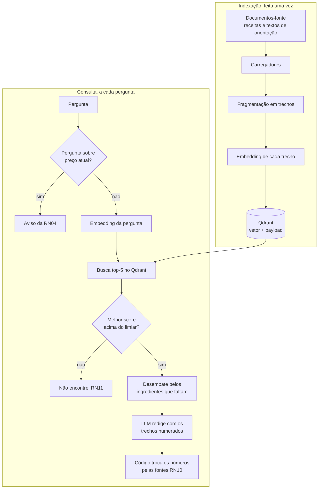

# Semana 2 — Estratégia do RAG de receitas

Como o Miau-ricio, agente do contexto **Receitas e nutrição**, responde perguntas sobre receitas e alimentação usando uma base de conhecimento. Este documento descreve a versão 1 do RAG (épico #15): o fluxo, a divisão em trechos (chunking), os embeddings, o banco vetorial e as limitações.

O comportamento esperado está na [spec do RAG de receitas](../../specs/15-rag-receitas/spec.md), e as escolhas técnicas, com justificativa, em [decisoes.md](../decisoes.md). Os termos (`Trecho`, `Fonte`, `Receita`, `Ingrediente`) vêm do [modelo de domínio](../arquitetura/modelo-de-dominio.md).

## 1. O que é o RAG e por que usar

RAG (*Retrieval-Augmented Generation*, geração aumentada por recuperação) junta duas etapas:

1. **Recuperação:** a pergunta vira um vetor (embedding), e o banco vetorial devolve os trechos da base de conhecimento com vetores mais próximos.
2. **Geração:** o LLM redige a resposta **só com esses trechos**, em vez de usar o que aprendeu no treinamento.

Para o EconoMIA, isso garante que:

- a resposta tem origem conhecida e cita a fonte (RN10);
- quando a base não tem a informação, o sistema diz que não encontrou, em vez de inventar (RN11);
- a base pode ser corrigida e ampliada sem treinar modelo nenhum.

## 2. Fluxo



O LLM só **interpreta** a pergunta (quais ingredientes a pessoa tem) e **redige** a resposta. Contar os ingredientes que faltam, ordenar as receitas e montar a lista de fontes são funções determinísticas, com testes (RN01).

## 3. Base de conhecimento

| Grupo | Fonte | Idioma | Volume na versão 1 |
| --- | --- | --- | --- |
| Receitas brasileiras | afrodite.json | Português | Todas as receitas com ingredientes e modo de preparo (de 8.183 no arquivo) |
| Receitas internacionais | RecipeNLG, amostra com semente fixa | Inglês | Cerca de 3.000 |
| Alimentação saudável | Guia Alimentar para a População Brasileira (Ministério da Saúde, 2014) | Português | Documento inteiro, por seção |
| Conservação e aproveitamento | De 2 a 5 textos de instituições públicas (Embrapa, Ministério da Saúde, FAO) | Português | A definir na curadoria |

Cada documento, com a instituição, o ano, o link e a licença, fica listado em `data/base-conhecimento/FONTES.md`.

**Curadoria das receitas:**

- saem as receitas sem ingredientes ou sem modo de preparo;
- os ingredientes divididos em subseções ("Massa:", "Recheio:") são juntados numa lista só;
- os nomes das seções do afrodite.json chegam com espaços sobrando e são normalizados.

## 4. Estratégia de chunking

O chunking define a unidade de recuperação. Trechos grandes demais misturam assuntos e diluem o vetor. Trechos pequenos demais perdem o contexto. A regra foi escolhida pelo tipo de documento.

### Receitas: uma receita é um trecho

A receita é curta e se explica sozinha. Separar os ingredientes do modo de preparo atrapalharia a recuperação: a pergunta "o que faço com frango e batata?" bate nos ingredientes, mas a resposta precisa do preparo.

Texto que vira embedding:

```text
Receita: {título}. Ingredientes: {lista}. Modo de preparo: {passos}.
```

O texto é cortado em 512 tokens, que é o limite do modelo e5. O título e os ingredientes vêm primeiro, e o corte, quando acontece, pega o fim do modo de preparo. O texto completo fica no payload, para ser mostrado na resposta.

### Guia Alimentar e textos de orientação: seção e parágrafo

- O texto é extraído do PDF com o pypdf.
- Saem os cabeçalhos, os rodapés e os números de página repetidos.
- O texto é dividido pelos capítulos e seções do sumário e, dentro de cada seção, por parágrafo, em trechos de até cerca de 350 tokens, com 50 tokens de sobreposição. A sobreposição evita que uma ideia cortada no meio se perca entre dois trechos.
- Cada um dos "Dez passos para uma alimentação adequada e saudável" vira um trecho próprio, porque é a parte mais citada do Guia.
- Cada trecho guarda `capitulo`, `secao` e `pagina`, para a citação apontar o lugar exato.

### Payload de cada trecho

| Campo | Para quê |
| --- | --- |
| `tipo` (`receita` ou `conhecimento`) | Filtrar a busca por tipo |
| `documento_id`, `titulo`, `secao`, `pagina` | Identificar o trecho e citar o lugar |
| `fonte`, `instituicao`, `ano`, `url`, `licenca` | Montar a citação (RN10) |
| `idioma` | Saber se a receita está em inglês |
| `ingredientes` (só receitas) | Contar os ingredientes que faltam |

Os campos `tipo`, `fonte` e `idioma` têm índice no Qdrant, para os filtros ficarem rápidos.

## 5. Estratégia de embeddings

Um embedding é um vetor de números que representa o sentido de um texto. Textos com sentido parecido ficam próximos no espaço vetorial, mesmo com palavras diferentes, e até em idiomas diferentes no caso dos modelos multilíngues.

Dois modelos são comparados nos mesmos trechos, com o mesmo chunking e o mesmo top-k (5):

| | `intfloat/multilingual-e5-base` | `qwen3-embedding:4b` |
| --- | --- | --- |
| Onde roda | sentence-transformers, dentro do processo Python | Ollama, no mesmo servidor do LLM |
| Dimensões | 768 | 2.560 |
| Contexto máximo | 512 tokens | 32 mil tokens |
| Prefixos | `query: ` na pergunta e `passage: ` no trecho | `Instruct: <tarefa>\nQuery: <pergunta>` na pergunta; trecho sem prefixo |

- Os vetores são normalizados e comparados por **similaridade de cosseno**.
- Cada modelo tem a sua coleção (`base_conhecimento_e5` e `base_conhecimento_qwen3`), porque os vetores têm dimensões diferentes e não podem ser misturados.
- Os prefixos fazem parte do treinamento dos dois modelos. Sem eles, a qualidade da recuperação cai.

### Como a escolha é feita

Conjunto de avaliação em `data/avaliacao/perguntas_rag_v1.json`, com cerca de 20 perguntas e o gabarito de quais trechos deveriam voltar:

- receitas brasileiras;
- receitas em inglês com a pergunta em português (busca entre idiomas);
- pelo menos 4 perguntas sobre o Guia Alimentar;
- 3 perguntas sem resposta na base.

| Métrica | O que mede |
| --- | --- |
| **Recall@5** | Em quantas perguntas o trecho certo aparece entre os 5 primeiros |
| **MRR** (*Mean Reciprocal Rank*) | Em média, quão no alto da lista o trecho certo aparece |
| **Separação dos scores** | Diferença entre os scores das perguntas com resposta e sem resposta. Serve para calibrar o limiar da RN11 |
| **Latência por consulta** e **tempo de indexação** | Custo de rodar o modelo |

A VM de produção tem 2 vCPUs e nenhuma GPU, então a latência na CPU pesa tanto quanto a qualidade. Os resultados e o modelo escolhido entram em [decisoes.md](../decisoes.md) quando a comparação terminar.

## 6. Banco vetorial

O **Qdrant** roda em Docker, como na VM de produção.

- Uma coleção por modelo de embeddings, com distância cosseno.
- Cada ponto guarda o vetor e o payload da seção 4.
- A busca devolve os 5 trechos mais próximos, com o score de cada um.

## 7. Da recuperação à resposta

1. **Pergunta sobre preço atual:** recebe o aviso de que a base de conhecimento não é fonte de preço atual (RN04), sem passar pela busca.
2. **Limiar de similaridade:** se o melhor score fica abaixo do limiar, a resposta diz que não encontrou (RN11). O valor inicial é 0,80 e é calibrado com a separação dos scores na comparação dos modelos.
3. **Desempate pelos ingredientes que faltam:** o LLM extrai da pergunta os ingredientes que a pessoa tem, em português e em inglês, num formato validado. Uma função determinística normaliza o texto (minúsculas, sem acento, singular simples) e conta quantos ingredientes de cada receita faltam. Entre receitas com scores dentro de uma faixa de tolerância (0,01), vem primeiro a que tem menos ingredientes faltando. Sal, água e óleo contam como sempre disponíveis, por uma lista provisória na configuração.
4. **Redação:** o LLM local (`qwen2.5:7b`, no Ollama) recebe os trechos numerados [1]…[n] e cita os números. O prompt fica num arquivo versionado em `prompts/miau-ricio/`.
5. **Fontes:** o código troca cada número citado pela fonte do payload (título, origem, ano, link e licença). O LLM nunca escreve a fonte.

## 8. Limitações

- **Licenças:** o afrodite.json não declara licença nem o site de origem, e as receitas dele não têm link, então a citação aponta o dataset. O RecipeNLG é de uso não comercial, para pesquisa e ensino.
- **Idioma:** as receitas do RecipeNLG estão em inglês. A busca entre idiomas depende do modelo multilíngue, e a resposta precisa traduzir os ingredientes.
- **Correspondência de ingredientes simplificada:** a normalização por texto não reconhece sinônimos ("aipim" e "mandioca") nem quantidades. A correspondência completa pelo `Alimento` do catálogo e as substituições (RN28) ficam para depois.
- **Base estática:** sem receitas para os ingredientes pedidos, vale a RN11. A busca sob demanda (RN26) está a definir.
- **Fora da versão 1:** restrições do perfil (RN27), notas recentes (RN21), envio para a lista de compras (RN29) e o endpoint da API (#24).
- **Trechos parecidos de outro alimento:** a recuperação pode trazer uma receita parecida, mas com outro ingrediente principal. O Recall@5 mede esse risco.
- **Desempenho na CPU:** sem GPU, o LLM de 7B gera poucos tokens por segundo. A latência medida entra nos resultados da comparação.

## 9. Demonstração

A demonstração da semana 2 mostra a consulta enviada, os trechos recuperados com os scores, a resposta baseada neles e as fontes usadas. Ela roda pela linha de comando (`perguntar "..."`) e pelo notebook `notebooks/01-rag-receitas-passo-a-passo.ipynb`.
