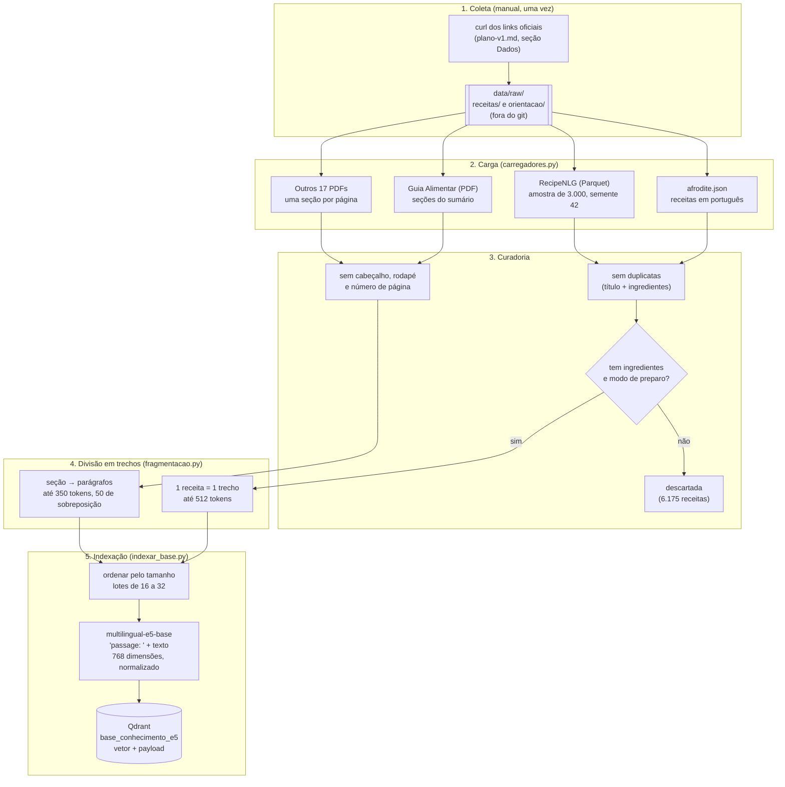

# Semana 2 — Pipeline de ingestão de dados

Como os 20 documentos-fonte viram os 6.151 trechos que o Miau-ricio consulta no Qdrant. Este documento descreve o pipeline que roda hoje, no comando `indexar` do contexto `receitas`. A estratégia de chunking e de embeddings, com as justificativas, está em [estrategia-rag.md](estrategia-rag.md); as fontes e as licenças, em [FONTES.md](../../data/base-conhecimento/FONTES.md).

## 1. Visão geral



O comando:

```bash
poetry run python -m economia.receitas.cli indexar            # base inteira (receitas e orientação)
poetry run python -m economia.receitas.cli indexar --recriar  # apaga a coleção antes
poetry run python -m economia.receitas.cli indexar --so-orientacao   # só os PDFs; as receitas gravadas ficam
poetry run python -m economia.receitas.cli indexar --amostra 400     # coleção menor, para comparar modelos
```

## 2. Etapas

### 2.1 Coleta

- Os arquivos brutos ficam em `data/raw/receitas/` e `data/raw/orientacao/`. A pasta está no `.gitignore`: o repositório guarda os links e as licenças, não as cópias.
- Os comandos `curl` de cada fonte estão na seção "Dados" do [plano da versão 1](../../specs/15-rag-receitas/plano-v1.md). A revista RACA (Fiocruz) não envia o certificado intermediário do HTTPS; o plano mostra como montar a cadeia sem desligar a verificação.
- Um documento só entra depois de a licença ser conferida no próprio arquivo ou na página editorial, e registrada no `FONTES.md`.

### 2.2 Carga

Cada formato tem um carregador em `src/economia/receitas/infraestrutura/carregadores.py`. Todos devolvem objetos do domínio, `Receita` ou `Documento`, cada um com a sua `Fonte` (título, instituição, ano, link e licença).

| Fonte | Formato | Carregador | O que sai |
| --- | --- | --- | --- |
| afrodite.json | JSON com `nome` e `secao[]` | `carregar_afrodite` | `Receita` em português, com as seções "Ingredientes" e "Modo de Preparo" |
| RecipeNLG | Parquet (218 MB, 780 mil receitas) | `carregar_recipenlg` | Amostra de 3.000 receitas em inglês, sempre a mesma (semente 42), com o link da receita original |
| Guia Alimentar | PDF de 158 páginas | `carregar_guia_alimentar` | `Documento` dividido pelas seções do sumário, com capítulo, seção e página impressa; os "Dez passos" viram seções próprias |
| Outros 17 PDFs | PDF | `carregar_documento_de_orientacao` | `Documento` com uma seção por página, o capítulo vigente e o número da página. O catálogo `DOCUMENTOS_DE_ORIENTACAO` diz o arquivo, a fonte e as páginas que entram (ex.: só o capítulo 3 do manual da IFC) |

Um PDF do catálogo que não estiver em `data/raw/` é avisado e fica de fora; a indexação continua com os outros.

### 2.3 Curadoria

- **Receitas duplicadas** saem: a chave é o título e os ingredientes, sem acentos e sem maiúsculas.
- **Receitas incompletas** saem: sem ingredientes ou sem modo de preparo. No afrodite.json, só 1.004 das 8.183 receitas estão completas (a maioria tem as seções vazias). Na última indexação, 6.175 receitas foram descartadas.
- **Ingredientes em subseções** ("Massa:", "Recheio:") são juntados numa lista só.
- **Textos dos PDFs**: cabeçalhos, rodapés e números de página repetidos saem; linhas quebradas no meio da frase são unidas; ligaduras do PDF (`/f_i`) viram letras.

### 2.4 Divisão em trechos (chunking)

Em `src/economia/receitas/aplicacao/fragmentacao.py`, com os tokens contados pelo tokenizador do próprio e5:

- **Receita = 1 trecho.** O texto que vira vetor é `Receita: <título>. Ingredientes: <...>. Modo de preparo: <...>`, cortado em 512 tokens (limite do e5) e dando prioridade ao título e aos ingredientes. O texto completo fica no payload, para o LLM.
- **Orientação:** cada seção é dividida por parágrafo em trechos de até 350 tokens, com 50 tokens repetidos entre trechos seguidos. Um trecho nunca junta duas seções, e um parágrafo maior que o limite é dividido em janelas de palavras, também com sobreposição.

### 2.5 Indexação

Em `src/economia/receitas/aplicacao/indexar_base.py` e `infraestrutura/repositorio_qdrant.py`:

1. A coleção é criada se não existir (ou apagada antes, com `--recriar`): vetores de 768 dimensões, distância cosseno, e índices de payload em `tipo`, `fonte` e `idioma`.
2. Os trechos são ordenados do mais curto para o mais longo e processados em lotes. Lotes com textos de tamanho parecido gastam menos tempo de CPU.
3. O e5 gera um vetor por trecho, com o prefixo `passage: ` (a pergunta usa `query: `), normalizado.
4. Cada trecho é gravado com um id fixo, derivado do id do trecho (UUID v5). Rodar a indexação de novo **sobrescreve** em vez de duplicar, o que permite indexar só a orientação (`--so-orientacao`) sem mexer nas receitas.
5. O payload guarda o que a resposta precisa para citar a fonte: tipo, documento, título, seção, capítulo, página, fonte (título, instituição, ano, link e licença), idioma, ingredientes e o conteúdo completo.
6. Um resumo da indexação (trechos, segundos, máquina) é gravado em `data/avaliacao/indexacao_<coleção>.json`.

## 3. Números da última indexação (10/11/2026)

| | |
| --- | --- |
| Documentos-fonte | 20 |
| Receitas na base | 4.004 (1.004 do afrodite.json e 3.000 do RecipeNLG) |
| Trechos de orientação | 2.147, de 18 documentos |
| Total na coleção | 6.151 trechos |
| Tempo | 6 min e 19 s para a base da versão 1 (4.346 trechos) e 4 min e 7 s para reindexar a orientação ampliada (2.147 trechos), com o e5 na CPU (16 núcleos) |

Trechos por documento: [FONTES.md](../../data/base-conhecimento/FONTES.md#na-base-depois-da-curadoria).

## 4. Testes

- `tests/receitas/test_carregadores.py`: carregadores do afrodite.json, do RecipeNLG, do Guia e dos PDFs por página.
- `tests/receitas/test_fragmentacao.py`: limites de tokens, sobreposição e divisão por seção.
- `tests/receitas/test_indexar_base.py` e `test_repositorio_qdrant.py`: lotes, ordem, ids fixos e payload, com o Qdrant em memória.
- `tests/bdd/test_ampliar_base_conhecimento.py`: o catálogo tem pelo menos 20 fontes, cada uma com título, instituição, link e licença.

## 5. Limitações

- **PDFs digitalizados** (sem camada de texto) não são lidos; não há OCR nesta versão.
- **Tabelas**: a TACO é dividida por página como texto, e os números perdem a ligação com as colunas. Os valores nutricionais devem vir da consulta estruturada da #22 (ver [avaliacao-rag.md](avaliacao-rag.md)).
- **Dados do afrodite.json**: algumas receitas têm a lista de ingredientes colada numa linha só, o que atrapalha a contagem dos ingredientes que faltam.
- **Atualização**: a indexação é manual. Não há agendamento nem detecção de documento novo.
- A branch `chore/16-base-conhecimento` tem outro pipeline de extração (PyMuPDF, saída em JSONL), que ainda não está ligado a este. A equipe precisa decidir qual fica.
