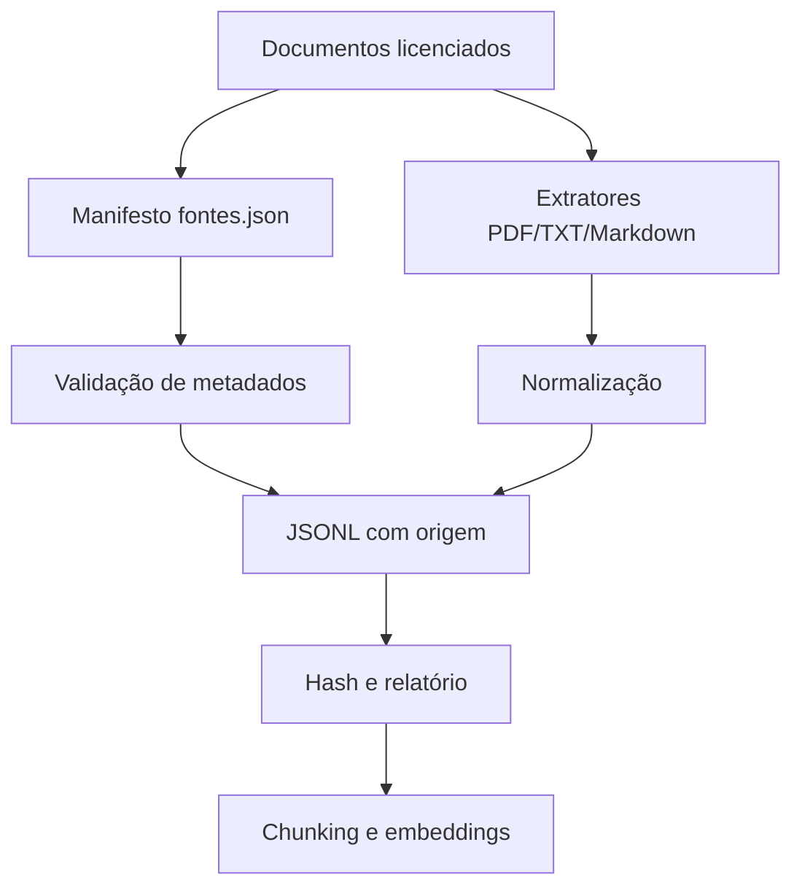

# Pipeline de ingestão e preparação

## Fluxo


## Execução
```bash
poetry install
poetry run python -m economia.leitura_documentos.infraestrutura.ingestao.pipeline
```

Saídas: `data/processed/documentos.jsonl` e `data/processed/relatorio_ingestao.json`.

PDFs digitalizados sem camada de texto são reportados; OCR não está incluído. DOCX e HTML também não são suportados nesta primeira versão.
