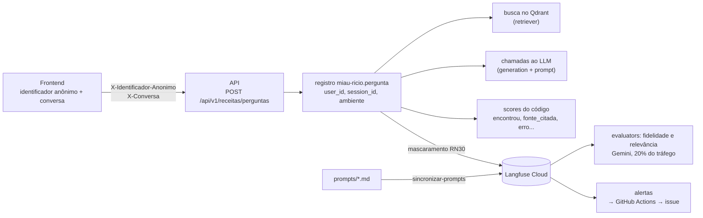

# Semana 3: observabilidade do Miau-ricio no Langfuse

Como o EconoMIA registra, mede e acompanha as respostas do Miau-ricio no Langfuse Cloud (região US). O comportamento esperado está na [spec 29](../../specs/29-observabilidade-langfuse/spec.md); as decisões e as justificativas, em [decisoes.md](../decisoes.md).

## 1. Visão geral



| O que | Onde está no código |
| --- | --- |
| Mascaramento de dados pessoais (RN30) | `src/economia/compartilhado/mascaramento.py` |
| Cliente do Langfuse, gerações e vínculo com o prompt | `src/economia/compartilhado/infraestrutura/observabilidade_langfuse.py` |
| Prompt management (sincronização e leitura) | `src/economia/compartilhado/infraestrutura/prompts_langfuse.py` |
| Evaluators e regra de avaliação | `src/economia/compartilhado/infraestrutura/avaliadores_langfuse.py` |
| Registro de cada pergunta da API e scores | `src/economia/api/observabilidade.py` |
| Identificador anônimo e da conversa | `src/economia/conversa/dominio/identificadores.py` e `frontend/src/identificadores.ts` |
| Prompts do juiz | `prompts/juiz/` |
| Workflow dos alertas | `.github/workflows/alerta-langfuse.yml` |

## 2. Configuração

No `.env` (modelo em `.env.example`):

| Variável | Para que serve | Valor |
| --- | --- | --- |
| `LANGFUSE_PUBLIC_KEY`, `LANGFUSE_SECRET_KEY` | Chaves do projeto. Sem elas, nada é enviado | pedir à equipe |
| `LANGFUSE_BASE_URL` | Região do Langfuse Cloud | `https://us.cloud.langfuse.com` |
| `LANGFUSE_AMBIENTE` | Separa os registros no Langfuse | `local`, `producao` ou `avaliacao` |
| `LANGFUSE_AMOSTRA_JUIZ` | Fração do tráfego real avaliada pelo juiz, por conta do custo | `0.2` |
| `LANGFUSE_MODELO_JUIZ` | Modelo do Gemini do juiz; precisa existir na LLM Connection | `gemini-3.8-flash` |

## 3. Tracing, pessoas e sessões

- Cada pergunta à API vira o registro `miau-ricio.pergunta`, com a busca (trechos e scores), cada chamada ao LLM (modelo, parâmetros, tokens, latência e prompt) e a resposta.
- O frontend cria um identificador anônimo (guardado no navegador) e um identificador por conversa (um por carregamento da página). Na interface do Langfuse, eles aparecem em **Users** e **Sessions**.
- Valores que não são UUID v4 são ignorados pela API: um e-mail no cabeçalho não chega ao Langfuse.
- Erros (Qdrant ou Ollama fora do ar) ficam com nível `ERROR` e o score `erro = 1`.

### Mascaramento (RN30)

Antes de sair da máquina, toda entrada, saída e metadado passa por `mascarar`: e-mail, CPF, telefone, cartão e chave de NFC-e viram `[EMAIL]`, `[CPF]`, `[TELEFONE]`, `[CARTAO]` e `[CHAVE_NFCE]`. Se o mascaramento falhar, vai só `[MASCARAMENTO_FALHOU]`. Nomes próprios e restrições de saúde escritas por extenso **não** são pegos pelos padrões (ver os riscos na spec).

## 4. Prompts no Langfuse

```bash
poetry run python -m economia.receitas.cli sincronizar-prompts
```

- Cada arquivo `prompts/<agente>/<nome>_v<N>.md` vira o prompt `<agente>/<nome>` com o rótulo `vN`. Os prompts em uso pela configuração e pelo juiz recebem também `production`.
- Rodar de novo sem mudança não cria versão. Alterar um arquivo cria uma versão nova com o mesmo rótulo.
- **O arquivo continua sendo a fonte da verdade.** Editar um prompt na interface do Langfuse não volta para o repositório: a próxima sincronização cria uma versão com o texto do arquivo. Mude o arquivo, abra o PR e sincronize depois do merge.
- A API lê o prompt do Langfuse pelo rótulo da versão configurada e usa o arquivo quando o Langfuse não responde. Cada geração fica ligada ao prompt e à versão, e a aba **Prompts > Metrics** mostra latência, tokens e scores por versão.

## 5. Scores e evaluators

Scores calculados pelo código (RN01), em todo registro:

| Score | Tipo | O que mede |
| --- | --- | --- |
| `encontrou` | booleano | a base tinha a informação (RN11) |
| `fonte_citada` | booleano | a resposta cita pelo menos uma fonte (RN10) |
| `aviso_de_preco` | booleano | só em pergunta de preço: recebeu o aviso da RN04 |
| `latencia_s` | numérico | segundos até a resposta |
| `erro` | booleano | a pergunta terminou em 503 |

A avaliação offline da #69 continua mandando os seus scores (ROUGE, cosseno, Hit@k, comportamento) nos experimentos.

### LLM como juiz (Gemini)

1. **LLM Connection.** Em **Settings > LLM Connections**, uma pessoa com papel Admin cadastra a chave do Gemini (adaptador Google AI Studio). A chave fica só no Langfuse. Hoje o projeto tem a conexão `gemini-student-free`, com o modelo `gemini-3.8-flash`.
2. **Evaluators e regra.**

   ```bash
   poetry run python -m economia.receitas.cli criar-avaliadores
   ```

   Cria (ou atualiza, pelo nome) os evaluators `fidelidade` e `relevancia`, com os prompts de `prompts/juiz/`, e a regra `miau-ricio: juiz no tráfego real`: observação `miau-ricio.pergunta`, ambientes `producao` e `local`, sem as que deram erro, amostra de 20%.
3. **Validação do modelo.** Ao salvar um evaluator, o Langfuse chama o modelo para testar. Se o Gemini não responder (chave inválida, cota esgotada ou modelo inexistente), o comando mostra o erro e o evaluator fica pausado. Teste a conexão no **Playground** do Langfuse com o mesmo modelo e rode o comando de novo.

Os evaluators leem a pergunta (`input.pergunta`), a resposta (`output.texto`) e os trechos usados (`output.trechos`) da própria observação raiz, porque não leem as observações filhas.

## 6. Alertas

Os alertas só são configurados pela interface: a API do Langfuse não tem rota para eles. No plano Hobby, cabem 2.

### 6.1 Automação para o GitHub Actions (uma vez, papel Admin)

1. No GitHub, crie um *fine-grained personal access token* só para este repositório, com a permissão **Contents: Read and write** (necessária para o `repository_dispatch`). Não coloque o token no repositório.
2. No Langfuse, em **Alerts > Automations > New automation**, escolha **GitHub Actions** e preencha:
   - URL: `https://api.github.com/repos/challenge2-qualidade-vida/challenge2-qualidade-de-vida/dispatches`
   - Event type: `langfuse-alerta`
   - Token: o token do passo 1
3. Para testar o workflow sem esperar um alerta: **Actions > Alerta do Langfuse > Run workflow**. Ele abre uma issue com a label `llmops`.

### 6.2 Os dois alertas

Em **Alerts > New Alert**, marcando a automação do GitHub Actions:

| Alerta | Fonte | Métrica | Filtro | Aviso | Alerta | Janela |
| --- | --- | --- | --- | --- | --- | --- |
| Latência do Miau-ricio | Observations | p95 latency | name = `miau-ricio.pergunta`, environment = `producao` | > 30 000 ms | > 60 000 ms | 1 hora |
| Fidelidade do Miau-ricio | Scores (numeric) | avg value | name = `fidelidade` | < 0,8 | < 0,7 | 1 dia |

Em **No data**, escolha *Treat as OK*: sem tráfego, não há o que avisar. Se a equipe preferir acompanhar a taxa de erro, troque um dos dois por **Scores (boolean)**, `avg` de `erro`, alerta acima de 0,1 em 1 hora.

## 7. Painel

Em **Dashboards > New dashboard** ("Miau-ricio"), com o filtro `environment = producao`:

| Widget | Fonte | Métrica | Agrupamento |
| --- | --- | --- | --- |
| Perguntas por dia | Traces | count | por dia, `name = miau-ricio.pergunta` |
| Latência p50 e p95 | Observations | p50 e p95 latency | `name = miau-ricio.pergunta` |
| Tokens por modelo | Observations | sum de tokens | por `model`, tipo `GENERATION` |
| Taxa de "encontrou" | Scores (boolean) | avg de `encontrou` | por dia |
| Taxa de erro | Scores (boolean) | avg de `erro` | por dia |
| Fidelidade e relevância | Scores (numeric) | avg de `fidelidade` e `relevancia` | por dia |
| Pessoas e conversas | Traces | count distinct de `userId` e `sessionId` | por dia |

## 8. Testes

Os testes nunca falam com o Langfuse do `.env`: `tests/conftest.py` deixa as chaves vazias. Os cenários BDD (`tests/bdd/test_observabilidade_langfuse.py`) usam o SDK real com um exportador de spans em memória, que confere o mascaramento, a pessoa, a sessão e o vínculo com o prompt sem rede.

## 9. Limites conhecidos

- O mascaramento por padrões não pega nomes próprios nem restrições de saúde por extenso. Antes de o perfil (RN27) mandar restrições ao Miau-ricio, a RN30 precisa ser revista.
- O texto mascarado vai para o Langfuse (EUA) e, na amostra do juiz, para o Google. Pedidos de exclusão de dados (LGPD, art. 18) ainda não têm processo.
- O payload que o Langfuse manda ao GitHub Actions não está documentado. O workflow guarda o conteúdo inteiro na issue; ajuste o título quando o formato for conhecido.
