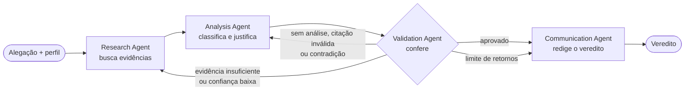
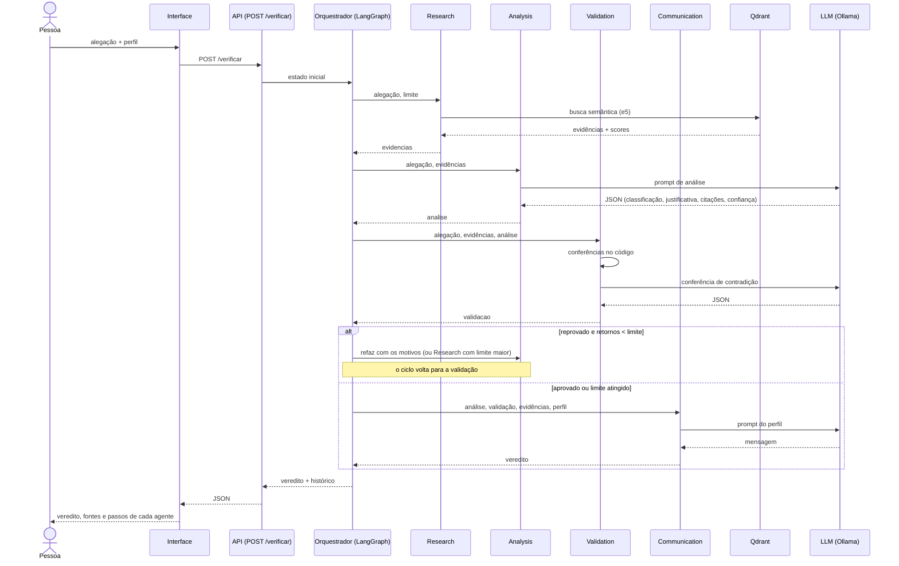

# Semana 4: arquitetura multiagente da verificação de alegações

> **Status:** esqueleto em revisão (19/11/2026, issue #72). Os contratos marcados como **proposta** ainda precisam ser travados entre Arquitetura (Pedro Lucas) e quem implementa cada agente. As seções 9 e 10 são preenchidas com os resultados da avaliação e da demo.

## 1. Objetivo e escopo

O fluxo recebe uma **alegação** sobre alimentação (ex.: "ovo aumenta o colesterol") e responde se ela é **reciclada**, **parcial** ou **nova** em relação à base de evidências, com uma justificativa ancorada nas fontes.

| Classificação | Quando |
| --- | --- |
| `reciclada` | A base já tem checagem ou evidência que cobre a alegação inteira |
| `parcial` | A base cobre só uma parte da alegação |
| `nova` | A base não tem evidência sobre a alegação |

A classificação diz **o quanto a base já cobre a alegação**, não se ela é verdadeira: a explicação ao consumidor traz o que as fontes dizem. Os termos estão no [modelo de domínio](../arquitetura/modelo-de-dominio.md) como proposta.

**Alegação-exemplo da demo:** a definir pela equipe (checklist de Dados & Backend da #72).

**Critérios de pronto da #72:**

- todo o pipeline (embeddings e LLM) roda localmente; a exceção é a observabilidade no Langfuse Cloud (seção 7);
- há evidência de um fluxo aprovado direto e de uma reprovação pelo Validation Agent com retorno;
- a alegação-exemplo roda do início ao fim pela interface;
- arquitetura, contratos, diagrama de sequência, avaliação e roteiro da demo estão neste documento.

## 2. Visão do fluxo



- **Roteamento:** quem decide o próximo nó é o código do orquestrador, a partir do `ResultadoDaValidacao`. O LLM não escolhe o caminho.
- **Ciclo de retorno:** o Validation Agent devolve o trabalho para o **Research** (busca de novo, com mais evidências) quando a confiança de uma `reciclada` ou `parcial` está abaixo do limiar, e para o **Analysis** (refaz a análise com os motivos da reprovação) quando falta a análise ou a justificativa, uma citação é inválida, falta citar a fonte ou há contradição. Com motivos para os dois destinos, vale o Research: sem evidência suficiente, refazer a análise não resolve. As regras completas estão na [spec 79](../../specs/79-analysis-validation/spec.md).
- **Limite:** no máximo 2 retornos (proposta). Depois disso, o Communication Agent redige o veredito explicando a incerteza, em vez de entrar em laço.

## 3. Agentes e responsáveis

| Agente | O que faz | Usa LLM? | Responsável | Situação |
| --- | --- | --- | --- | --- |
| Research | Busca semântica das evidências na base (top-k com scores) | Não | Isabel | Implementado na #75 (branch `feat/75-research-agent`) |
| Analysis | Classifica a alegação e escreve a justificativa citando as evidências | Sim | Paulo Vitor | Implementado na #79 (branch `feat/79-analysis-validation`) |
| Validation | Confere as citações, as contradições e a confiança mínima; aprova ou devolve | Conferências no código; contradição com LLM | Paulo Vitor | Implementado na #79 (branch `feat/79-analysis-validation`) |
| Communication | Adapta o veredito ao perfil de leitura | Sim | Guilherme | A implementar |
| Orquestrador | Grafo LangGraph, estado compartilhado, roteamento e ciclo de retorno | Não | Pedro Lucas | A implementar |

## 4. Estado compartilhado (proposta)

O estado é um modelo Pydantic da camada `aplicacao` do contexto `verificacao`, lido e escrito pelos nós do grafo. Cada agente lê só os campos de que precisa e devolve só os campos que produz.

| Campo | Tipo | Quem escreve |
| --- | --- | --- |
| `alegacao` | `str` | Entrada |
| `perfil` | `consumidor_geral` ou `consumidor_rapido` | Entrada |
| `limite` | `int`, de 1 a 20 (padrão 5) | Entrada; o Research aumenta no retorno |
| `evidencias` | lista de `EvidenciaRecuperada` (contrato da #75) | Research |
| `analise` | `AnaliseDaAlegacao` ou `null` | Analysis |
| `validacao` | `ResultadoDaValidacao` ou `null` | Validation |
| `retornos` | `int` | Orquestrador |
| `historico` | lista de `{agente, entrada, saida, segundos}` | Orquestrador |
| `veredito` | `Veredito` ou `null` | Communication |

## 5. Contratos de entrada e saída

### 5.1 Research Agent (definido na #75)

Entrada:

```json
{ "pergunta": "Ovo aumenta o colesterol?", "limite": 5 }
```

Saída (`RespostaVerificacao`):

```json
{
  "pergunta": "Ovo aumenta o colesterol?",
  "total_evidencias": 1,
  "evidencias": [
    {
      "trecho": {
        "id": "guia-alimentar-0123",
        "texto": "...",
        "pagina_inicial": 45,
        "pagina_final": 45,
        "secao": "Ovos"
      },
      "documento": {
        "id": "guia-alimentar",
        "arquivo": "guia-alimentar.pdf",
        "hash_sha256": "...",
        "fonte": { "titulo": "Guia Alimentar para a População Brasileira", "instituicao": "Ministério da Saúde", "ano": 2014, "url": "https://..." }
      },
      "score": 0.87
    }
  ]
}
```

- O `score` é similaridade de cosseno (−1 a 1), não probabilidade de veracidade.
- A busca usa o e5 (`intfloat/multilingual-e5-base`) na coleção `evidencias_verificacao_e5` do Qdrant, sem limiar de score: quem decide se a evidência basta é o Validation Agent.

### 5.2 Analysis Agent (proposta)

Entrada: `alegacao`, `evidencias` e, num retorno, os `motivos` da validação anterior.

Saída (`AnaliseDaAlegacao`):

```json
{
  "classificacao": "parcial",
  "justificativa": "O Guia Alimentar trata do consumo de ovos [1], mas não fala de colesterol.",
  "citacoes": ["guia-alimentar-0123"],
  "citacoes_invalidas": [],
  "confianca": 0.87
}
```

- O LLM recebe as evidências numeradas a partir de 1 e devolve `{classificacao, justificativa, citacoes: [números]}`. O código converte os números nos ids dos trechos; números fora da lista ficam em `citacoes_invalidas`.
- A `confianca` é calculada pelo código (RN01): o maior score entre as evidências citadas, 0 sem citação válida. É similaridade, não probabilidade de veracidade.
- JSON inválido ou fora do schema não vira análise (`null`), e o Validation devolve ao Analysis.

### 5.3 Validation Agent (proposta)

Entrada: `alegacao`, `evidencias` e `analise`.

Saída (`ResultadoDaValidacao`):

```json
{
  "aprovado": false,
  "motivos": ["A citação 7 não está entre as 5 evidências recuperadas."],
  "retornar_para": "analysis"
}
```

| Conferência | Como | Se falhar |
| --- | --- | --- |
| Há uma análise (o LLM devolveu JSON válido) | Código | `analysis` |
| A justificativa não é vazia | Código | `analysis` |
| Todas as citações existem entre as evidências | Código | `analysis` |
| `reciclada` ou `parcial` cita ao menos uma evidência | Código | `analysis` |
| `reciclada` ou `parcial` com a confiança no limiar mínimo ou acima | Código (`LIMIAR_CONFIANCA_VERIFICACAO`, 0,845) | `research` |
| `nova`, quando há evidência no limiar mínimo ou acima, cita ao menos uma dessas evidências e explica por que não cobre a alegação (RN10) | Código | `analysis` |
| A justificativa não contradiz as evidências citadas | LLM, com saída JSON, só depois das conferências do código | `analysis` |

`retornar_para` é `null` quando aprovado. O destino é decidido pelo código a partir da conferência que falhou.

### 5.4 Communication Agent (proposta)

Entrada: `alegacao`, `analise`, `validacao`, `evidencias` e `perfil`.

Saída (`Veredito`):

```json
{
  "classificacao": "parcial",
  "mensagem": "Em parte. O Guia Alimentar fala de ovos, mas não de colesterol...",
  "fontes": [{ "titulo": "Guia Alimentar para a População Brasileira", "instituicao": "Ministério da Saúde", "ano": 2014, "url": "https://..." }],
  "aprovado_pela_validacao": true
}
```

- `consumidor_geral`: explicação completa, com as fontes.
- `consumidor_rapido`: uma ou duas frases, com o link da fonte principal.
- Quando o limite de retornos foi atingido, `aprovado_pela_validacao` é `false` e a mensagem diz que a verificação não foi conclusiva.

### 5.5 API

`POST /verificar` executa o fluxo completo. Na #75, a rota devolve só as evidências do Research. Com o orquestrador, ela passa a receber `{alegacao, perfil}` e a devolver o `Veredito` e o `historico` (as saídas intermediárias que a interface mostra).

## 6. Diagrama de sequência



## 7. Observabilidade

- **Ferramenta:** Langfuse Cloud, já usado pelo Miau-ricio ([observabilidade da semana 3](../semana-3/observabilidade.md)). É a exceção ao critério "zero API externa", registrada em [decisões](../decisoes.md) (19/11/2026). LLM, embeddings e banco vetorial rodam localmente.
- **Registro:** um trace por verificação e uma observação por nó do grafo, com entrada, saída e tempo. As chamadas ao LLM entram como gerações (modelo, versão do prompt, tokens e latência), pelo mesmo gancho do adaptador do Ollama (`RegistroDeGeracoes`).
- **Ciclo de retorno visível:** cada retorno aparece como um novo nó Analysis ou Research no mesmo trace, com os motivos da validação no metadado. É a evidência pedida pelo critério de pronto.
- **Dados pessoais:** as alegações passam pelo mascaramento antes do envio (RN30).

## 8. Relação com a arquitetura existente

- **Contexto:** os quatro agentes ficam no contexto `verificacao` (`src/economia/verificacao/`), com as camadas `dominio`, `aplicacao` e `infraestrutura`. O grafo do LangGraph fica na `infraestrutura`, e o domínio não importa LangGraph nem LLM.
- **Mia:** no modelo de domínio, a Verificação (Mia) "confere a fundamentação" e não usa RAG. O Validation Agent faz esse papel. O Research Agent usa RAG, o que muda a descrição do contexto: **ponto aberto** para a equipe.
- **Reaproveitado da semana 3:** o adaptador do Ollama com saída JSON (`gerar_json`), os prompts no prompt management do Langfuse e o padrão de avaliação com métricas determinísticas.

## 9. Avaliação (10 a 20 casos)

O fluxo Research → Analysis → Validation rodou em 15 alegações fictícias: 5 recicladas, 5 parciais e 5 novas, com a classificação esperada revisada pela equipe em 24/11/2026 ([casos_v1.json](../../data/avaliacao/verificacao/casos_v1.json)). Usou o comando da [spec 79](../../specs/79-analysis-validation/spec.md):

```bash
poetry run python -m economia.verificacao.cli avaliar \
  --casos data/avaliacao/verificacao/casos_v1.json \
  --saida data/avaliacao/verificacao/resultados_v1.json --llm qwen2.5:7b
```

**Configuração:**

| Parâmetro | Valor |
| --- | --- |
| Data | 24/11/2026 |
| Máquina | Mac M4 |
| LLM | `qwen2.5:7b`, temperatura 0, semente 42 |
| Busca | e5, coleção `evidencias_verificacao_e5` (1810 trechos), top 5 |
| Limiar de confiança | 0,845 |
| Retornos por caso | até 2 |
| Prompts | `verificacao/analise` v1 e `verificacao/validacao` v1 |

Resultado em [resultados_v1.json](../../data/avaliacao/verificacao/resultados_v1.json).

| Caso | Alegação | Esperada | Obtida | Acertou | Aprovada | Retornos | Confiança | Latência (s) |
| --- | --- | --- | --- | --- | --- | --- | --- | --- |
| v01 | Alimentos ultraprocessados devem ser evitados. | reciclada | reciclada | sim | sim | 0 | 0.857 | 8.2 |
| v02 | Até os seis meses, o bebê deve receber só leite materno. | reciclada | reciclada | sim | sim | 0 | 0.854 | 6.0 |
| v03 | Crianças menores de dois anos não devem comer açúcar. | reciclada | reciclada | sim | sim | 0 | 0.854 | 5.6 |
| v04 | Óleos, gorduras, sal e açúcar devem ser usados em pequenas quantidades no preparo dos alimentos. | reciclada | reciclada | sim | sim | 0 | 0.853 | 6.4 |
| v05 | Comer com regularidade, devagar e em companhia faz parte de uma alimentação adequada. | reciclada | reciclada | sim | não | 2 (research, research) | 0.000 | 57.2 |
| v06 | Ultraprocessados devem ser evitados porque causam câncer em poucas semanas de consumo. | parcial | nova | não | sim | 2 (research, research) | 0.000 | 76.1 |
| v07 | A pandemia de COVID-19 aumentou a insegurança alimentar no Brasil porque as pessoas passaram a comer mais em casa. | parcial | parcial | sim | sim | 1 (analysis) | 0.848 | 19.5 |
| v08 | O feijão tem fibra alimentar e por isso cura o diabetes. | parcial | reciclada | não | não | 2 (research, research) | 0.000 | 57.8 |
| v09 | Aplicativos de doação reduzem o desperdício de alimentos e baixam o preço da comida no supermercado. | parcial | nova | não | sim | 0 | 0.000 | 7.2 |
| v10 | Comer em companhia faz parte de uma alimentação adequada e faz emagrecer mais rápido. | parcial | parcial | sim | sim | 0 | 0.847 | 7.8 |
| v11 | O jejum intermitente acelera o metabolismo. | nova | nova | sim | sim | 0 | 0.000 | 6.0 |
| v12 | Suplementos de colágeno rejuvenescem a pele. | nova | nova | sim | sim | 0 | 0.000 | 7.0 |
| v13 | Beber água com limão em jejum desintoxica o fígado. | nova | nova | sim | sim | 0 | 0.000 | 8.6 |
| v14 | Comer manga com leite faz mal à saúde. | nova | parcial | não | sim | 1 (analysis) | 0.847 | 13.7 |
| v15 | Cortar o glúten emagrece quem não tem doença celíaca. | nova | reciclada | não | não | 2 (research, research) | 0.000 | 63.9 |

| Métrica | Valor |
| --- | --- |
| Acurácia da classificação | 67% (10 de 15) |
| Aprovação direta | 60% (9 de 15) |
| Aprovação ao fim dos retornos | 80% (12 de 15) |
| Média de retornos | 0,67 |
| Latência média | 23,4 s |

Por classificação, os acertos foram:

- **Recicladas:** 5 de 5.
- **Novas:** 3 de 5.
- **Parciais:** 2 de 5.

### Comparação com o `gemma3:12b`

Os mesmos 15 casos rodaram com o `gemma3:12b`, o outro candidato da semana 3, com a mesma base, o mesmo limiar e os mesmos prompts. Resultado em [resultados_v1_gemma3-12b.json](../../data/avaliacao/verificacao/resultados_v1_gemma3-12b.json).

| Métrica | `qwen2.5:7b` | `gemma3:12b` |
| --- | --- | --- |
| Acurácia da classificação | 67% | 67% |
| Aprovação direta | 60% | 67% |
| Aprovação ao fim dos retornos | 80% | 67% |
| Média de retornos | 0,67 | 0,67 |
| Latência média | 23,4 s | 85,1 s |

Os modelos divergiram só em 3 casos:

| Caso | Esperada | `qwen2.5:7b` | `gemma3:12b` |
| --- | --- | --- | --- |
| v06 (câncer em semanas) | parcial | nova, aprovada após 2 retornos | reciclada, reprovada após 2 retornos |
| v07 (pandemia) | parcial | parcial, aprovada após 1 retorno | parcial, aprovada direto |
| v09 (aplicativos e preço) | parcial | nova, aprovada direto | reciclada, reprovada após 2 retornos |
| v14 (manga com leite) | nova | parcial, aprovada após 1 retorno | parcial, aprovada direto |

Sobre os dois modelos:

- **Acertos:** os dois acertaram e erraram os mesmos 10 e 5 casos.
- **Onde erram:** nos dois, os erros estão nas parciais e nas novas.
- **Retornos ao Research:** a degradação com 20 trechos (achado 2) aparece igual no `gemma3:12b`. Na v05, na v06, na v08 e na v15, a justificativa final descreve o texto ("O texto fornecido é uma compilação de trechos...").
- **Primeira análise:** o `gemma3:12b` cita as fontes melhor, e por isso a v07 e a v14 passaram sem retorno.
- **Parciais:** o `gemma3:12b` tende a chamar de `reciclada` uma parcial cuja primeira parte a base cobre (v06, v08 e v09).
- **Custo:** o `gemma3:12b` levou 3,6 vezes o tempo do `qwen2.5:7b` para o mesmo resultado.

O ganho não está no tamanho do modelo. Está no prompt (exemplos de `parcial`) e no retorno ao Research (menos trechos).

**Reprodutibilidade:** uma segunda execução do `qwen2.5:7b` deu as mesmas classificações, justificativas e retornos nos 15 casos. Só a latência mudou, de 23,4 s para 15,4 s, com o modelo já carregado.

### Achados

1. **O limiar está colado nos scores.** Nesta base, o e5 dá entre 0,83 e 0,86 para quase toda alegação, coberta ou não:
   - as recicladas aprovadas ficaram entre 0,853 e 0,857;
   - a v05, também reciclada, ficou em 0,842 e voltou para o Research.

   Com 15 casos, não dá para separar "coberta" de "tema próximo" pelo score. A calibração do limiar fica pendente, como previsto nos riscos da spec.
2. **Mais evidências pioram a análise.** O retorno ao Research dobra a busca (10 e depois 20 trechos), e com 20 trechos o `qwen2.5:7b` perde a tarefa: na v05, na v08 e na v15, a justificativa final descreve o texto ("O texto apresentado é uma compilação de trechos...") em vez de classificar a alegação. As três terminaram reprovadas. Com o Validation, nenhuma dessas análises seria aprovada.
3. **A regra da `nova` com fonte funcionou, mas mudou a classificação.** Na v14 (manga com leite), a primeira análise disse `nova` sem citar as evidências fortes, que falam de leite, e foi devolvida. A segunda citou as evidências e trocou para `parcial`. A justificativa está correta ("não abordam a combinação de manga com leite"). O erro foi de rótulo: o pedido de citar a fonte foi lido como "mudar a classificação".
4. **As parciais são o ponto fraco.** Na v09, o modelo viu que a base fala de plataformas de doação, mas classificou como `nova` porque a parte do preço não aparece. A fronteira entre `parcial` e `nova` precisa de exemplos no prompt.
5. **Bug encontrado e corrigido pela avaliação.** Na primeira execução, o retorno ao Research repassava ao Analysis os motivos sobre o score, e o LLM passou a comentar a reprovação em vez de analisar. Num caso, escreveu "confiança ajustada para 0,846", um valor que o LLM não deveria produzir (RN01). A correção está no commit `1349bbb`. Na primeira execução, a acurácia já era de 67% e a aprovação ao fim dos retornos era de 73%.

**Próximos passos** (valem para os dois modelos):

- Limitar a busca do retorno ao Research a 10 trechos, ou repetir a alegação no fim da mensagem, e medir de novo.
- Pôr no prompt `verificacao/analise` (v2) um exemplo de cada classificação e a instrução de manter a classificação quando o retorno pede só a fonte.
- Revisar com a equipe a classificação esperada dos 15 casos e calibrar o limiar com mais casos.

## 10. Roteiro da demo

A preencher (checklist de Scrum & Documentação): passo a passo com prints da interface (alegação, saída de cada agente e veredito) e dos traces no Langfuse, um caso aprovado direto e um caso com retorno.

## 11. Pontos abertos

1. Travar o estado compartilhado e os contratos das seções 4 e 5 (Pedro Lucas e responsáveis de cada agente).
2. Escolher a alegação-exemplo da demo.
3. Confirmar a definição de reciclada, parcial e nova no modelo de domínio.
4. Rota da API: `POST /verificar` (como na #75) ou `POST /api/v1/verificacoes`, no padrão da API atual. A #75 também cria a aplicação em `api/main.py`, separada de `api/app.py`.
5. Limiares: confiança mínima, score mínimo das evidências e limite de retornos.
6. Descrição do contexto Verificação (Mia) no modelo de domínio, agora com RAG.
