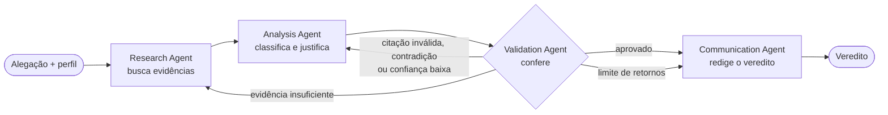
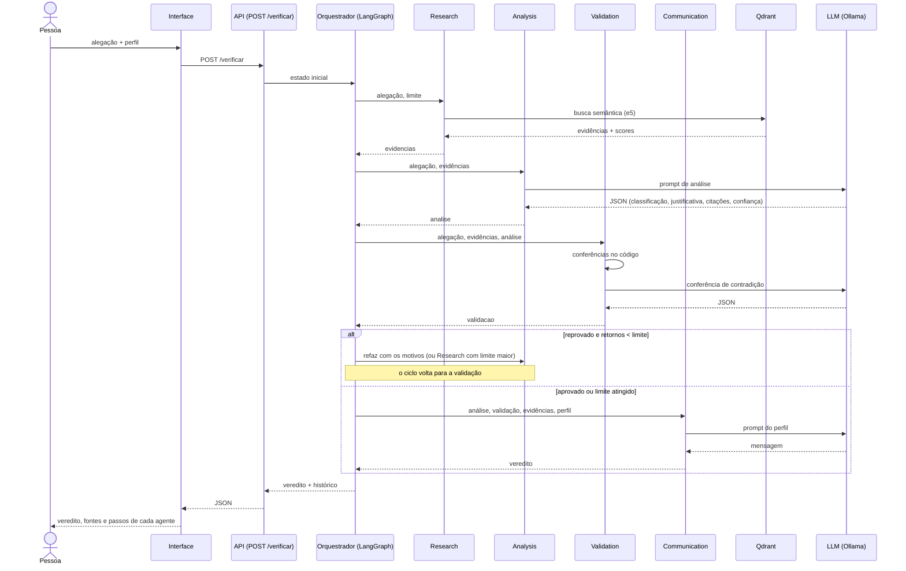

# Semana 4: arquitetura multiagente da verificação de alegações

> **Status:** esqueleto em revisão (19/11/2026, issue #72). Os contratos marcados como **proposta** ainda precisam ser travados entre Arquitetura (Pedro Lucas) e quem implementa cada agente. As seções 9 e 10 são preenchidas com os resultados da avaliação e da demo.

## 1. Objetivo e escopo

O fluxo recebe uma **alegação** sobre alimentação (ex.: "ovo aumenta o colesterol") e responde se ela é **reciclada**, **parcial** ou **nova** em relação à base de evidências, com uma justificativa ancorada nas fontes.

| Classificação | Quando |
| --- | --- |
| `reciclada` | A base já tem checagem ou evidência que cobre a alegação inteira |
| `parcial` | A base cobre só uma parte da alegação |
| `nova` | A base não tem evidência sobre a alegação |

A classificação diz **o quanto a base já cobre a alegação**, não se ela é verdadeira: a explicação ao consumidor traz o que as fontes dizem. Os termos estão no [modelo de domínio](../arquitetura/modelo-de-dominio.md) como proposta.

**Alegação-exemplo da demo:** a definir pela equipe (checklist de Dados & Backend da #72).

**Critérios de pronto da #72:**

- todo o pipeline (embeddings e LLM) roda localmente; a exceção é a observabilidade no Langfuse Cloud (seção 7);
- há evidência de um fluxo aprovado direto e de uma reprovação pelo Validation Agent com retorno;
- a alegação-exemplo roda do início ao fim pela interface;
- arquitetura, contratos, diagrama de sequência, avaliação e roteiro da demo estão neste documento.

## 2. Visão do fluxo



- **Roteamento:** quem decide o próximo nó é o código do orquestrador, a partir do `ResultadoDaValidacao`. O LLM não escolhe o caminho.
- **Ciclo de retorno:** o Validation Agent devolve o trabalho para o **Research** (busca de novo, com mais evidências) quando a evidência é insuficiente, e para o **Analysis** (refaz a análise com os motivos da reprovação) quando a citação é inválida, há contradição ou a confiança está abaixo do limiar.
- **Limite:** no máximo 2 retornos (proposta). Depois disso, o Communication Agent redige o veredito explicando a incerteza, em vez de entrar em laço.

## 3. Agentes e responsáveis

| Agente | O que faz | Usa LLM? | Responsável | Situação |
| --- | --- | --- | --- | --- |
| Research | Busca semântica das evidências na base (top-k com scores) | Não | Isabel | Implementado na #75 (branch `feat/75-research-agent`) |
| Analysis | Classifica a alegação e escreve a justificativa citando as evidências | Sim | Paulo Vitor | A implementar |
| Validation | Confere as citações, as contradições e a confiança mínima; aprova ou devolve | Conferências no código; contradição com LLM | Paulo Vitor | A implementar |
| Communication | Adapta o veredito ao perfil de leitura | Sim | Guilherme | A implementar |
| Orquestrador | Grafo LangGraph, estado compartilhado, roteamento e ciclo de retorno | Não | Pedro Lucas | A implementar |

## 4. Estado compartilhado (proposta)

O estado é um modelo Pydantic da camada `aplicacao` do contexto `verificacao`, lido e escrito pelos nós do grafo. Cada agente lê só os campos de que precisa e devolve só os campos que produz.

| Campo | Tipo | Quem escreve |
| --- | --- | --- |
| `alegacao` | `str` | Entrada |
| `perfil` | `consumidor_geral` ou `consumidor_rapido` | Entrada |
| `limite` | `int`, de 1 a 20 (padrão 5) | Entrada; o Research aumenta no retorno |
| `evidencias` | lista de `EvidenciaRecuperada` (contrato da #75) | Research |
| `analise` | `AnaliseDaAlegacao` ou `null` | Analysis |
| `validacao` | `ResultadoDaValidacao` ou `null` | Validation |
| `retornos` | `int` | Orquestrador |
| `historico` | lista de `{agente, entrada, saida, segundos}` | Orquestrador |
| `veredito` | `Veredito` ou `null` | Communication |

## 5. Contratos de entrada e saída

### 5.1 Research Agent (definido na #75)

Entrada:

```json
{ "pergunta": "Ovo aumenta o colesterol?", "limite": 5 }
```

Saída (`RespostaVerificacao`):

```json
{
  "pergunta": "Ovo aumenta o colesterol?",
  "total_evidencias": 1,
  "evidencias": [
    {
      "trecho": {
        "id": "guia-alimentar-0123",
        "texto": "...",
        "pagina_inicial": 45,
        "pagina_final": 45,
        "secao": "Ovos"
      },
      "documento": {
        "id": "guia-alimentar",
        "arquivo": "guia-alimentar.pdf",
        "hash_sha256": "...",
        "fonte": { "titulo": "Guia Alimentar para a População Brasileira", "instituicao": "Ministério da Saúde", "ano": 2014, "url": "https://..." }
      },
      "score": 0.87
    }
  ]
}
```

- O `score` é similaridade de cosseno (−1 a 1), não probabilidade de veracidade.
- A busca usa o e5 (`intfloat/multilingual-e5-base`) na coleção `evidencias_verificacao_e5` do Qdrant, sem limiar de score: quem decide se a evidência basta é o Validation Agent.

### 5.2 Analysis Agent (proposta)

Entrada: `alegacao`, `evidencias` e, num retorno, os `motivos` da validação anterior.

Saída (`AnaliseDaAlegacao`):

```json
{
  "classificacao": "parcial",
  "justificativa": "O Guia Alimentar trata do consumo de ovos [1], mas não fala de colesterol.",
  "citacoes": ["guia-alimentar-0123"],
  "confianca": 0.7
}
```

- `citacoes` são ids de trechos que vieram do Research. O LLM não inventa fontes.
- A resposta do LLM é JSON validado por schema. JSON inválido vira reprovação, com retorno ao Analysis.

### 5.3 Validation Agent (proposta)

Entrada: `alegacao`, `evidencias` e `analise`.

Saída (`ResultadoDaValidacao`):

```json
{
  "aprovado": false,
  "motivos": ["A citação 'guia-alimentar-9999' não está entre as evidências recuperadas"],
  "retornar_para": "analysis"
}
```

| Conferência | Como | Se falhar |
| --- | --- | --- |
| As citações existem entre as evidências | Código | `analysis` |
| A justificativa não é vazia e cita ao menos uma evidência (exceto `nova`) | Código | `analysis` |
| A confiança está acima do limiar mínimo | Código (limiar configurável) | `analysis` |
| Há evidência suficiente para `reciclada` ou `parcial` | Código (score mínimo) | `research` |
| A justificativa não contradiz as evidências citadas | LLM, com saída JSON | `analysis` |

`retornar_para` é `null` quando aprovado. O destino é decidido pelo código a partir da conferência que falhou.

### 5.4 Communication Agent (proposta)

Entrada: `alegacao`, `analise`, `validacao`, `evidencias` e `perfil`.

Saída (`Veredito`):

```json
{
  "classificacao": "parcial",
  "mensagem": "Em parte. O Guia Alimentar fala de ovos, mas não de colesterol...",
  "fontes": [{ "titulo": "Guia Alimentar para a População Brasileira", "instituicao": "Ministério da Saúde", "ano": 2014, "url": "https://..." }],
  "aprovado_pela_validacao": true
}
```

- `consumidor_geral`: explicação completa, com as fontes.
- `consumidor_rapido`: uma ou duas frases, com o link da fonte principal.
- Quando o limite de retornos foi atingido, `aprovado_pela_validacao` é `false` e a mensagem diz que a verificação não foi conclusiva.

### 5.5 API

`POST /verificar` executa o fluxo completo. Na #75, a rota devolve só as evidências do Research. Com o orquestrador, ela passa a receber `{alegacao, perfil}` e a devolver o `Veredito` e o `historico` (as saídas intermediárias que a interface mostra).

## 6. Diagrama de sequência



## 7. Observabilidade

- **Ferramenta:** Langfuse Cloud, já usado pelo Miau-ricio ([observabilidade da semana 3](../semana-3/observabilidade.md)). É a exceção ao critério "zero API externa", registrada em [decisões](../decisoes.md) (19/11/2026). LLM, embeddings e banco vetorial rodam localmente.
- **Registro:** um trace por verificação e uma observação por nó do grafo, com entrada, saída e tempo. As chamadas ao LLM entram como gerações (modelo, versão do prompt, tokens e latência), pelo mesmo gancho do adaptador do Ollama (`RegistroDeGeracoes`).
- **Ciclo de retorno visível:** cada retorno aparece como um novo nó Analysis ou Research no mesmo trace, com os motivos da validação no metadado. É a evidência pedida pelo critério de pronto.
- **Dados pessoais:** as alegações passam pelo mascaramento antes do envio (RN30).

## 8. Relação com a arquitetura existente

- **Contexto:** os quatro agentes ficam no contexto `verificacao` (`src/economia/verificacao/`), com as camadas `dominio`, `aplicacao` e `infraestrutura`. O grafo do LangGraph fica na `infraestrutura`, e o domínio não importa LangGraph nem LLM.
- **Mia:** no modelo de domínio, a Verificação (Mia) "confere a fundamentação" e não usa RAG. O Validation Agent faz esse papel. O Research Agent usa RAG, o que muda a descrição do contexto: **ponto aberto** para a equipe.
- **Reaproveitado da semana 3:** o adaptador do Ollama com saída JSON (`gerar_json`), os prompts no prompt management do Langfuse e o padrão de avaliação com métricas determinísticas.

## 9. Avaliação (10 a 20 casos)

A preencher (checklist de AI Engineering & Prompts). Tabela prevista:

| Caso | Alegação | Esperado | Obtido | Aprovado direto? | Retornos | Latência |
| --- | --- | --- | --- | --- | --- | --- |
| | | | | | | |

Métricas: acurácia da classificação, taxa de aprovação direta, média de retornos e latência média.

## 10. Roteiro da demo

A preencher (checklist de Scrum & Documentação): passo a passo com prints da interface (alegação, saída de cada agente e veredito) e dos traces no Langfuse, um caso aprovado direto e um caso com retorno.

## 11. Pontos abertos

1. Travar o estado compartilhado e os contratos das seções 4 e 5 (Pedro Lucas e responsáveis de cada agente).
2. Escolher a alegação-exemplo da demo.
3. Confirmar a definição de reciclada, parcial e nova no modelo de domínio.
4. Rota da API: `POST /verificar` (como na #75) ou `POST /api/v1/verificacoes`, no padrão da API atual. A #75 também cria a aplicação em `api/main.py`, separada de `api/app.py`.
5. Limiares: confiança mínima, score mínimo das evidências e limite de retornos.
6. Descrição do contexto Verificação (Mia) no modelo de domínio, agora com RAG.
