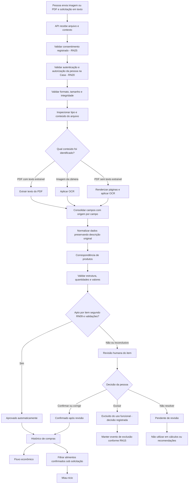

# POC: Pipeline de Compras e Economia Doméstica

- **Projeto:** EconoMIA

- **Responsabilidade proposta:** Engenharia de Dados e Backend

- **Semana:** 5 — Multimodalidade

- **Issue relacionada:** [#80 — Implementação do Assistente de IA Multimodal](https://github.com/challenge2-qualidade-vida/challenge2-qualidade-de-vida/issues/80)

- **Status:** Proposta para revisão da equipe

- **Natureza:** POC documental de viabilidade técnica; não representa implementação concluída.

---

## 1. Contexto

O EconoMIA é um assistente de planejamento de compras de supermercado. Seu modelo de domínio prevê a leitura de notas fiscais, a revisão dos itens extraídos, o histórico de compras e o aproveitamento de ingredientes em sugestões de receitas.

A proposta desta POC é avaliar como os dados de uma nota fiscal podem ser processados uma única vez e reutilizados em dois fluxos complementares:

- **Alimentar:** identificar alimentos adquiridos e disponibilizá-los para sugestões de receitas.

- **Econômico:** registrar gastos com supermercado e permitir análises do histórico de compras.

A proposta não altera o foco principal do produto. Ela amplia o aproveitamento dos dados gerados por uma funcionalidade prevista no modelo de domínio.

Esta POC está relacionada à Issue #80 — Implementação do Assistente de IA Multimodal —, mas não representa a implementação integral do assistente multimodal. Seu recorte é a viabilidade de um pipeline de leitura e estruturação de notas fiscais para reutilização dos dados nos fluxos alimentar e econômico.

A separação entre as entregas é mantida: a Semana 3 tratou da comparação entre LLM puro e RAG; a Semana 4 tratou do protótipo multiagente de validação de informações; e a Semana 5 aborda multimodalidade. Esta POC não substitui nem reexecuta os experimentos anteriores.

## 2. Objetivo

Documentar a viabilidade técnica e avaliar alternativas de um pipeline determinístico de leitura, tratamento, validação e disponibilização de dados de notas fiscais de supermercado. Nesta etapa, “avaliar” significa analisar alternativas, dependências e critérios de validação; não significa que a solução já tenha sido validada experimentalmente. Os testes e a medição de resultados permanecem planejados.

A POC prioriza soluções convencionais de processamento de documentos, regras de negócio e cálculos determinísticos, evitando chamadas a modelos de linguagem quando não forem necessárias.

Os objetivos específicos são:

1\. Identificar os formatos de entrada que podem ser utilizados.

2\. Avaliar alternativas de extração de dados.

3\. Definir uma estrutura comum para os dados extraídos.

4\. Estabelecer validações e critérios de revisão humana.

5\. Definir como os dados revisados podem ser reutilizados nos fluxos alimentar e econômico.

6\. Identificar o que já existe no repositório e o que ainda precisaria ser implementado.

7\. Propor critérios de avaliação para uma futura implementação.

## 3. Problema

A leitura de uma nota fiscal pode gerar informações úteis para diferentes funcionalidades do EconoMIA. Entretanto, se os dados forem extraídos e tratados separadamente por cada funcionalidade, haverá duplicação de processamento, regras e estruturas.

A proposta é estabelecer um fluxo compartilhado, com dados estruturados e revisados, que possa alimentar dois destinos funcionais: **fluxo alimentar** (ingredientes e funcionalidades de Receitas e Planejamento) e **fluxo econômico** (histórico e comparações de Preços). Esses nomes serão usados de forma consistente ao longo desta POC, respeitando os limites de cada contexto.

## 4. Fluxo proposto

O fluxo geral da POC é:

1\. Verificar o consentimento da pessoa antes do primeiro processamento de nota (RN25).

2\. Receber uma nota fiscal em formato suportado.

3\. Validar o formato, o tamanho e a integridade do arquivo.

4\. Identificar o tipo de arquivo e inspecionar seu conteúdo.

5\. Selecionar uma única estratégia de leitura conforme o conteúdo: extração textual para PDF digital; OCR para imagem capturada pela câmera ou PDF escaneado. Se o PDF não tiver texto extraível, renderizar suas páginas e aplicar OCR.

6\. Extrair estabelecimento, data, itens, quantidades e valores disponíveis.

7\. Normalizar os dados sem descartar a descrição original.

8\. Associar os produtos extraídos a produtos estruturados, quando possível.

9\. Validar consistência dos valores, quantidades e totais.

10\. Registrar evidências de confiança por etapa e aplicar a regra de encaminhamento da RN09.

11\. Classificar individualmente os itens como aprovados automaticamente ou encaminhados para revisão humana, conforme a RN09.

12\. Permitir que a pessoa confirme, corrija, complete ou exclua os itens encaminhados para revisão.

13\. Manter os itens não resolvidos como pendentes, sem utilizá-los em cálculos ou recomendações.

14\. Registrar no histórico os itens aprovados automaticamente ou confirmados após revisão humana, preservando o estado e o histórico de cada item.

15\. Disponibilizar aos fluxos alimentar e econômico somente os itens aptos ao uso funcional, conforme a solicitação e as regras de cada contexto.

### 4.1 Revisão pela pessoa

A aprovação e a revisão são realizadas individualmente por item, e não necessariamente para a nota inteira. Uma nota com dez itens pode, por exemplo, ter oito itens aprovados automaticamente e dois pendentes. O sistema deverá manter o estado de cada item de forma independente.

A POC considera quatro estados funcionais para os itens:

- **Aprovado automaticamente:** item que atende aos critérios da RN09 e às validações aplicáveis, sem necessidade de revisão humana.
- **Confirmado ou corrigido após revisão humana:** item que foi analisado pela pessoa e teve seus dados confirmados, corrigidos ou completados.
- **Excluído pela pessoa:** item que não corresponde à compra ou que a pessoa decidiu retirar do uso funcional. A exclusão deve permanecer rastreável como decisão de revisão, respeitando a política de retenção e exclusão da RN15.
- **Pendente de revisão:** item que ainda não foi resolvido. Não pode alimentar cálculos, histórico funcional ou recomendações enquanto permanecer pendente.

Itens aprovados automaticamente e itens confirmados após revisão humana podem ser registrados no histórico de compras. A revisão humana não deve ser exigida para todos os itens quando a RN09 permite aprovação automática.

Durante a revisão, a pessoa poderá:

- **Confirmar:** aceitar o dado extraído.

- **Corrigir:** ajustar informações incorretas, como descrição, quantidade ou valor.

- **Completar:** preencher campos que não foram extraídos.

- **Excluir:** retirar do uso funcional itens que não correspondam à compra, mantendo o registro da decisão conforme a política de retenção e exclusão da RN15.

Os dados originais extraídos devem ser preservados para permitir a comparação entre a leitura inicial e as alterações realizadas. A exclusão funcional de um item não significa apagar silenciosamente o registro de que ele foi analisado e excluído.

A revisão não deve substituir silenciosamente os dados originais. A informação extraída, a alteração realizada, a decisão de exclusão e o resultado confirmado precisam ser distinguíveis.

### 4.2 Separação entre as etapas de processamento

O pipeline deve separar quatro etapas:

1\. **Extração:** obtenção de texto e campos a partir do documento.

2\. **Normalização:** padronização de descrições, unidades e formatos.

3\. **Validação:** aplicação de regras estruturais e monetárias.

4\. **Revisão:** confirmação humana dos dados que não podem ser aprovados automaticamente.

A confiança de uma etapa não deve ser confundida com a confiança das demais. Uma extração legível, por exemplo, não garante que o produto tenha sido identificado corretamente.

## 5. Reutilização dos dados

### 5.1 Fluxo alimentar

Somente itens aptos ao uso funcional como ingredientes poderão ser encaminhados ao fluxo alimentar. Para isso, devem ser classificados como alimentos e ter identificação compatível com uso culinário. Esses itens poderão ser aprovados automaticamente quando atenderem aos critérios da RN09 e às validações determinísticas, ou confirmados/corrigidos após revisão humana quando necessário. A confirmação da presença de um item na nota não significa, por si só, que ele seja um ingrediente. Produtos como papel higiênico, produtos de limpeza e utensílios, por exemplo, devem permanecer fora da lista de ingredientes.

Antes de encaminhar a solicitação ao agente Miau-ricio, a pessoa poderá adicionar ou remover ingredientes da lista. As sugestões devem partir da lista final de itens aptos ao uso alimentar, composta por itens aprovados automaticamente e por itens confirmados ou corrigidos após revisão humana.

O sistema não mantém uma despensa permanente.

A utilização dos itens deve respeitar a RN21, incluindo a definição do período considerado como nota recente.

### 5.2 Fluxo econômico

Os dados da nota podem compor o histórico de compras da Casa.

O sistema poderá apresentar:

- Total da compra.

- Valores dos itens.

- Quantidades e preços unitários.

- Comparações com compras anteriores da mesma Casa.

A comparação deverá utilizar dados estruturados e cálculos determinísticos, respeitando a RN22.

O acesso ao histórico da Casa depende de regras de domínio e privacidade ainda pendentes de definição. A equipe deverá decidir quem pode consultar as compras, se todos os integrantes visualizam os mesmos registros, como o acesso é tratado quando uma pessoa sai da Casa e o que acontece com os registros quando uma conta é excluída, mas a Casa continua ativa. Esta POC não define unilateralmente essas permissões.

### 5.3 Armazenamento, rastreabilidade e reutilização

A imagem original da nota é descartada após a leitura, conforme a RN15. Esta POC não propõe retenção temporária adicional nem altera essa regra. Se a revisão humana exigir conferência visual e a pessoa não tiver mais acesso ao comprovante físico, a alternativa adotada nesta proposta é solicitar novo envio da imagem ou do documento para aquela conferência. O novo envio deverá passar novamente pelas validações aplicáveis e não deverá gerar um segundo cadastro da mesma nota. Quando possível, o novo envio deverá ser associado ao registro pendente ou já existente por meio do identificador de deduplicação disponível. Se não houver chave de acesso ou outro identificador confiável, o mecanismo de associação deverá ser definido pela equipe; não se deve presumir que estabelecimento, data e total sejam suficientes para identificar a mesma nota.

A possibilidade de retenção temporária da imagem poderá ser discutida pela equipe em outro momento, mas exigiria aprovação formal de alteração da RN15 e definição de prazo, controle de acesso, segurança e descarte. Até que isso ocorra, prevalece o descarte após a leitura.

Os dados estruturados extraídos e posteriormente revisados poderão ser mantidos para o histórico de compras, respeitando as regras de retenção e exclusão da conta.

Cada item deverá possuir identificador próprio. Para cada campo relevante, a estrutura conceitual deverá permitir distinguir o valor originalmente extraído, sua origem (extração textual de PDF ou OCR), eventual valor corrigido e valor final confirmado. As alterações deverão ser rastreáveis, incluindo o campo alterado, valor anterior, valor novo, data e hora da revisão e identificação do responsável pela revisão, conforme as regras de acesso e privacidade que a equipe aprovar. A decisão de excluir um item também deverá ser registrada como evento de revisão, sem apagar silenciosamente o histórico de processamento. A retenção desse registro continuará sujeita à RN15 e à política de exclusão aprovada pela equipe.

Essa rastreabilidade é uma necessidade conceitual; o modelo físico, as tabelas e o mecanismo de auditoria ainda dependem da definição do modelo de dados e dos responsáveis pelo histórico.

### 5.4 Exemplo de reutilização ponta a ponta

Considere uma nota fiscal contendo arroz, feijão, leite e ovos.

Após a leitura e a revisão humana, os dados confirmados poderão ser utilizados de duas formas:

**Fluxo alimentar:**

1\. A pessoa solicita sugestões de receitas com os itens de uma compra recente.

2\. O sistema apresenta os ingredientes identificados e revisados.

3\. A pessoa remove ou adiciona ingredientes.

4\. O Miau-ricio recebe a lista final confirmada e sugere receitas.

**Fluxo econômico:**

1\. Os itens confirmados são registrados no histórico de compras.

2\. O sistema calcula o total da compra usando valores estruturados.

3\. Em uma consulta posterior, compara os preços unitários com notas anteriores da mesma Casa.

4\. A comparação informa quando o produto é o mesmo ou quando se trata de produto equivalente de outra marca.

O exemplo descreve o comportamento esperado, não uma funcionalidade já comprovada em execução.

## 6. Auditoria preliminar do repositório

Foi realizada uma inspeção inicial dos arquivos disponíveis na branch `main` do repositório `challenge2-qualidade-de-vida/challenge2-qualidade-de-vida`, em **25/11/2026**. O hash exato do commit efetivamente inspecionado não foi registrado durante a auditoria. Ele somente deverá ser incluído se for possível recuperar e confirmar a versão exata consultada. Não se deve utilizar automaticamente o hash atual de `main`, pois a branch pode ter avançado desde a inspeção, nem atribuir um hash não verificado.

Para identificar o commit atual da branch, o comando é `git rev-parse main`. Esse resultado só poderá ser registrado como hash auditado se houver confirmação de que corresponde à versão efetivamente inspecionada. Caso essa confirmação não seja possível, a limitação deverá permanecer documentada.

O objetivo da inspeção foi identificar componentes que possam ser reaproveitados e evitar documentar como proposta algo que já esteja implementado.

### 6.1 Componentes encontrados

| Arquivo | Evidência encontrada |

|---|---|

| `src/economia/leitura_documentos/infraestrutura/ingestao/extratores.py` | Extração de texto de PDF, TXT e Markdown |

| `src/economia/leitura_documentos/infraestrutura/ingestao/normalizadores.py` | Normalização conservadora de texto |

| `src/economia/leitura_documentos/infraestrutura/ingestao/pipeline.py` | Ingestão de documentos catalogados para a base de conhecimento |

| `src/economia/leitura_documentos/infraestrutura/ingestao/leitor_documental.py` | Adaptador de leitura de PDF |

| `src/economia/leitura_documentos/aplicacao/portas.py` | Contrato de leitura e normalização documental |

| `tests/leitura_documentos/test_extratores.py` | Testes de extração de PDF, TXT e Markdown |

| `tests/leitura_documentos/test_normalizadores.py` | Testes de normalização |

| `tests/leitura_documentos/test_pipeline.py` | Testes de ingestão e registro de falhas |

### 6.2 O que a implementação atual comprova

A implementação inspecionada comprova que o projeto já possui uma estrutura de leitura documental voltada à ingestão da base de conhecimento do RAG.

Foram identificados:

- Extração de texto de PDFs com texto selecionável usando PyMuPDF.

- Extração de arquivos TXT e Markdown.

- Preservação da separação entre páginas do PDF.

- Normalização de espaços e quebras de linha.

- Verificação de metadados no manifesto de fontes.

- Geração de arquivos JSONL e relatórios de ingestão.

- Registro de arquivos sem texto, sem metadados ou com falha de extração.

Esses componentes podem servir como referência técnica ou ser avaliados para reaproveitamento, desde que a equipe confirme sua adequação ao domínio de notas fiscais.

### 6.3 O que não foi identificado na estrutura inspecionada

Na inspeção realizada, não foram identificadas implementações de:

- OCR de imagens ou documentos digitalizados.

- Extração estruturada de produtos, quantidades e valores de compras.

- Correspondência de produtos com catálogo.

- Confiança por item aplicada à RN09.

- Revisão humana de itens extraídos de notas.

- Deduplicação de notas por HMAC.

- Persistência do histórico de compras decorrente desse fluxo.

- Integração ponta a ponta entre notas fiscais, Miau-ricio e histórico econômico.

A API inspecionada em `src/economia/api/app.py` expõe rotas de saúde, perguntas de receitas e pesquisa de evidências. Não foi identificada nessa implementação uma rota de cadastro de notas fiscais.

**Importante:** esta é uma auditoria preliminar da branch `main` e dos arquivos consultados. A ausência de um componente nessa inspeção não comprova que ele não exista em outra branch, em outro módulo ainda não consultado ou em alterações locais não publicadas. A data da inspeção é 25/11/2026. Como o hash do commit efetivamente inspecionado não foi registrado e ainda não foi possível confirmá-lo, essa limitação permanece explícita; não se deve substituir essa informação pelo hash de uma versão posterior sem comprovar a correspondência.

### 6.4 Reaproveitamento possível

A estrutura existente de leitura documental pode servir de referência para:

- Extração convencional de texto de PDFs.

- Normalização de texto.

- Organização de adaptadores de leitura.

- Tratamento e registro de erros.

Entretanto, o pipeline de ingestão da base RAG não deve ser considerado automaticamente o pipeline de notas fiscais. Os objetivos, os dados de saída, as validações e os requisitos de privacidade são diferentes.

A futura implementação deverá respeitar os contextos e contratos definidos pela arquitetura do projeto.

## 7. Estratégia técnica proposta

A POC avaliará as seguintes alternativas:

- Extração convencional de texto de PDFs digitais.

- OCR convencional para imagens capturadas pela câmera e PDFs escaneados.

- Regras determinísticas para identificação e validação de campos.

- Normalização de produtos por regras e correspondência com dados estruturados.

- Persistência relacional.

- Exposição dos resultados por contratos tipados.

Nenhuma biblioteca ou serviço adicional será adotado sem justificativa, avaliação e registro em `docs/decisoes.md`.

A multimodalidade desta POC está na entrada de conteúdos visuais e textuais: imagens capturadas pela câmera são interpretadas por OCR; PDFs digitais podem fornecer texto extraível diretamente; PDFs escaneados seguem a estratégia de OCR. O sistema identifica o conteúdo do arquivo e seleciona a estratégia adequada, sem executar todos os caminhos para toda entrada.

Um modelo multimodal só será considerado se os métodos convencionais não alcançarem os resultados necessários, com justificativa registrada e comparação de resultados.

### 7.1 Arquitetura lógica proposta



A etapa de consolidação deve preservar a procedência de cada campo, identificando a estratégia efetivamente utilizada na leitura do arquivo: extração textual do PDF ou OCR. Como o pipeline seleciona uma única estratégia por arquivo, não se prevê a execução simultânea das duas modalidades para conciliação de resultados. Quando houver mais de uma ocorrência do mesmo campo dentro do conteúdo processado, os valores deverão ser preservados e avaliados pelas regras de validação; ambiguidades não resolvidas deverão ser encaminhadas para revisão.

A validação de consentimento (RN25) e a autorização de acesso à Casa (RN20) são verificações distintas. O backend deverá identificar a pessoa autenticada, verificar se ela pertence à Casa informada e confirmar se possui permissão vigente para registrar compras naquele contexto. O identificador `id_casa` enviado pelo cliente, isoladamente, não comprova autorização.

O diagrama representa uma arquitetura proposta. Não significa que todos os componentes estejam implementados. Os estados e caminhos de revisão representam o comportamento pretendido, sujeito às regras vigentes e às decisões de domínio ainda pendentes.

### 7.2 Modalidades e formatos de entrada

| Entrada | Modalidade envolvida | Estratégia proposta | Situação |

|---|---|---|---|

| PDF digital | Conteúdo textual | Extração convencional de texto | Há componente reutilizável para extração textual |

| PDF escaneado | Conteúdo em imagem | Renderização das páginas e OCR | A avaliar |

| Foto do comprovante pela câmera | Conteúdo em imagem | OCR | A avaliar |

| Texto da solicitação | Texto | Interpretação da intenção e associação ao arquivo | A definir na integração |

### 7.3 Limites de arquivos

Os únicos formatos de arquivo previstos nesta POC são imagem capturada pela câmera e PDF. A solicitação em texto é um dado contextual associado ao arquivo, não uma terceira modalidade de documento. Os limites definitivos de tamanho, quantidade de páginas, resolução e extensões aceitas ainda precisam ser definidos e aprovados pela equipe.

A implementação deverá estabelecer:

- Extensões aceitas.

- Tamanho máximo por arquivo.

- Quantidade máxima de páginas.

- Resolução mínima recomendada para imagens.

- Tempo máximo de processamento.

- Mensagens de erro para arquivos inválidos ou acima dos limites.

Esses valores não devem ser inventados nesta etapa. Devem ser definidos após avaliação técnica e considerando a infraestrutura disponível.

### 7.4 Contrato de entrada proposto

O contrato de entrada representa os dados que a API precisará receber para iniciar o processamento.

Exemplo conceitual:

```json
{
  "arquivo": {
    "nome": "nota_supermercado.pdf",
    "tipo_conteudo": "application/pdf",
    "referencia_upload": "identificador-do-arquivo-recebido-pela-api"
  },
  "contexto": {
    "id_casa": "identificador-da-casa",
    "id_solicitacao": "identificador-da-solicitacao",
    "versao_contrato": "versao-a-definir"
  },
  "solicitacao": {
    "texto": "Leia esta nota e veja o que posso preparar com os ingredientes."
  },
  "referencia_consentimento": "identificador-do-registro-de-consentimento"
}
```

Observações:

- O conteúdo do arquivo será transmitido pelo mecanismo de upload definido pela API, não necessariamente como texto JSON.

- A referência de consentimento é apenas ilustrativa. A API deverá validar no backend a existência, a pessoa titular, a finalidade, a vigência e eventual revogação do registro de consentimento associado à solicitação. Um booleano enviado pelo cliente, isoladamente, não comprova consentimento.
- A autorização para operar na Casa é uma verificação separada do consentimento. O backend deverá identificar a pessoa autenticada, verificar seu vínculo com a Casa indicada e confirmar a permissão vigente para registrar compras naquele contexto. O `id_casa` enviado pelo cliente não comprova, por si só, essa autorização.

- A solicitação em texto é contextual e não deve substituir os dados extraídos do documento.

- Os identificadores de Casa e solicitação e a versão do contrato são campos conceituais, sujeitos ao modelo de autenticação e aos padrões já adotados pelo projeto. O contrato definitivo depende da revisão da equipe e da arquitetura da API.

### 7.5 Contrato de saída proposto

O processamento deverá gerar dados estruturados, preservando a descrição original, a origem individual de cada campo e a distinção entre valores extraídos, eventuais correções e valores confirmados.

Exemplo conceitual de um item que permanece pendente de revisão:

```json
{
  "id_nota": "identificador-interno",
  "estabelecimento": {
    "valor_extraido": "Supermercado Exemplo",
    "origem": "extracao_textual_pdf",
    "valor_corrigido": null,
    "valor_confirmado": null
  },
  "data_compra": {
    "valor_extraido": "2026-11-20",
    "origem": "extracao_textual_pdf",
    "valor_corrigido": null,
    "valor_confirmado": null
  },
  "total": {
    "valor_extraido_centavos": 12590,
    "origem": "extracao_textual_pdf",
    "valor_corrigido_centavos": null,
    "valor_confirmado_centavos": null,
    "moeda": "BRL"
  },
  "itens": [
    {
      "id_item": "identificador-do-item",
      "campos": {
        "descricao": {
          "valor_extraido": "ARROZ TIPO 1 5KG",
          "origem": "extracao_textual_pdf",
          "valor_corrigido": null,
          "valor_confirmado": null
        },
        "quantidade": {
          "valor_extraido": 2,
          "origem": "extracao_textual_pdf",
          "valor_corrigido": null,
          "valor_confirmado": null
        },
        "unidade_quantidade": {
          "valor_extraido": "pacote",
          "origem": "extracao_textual_pdf",
          "valor_corrigido": null,
          "valor_confirmado": null
        },
        "peso_por_embalagem": {
          "valor_extraido": 5,
          "unidade": "kg",
          "origem": "extracao_textual_pdf",
          "valor_corrigido": null,
          "valor_confirmado": null
        },
        "valor_unitario_centavos": {
          "valor_extraido": 6295,
          "origem": "extracao_textual_pdf",
          "valor_corrigido": null,
          "valor_confirmado": null
        },
        "valor_total_centavos": {
          "valor_extraido": 12590,
          "origem": "extracao_textual_pdf",
          "valor_corrigido": null,
          "valor_confirmado": null
        }
      },
      "produto_normalizado": {
        "valor_identificado": null,
        "origem": "correspondencia_catalogo",
        "valor_corrigido": null,
        "valor_confirmado": null
      },
      "id_produto_catalogo": {
        "valor_identificado": null,
        "origem": "correspondencia_catalogo",
        "valor_corrigido": null,
        "valor_confirmado": null
      },
      "marca": {
        "valor_identificado": null,
        "origem": "correspondencia_catalogo",
        "valor_corrigido": null,
        "valor_confirmado": null
      },
      "evidencias_confianca": {
        "extracao": null,
        "correspondencia": null
      },
      "status_revisao": "pendente",
      "historico_revisoes": []
    }
  ],
  "status_processamento": "aguardando_revisao"
}
```

O exemplo é ilustrativo e não representa um contrato aprovado nem uma decisão sobre o modelo físico. Os valores de origem são apenas exemplos para demonstrar a procedência por campo; na implementação, cada origem deverá refletir a estratégia efetivamente utilizada na leitura do documento. Como o fluxo seleciona uma única estratégia de leitura por arquivo, não há conciliação simultânea entre OCR e extração textual. Quando houver inconsistência entre campos ou entre os valores extraídos e as validações determinísticas, o item deverá ser encaminhado para revisão, sem substituição silenciosa dos dados originais.

O item do exemplo permanece pendente: os dados extraídos estão preservados, os valores confirmados ainda não foram preenchidos e o histórico de revisão está vazio. Assim, o exemplo não confunde extração com validação humana.

No exemplo, a compra corresponde a dois pacotes de arroz de 5 kg cada. O valor unitário de R$ 62,95 por pacote equivale a R$ 12,59 por quilograma (R$ 62,95 ÷ 5 kg), conversão que deverá ser realizada deterministicamente a partir da quantidade e do conteúdo da embalagem. A estrutura definitiva para quantidade, embalagem e unidade depende da validação do modelo de domínio.

Os valores de confiança permanecem nulos no exemplo porque sua origem e calibração ainda precisam ser definidas. Não se deve preencher números arbitrários.

Para padronização, a implementação poderá utilizar valores controlados de procedência, como `extracao_textual_pdf`, `ocr_imagem` e `ocr_pdf_escaneado`. O valor `correspondencia_catalogo` deverá ser reservado aos campos obtidos por associação com o catálogo, e não à leitura do documento. A lista definitiva desses valores deverá ser validada junto ao contrato de saída.

Os valores monetários devem respeitar a representação de dinheiro definida no projeto, em centavos e sem cálculos monetários por LLM. Quantidades devem aceitar valores fracionários quando aplicável e sempre ser acompanhadas de unidade explícita e normalizada; a quantidade de embalagens deve ser distinguida do conteúdo de cada embalagem.

### 7.6 Integração entre arquivo e solicitação em texto

O arquivo e o texto enviado pela pessoa possuem funções diferentes:

- O arquivo é a fonte dos dados da compra.

- O texto expressa a intenção da pessoa sobre o que deseja fazer com esses dados.

Exemplo:

**Arquivo enviado:** nota fiscal de supermercado.

**Solicitação:** "Quais receitas consigo fazer com o que comprei?"

Fluxo proposto:

1\. A API recebe o arquivo e a solicitação.

2\. O sistema valida o consentimento e o arquivo.

3\. O pipeline extrai e normaliza os dados.

4\. As validações determinam quais itens podem ser aprovados e quais precisam de revisão.

5\. Os itens pendentes são apresentados à pessoa.

6\. Após a revisão, a pessoa confirma os dados.

7\. O sistema identifica que a solicitação é alimentar.

8\. Os ingredientes confirmados são apresentados para ajuste.

9\. A lista final é encaminhada ao Miau-ricio.

Se a solicitação for "Quanto gastei com arroz nas últimas compras?", o fluxo deverá utilizar o histórico econômico e as regras de comparação aplicáveis.

O texto não deve permitir que itens ainda pendentes sejam utilizados em cálculos ou recomendações.

### 7.7 Correspondência e normalização de produtos

A descrição impressa na nota pode ser abreviada, conter códigos ou não identificar claramente marca, peso ou unidade.

Por isso, a normalização deverá preservar:

- Descrição original.

- Nome normalizado, quando identificado.

- Marca, quando disponível.

- Quantidade e unidade.

- Identificador do produto correspondente, quando houver.

- Evidência utilizada para a correspondência.

A estratégia de correspondência deverá ser avaliada com dados reais e um catálogo estruturado adequado.

Quando não houver correspondência segura, o item deverá permanecer como não identificado ou ser encaminhado à revisão, sem associação forçada. Produtos equivalentes não devem ser tratados automaticamente como o mesmo produto: marcas diferentes podem ser comparáveis para fins econômicos, mas continuam sendo produtos distintos no catálogo. A equivalência deverá considerar categoria, quantidade, unidade, peso e tamanho da embalagem, com conversão explícita e determinística para uma unidade comparável quando aplicável. Quando a nota informar quantidade de embalagens e conteúdo por embalagem, o preço por kg, litro ou outra unidade de medida deverá ser calculado a partir desses dados, sem confundir preço por pacote com preço por unidade de conteúdo.

A existência, a origem e a cobertura de um catálogo adequado ainda são decisões pendentes.

### 7.8 Evidências de confiança e regra de encaminhamento

A RN09 estabelece o encaminhamento para revisão humana de itens com confiança abaixo de 0,85.

Como o pipeline possui etapas distintas, a confiança deverá ser registrada separadamente para:

- **Confiança da extração/OCR:** indica a confiabilidade da leitura do texto e dos campos no documento.
- **Confiança da correspondência do produto:** indica a confiabilidade da associação entre a descrição extraída e um produto do catálogo.
- **Validações determinísticas:** registram resultados como válido, inválido ou inconclusivo; não são pontuações de confiança.

A confiança da extração e a confiança da correspondência são dimensões independentes e não devem ser fundidas em uma média. A proposta é encaminhar para revisão humana os itens cuja confiança necessária esteja abaixo de 0,85, conforme a RN09.

Independentemente das pontuações de confiança, uma inconsistência determinística bloqueia a aprovação automática. Por exemplo, se quantidade multiplicada pelo preço unitário não corresponder ao valor total do item, considerando as regras de arredondamento aplicáveis, o item deverá ser encaminhado para revisão mesmo que a leitura e a correspondência tenham confiança alta.

Exemplo: um produto cuja descrição tenha sido extraída com confiança 0,98, mas cuja correspondência com o catálogo tenha confiança 0,60, deverá ser encaminhado para revisão.

Não será calculada uma média ou pontuação combinada entre as etapas nesta POC.

Quando uma etapa não fornecer uma medida de confiança compatível com a RN09, não será atribuído um valor artificial. O item não deverá receber aprovação automática até que exista uma estratégia de avaliação e encaminhamento definida pela equipe.

A regra proposta depende da validação da origem, interpretação e calibração das medidas de confiança. Sua aplicação deverá ser avaliada com exemplos do conjunto de avaliação.

Esta operacionalização é uma proposta para a POC e não representa alteração aprovada da RN09.

### 7.9 Idempotência e duplicidade

A deduplicação deve impedir que a mesma nota seja registrada várias vezes.

A estratégia prevista na RN15 utiliza a chave de acesso da nota apenas durante o processamento. O sistema deriva um código por HMAC-SHA256, usando uma chave secreta do próprio sistema, e armazena somente o código derivado.

Fluxo proposto:

1\. Obter a chave de acesso durante o processamento, quando disponível.

2\. Calcular o HMAC com a chave secreta do sistema.

3\. Consultar se o código derivado já existe.

4\. Se existir, informar que a nota já foi cadastrada e interromper o novo registro.

5\. Se não existir, continuar o processamento e registrar o identificador derivado.

6\. Descartar a chave de acesso original após o uso.

O HMAC não deve ser confundido com hash simples. A chave secreta não pode ser armazenada no repositório nem exposta em logs.

A persistência deverá impor uma restrição de unicidade sobre o identificador HMAC, além da verificação realizada pela aplicação, para impedir duplicidades em requisições concorrentes. A operação deverá tratar a violação de unicidade como nota já registrada, sem criar um segundo cadastro.

Ainda precisam ser definidos o escopo da unicidade (global, por Casa ou por conta) e a estratégia de rotação da chave secreta. A rotação deverá preservar a capacidade de reconhecer registros existentes, por exemplo por meio de versionamento de chave e migração controlada dos identificadores, sem expor a chave em código ou logs.

Se não houver chave de acesso disponível, a estratégia alternativa de deduplicação ainda precisa ser definida. Não se deve garantir deduplicação perfeita usando apenas estabelecimento, data e total, pois compras diferentes podem compartilhar esses valores. Até que essa alternativa seja aprovada, a documentação deverá tratar esses casos como uma limitação conhecida, sem prometer bloqueio garantido de duplicidade.

## 8. Tratamento de falhas e recuperação

| Situação | Comportamento esperado | Recuperação |

|---|---|---|

| Arquivo em formato não suportado | Rejeitar o envio com mensagem clara | Solicitar imagem ou PDF em formato aceito |

| Arquivo corrompido | Interromper o processamento | Solicitar novo envio |

| PDF sem texto extraível | Identificar ausência de camada textual | Aplicar OCR às páginas renderizadas, se a qualidade permitir |

| Imagem ilegível | Informar que a leitura não foi possível | Solicitar foto com melhor qualidade |

| Campo obrigatório ausente | Marcar o campo como não identificado | Solicitar revisão humana |

| Produto ambíguo | Não forçar correspondência | Encaminhar para revisão |

| Quantidade ou valor inconsistente | Bloquear aprovação automática do item | Revisar os campos e a consistência |

| Soma dos itens diferente do total | Registrar divergência | Investigar descontos, acréscimos ou falhas de extração |

| Confiança abaixo do limite | Encaminhar para revisão | Aguardar confirmação da pessoa |

| Nota duplicada | Impedir novo cadastro | Informar que a nota já foi registrada |

| Falha de persistência | Não confirmar registro concluído | Permitir nova tentativa controlada |

| Falha na integração com receitas | Preservar os dados revisados | Permitir nova solicitação posteriormente |

| Solicitação em texto sem relação com a nota | Não inferir dados ausentes | Solicitar esclarecimento ou tratar a intenção separadamente |

| Consentimento ausente, inválido ou revogado | Interromper o processamento antes da consulta ou persistência | Informar a necessidade de autorização válida e registrar o evento sem dados excessivos |

Os comportamentos descritos são requisitos propostos e precisam ser validados antes da implementação.

## 9. Regras e restrições

- **RN01:** cálculos monetários e comparações são determinísticos.

- **RN02 e RN03:** preços mantêm data, fonte e origem.

- **RN09:** itens abaixo de 0,85 passam por revisão.

- **RN15:** o CPF deve ser identificado durante a leitura e descartado imediatamente após a identificação, sem persistência em banco, logs, mensagens de erro, filas, arquivos intermediários, traces, metadados, ferramentas de observabilidade ou qualquer outro registro operacional. A eventual chave de acesso encontrada no documento só poderá ser utilizada transitoriamente se a estratégia de deduplicação aprovada depender dela; não haverá consulta fiscal externa nesta POC. O identificador derivado para deduplicação não poderá expor a chave original. Quando uma nota já foi cadastrada, o sistema avisa e não a registra novamente. A imagem é descartada após a leitura. Os dados estruturados, registros de revisão e identificadores derivados de deduplicação ficam sujeitos à política de retenção e são excluídos conforme as regras de exclusão da conta. A exclusão deverá abranger também filas, armazenamento temporário, cópias e registros operacionais que contenham dados pessoais ou dados derivados vinculáveis à compra. O escopo de unicidade do HMAC (global, por Casa ou por conta) e o tratamento do identificador na exclusão de uma nota permanecem decisões pendentes; esta POC não escolhe uma alternativa.

- **RN20:** o histórico de compras compõe o perfil da Casa, com regras de acesso, compartilhamento, saída de integrantes e exclusão a serem definidas pelo domínio e pela política de privacidade. Antes de registrar ou consultar compras nesse contexto, o backend deverá autenticar a pessoa e validar seu vínculo e sua permissão vigente para operar na Casa. Essa autorização é distinta do consentimento para processamento da nota previsto na RN25.

- **RN21:** itens de notas recentes podem ser utilizados como ingredientes mediante solicitação.

- **RN22:** no MVP, o preço de um item da nota fiscal é comparado somente com notas anteriores da própria Casa, pelo preço por unidade e em dois níveis: primeiro com o mesmo produto e a mesma marca; na ausência de histórico desse produto, com produtos equivalentes de outra marca, identificados como "outra marca". A variação de preço do mesmo produto e a diferença entre marcas aparecem separadamente. A comparação com os preços do Cifrão permanece pendente.

- **RN25:** consentimento antes do cadastro da primeira nota; a autorização deverá ser registrada e validada no backend, incluindo finalidade, titular, vigência e revogação, sem confiar apenas em um booleano enviado pelo cliente.

- **RN30:** dados pessoais e sensíveis não são enviados ao Langfuse. A proteção também deverá abranger logs, traces, metadados, filas, mensagens de erro e demais mecanismos de observabilidade.

A exclusão de dados deverá considerar todo o ciclo de vida da informação, incluindo tabelas principais, histórico de revisão, identificadores HMAC, filas, armazenamento temporário e observabilidade. O CPF deverá ser reconhecido e descartado imediatamente, sem ser copiado para memória de processamento posterior, logs, traces, filas, mensagens de erro, metadados, observabilidade, arquivos intermediários ou armazenamento persistente. Os prazos, exceções legais, escopo de unicidade do HMAC e responsabilidades de exclusão ainda precisam ser definidos pela equipe.

### 9.1 Ampliação proposta da RN09

Esta POC propõe explicitar, na RN09, que a pessoa pode confirmar, corrigir, completar ou excluir os itens abaixo de 0,85 durante a revisão.

Propõe também que os dados originais extraídos sejam preservados e que as alterações realizadas durante a revisão sejam registradas.

Esta é uma proposta, não uma alteração da regra. Ela depende de avaliação e aprovação da equipe. Enquanto não houver aprovação, vale o texto atual da RN09.

## 10. Plano de avaliação da POC

Esta seção descreve a proposta de avaliação. As métricas ainda não foram executadas e não há resultados de testes neste documento.

A avaliação deverá utilizar um conjunto de notas fiscais e métricas definidas antes da execução. Os percentuais de aceitação não serão fixados agora. Primeiro será estabelecida uma linha de base, e depois a equipe aprovará os limites.

### 10.1 Conjunto de avaliação

- **Origem das notas:** a definir com a equipe (notas próprias dos integrantes, com consentimento, e/ou notas sintéticas ou anonimizadas).

- **Privacidade:** CPF e chave de acesso são removidos ou mascarados antes de qualquer armazenamento para avaliação. Imagens originais não entram no repositório. A avaliação segue as RN15 e RN25.

- **Diversidade esperada:** PDF digital, PDF escaneado e imagens de comprovantes capturadas pela câmera, com qualidade variada e mais de um estabelecimento.

- **Gabarito:** conferido manualmente por pelo menos uma pessoa da equipe antes da medição. Casos ambíguos são revisados por uma segunda pessoa.

- **Quantidade de notas:** decisão pendente.

### 10.2 O que conta como correto

- **Campo da nota correto:** estabelecimento, data e total iguais ao gabarito.

- **Associação entre item extraído e item do gabarito:** o pareamento é definido antes do cálculo das métricas, por critérios combinados de similaridade da descrição original, posição na nota e valores. O pareamento não pode usar o resultado que está sendo avaliado para favorecer uma correspondência. Cada item do gabarito pode ser associado a no máximo um item extraído, e cada item extraído pode ser associado a, no máximo, um item do gabarito. O pareamento deve ser individual e um para um. Em notas com produtos repetidos, a posição na nota e os valores desempatam a associação. A associação deve ser determinística e reproduzível. Em caso de ambiguidade não resolvida pelos critérios definidos, o pareamento é marcado para revisão manual, sem associação forçada. Pareamentos ambíguos ficam fora do cálculo das métricas até serem resolvidos, e devem ser reportados tanto em taxa quanto em quantidade absoluta. Itens extraídos sem correspondência no gabarito são tratados como erro de precisão.

- **Item encontrado:** item do gabarito que foi associado a um item extraído, mesmo que com algum campo errado.

- **Correção integral do item:** descrição original, quantidade, valor unitário e valor total iguais ao gabarito. Se qualquer campo divergir, o item é contado como não integralmente correto; o erro também é registrado individualmente por campo.

- **Correção individual por campo:** cada campo (descrição, quantidade, unidade, preço unitário e valor total) é comparado separadamente com o gabarito. Assim, um item pode ter alguns campos corretos e outros incorretos. Item duplicado não é eliminado antes da avaliação: ele permanece registrado e conta como erro de precisão, para que a precisão não seja elevada artificialmente.

- **Normalização correta:** o produto normalizado corresponde ao gabarito. Item marcado como "não identificado" não conta como erro na precisão da normalização, mas aparece na cobertura da normalização.

- **Cobertura da normalização:** itens do gabarito que receberam um produto normalizado / total de itens do gabarito.

- **Taxa de encaminhamento para revisão:** itens encaminhados para revisão humana / total de itens extraídos. Mede o que aconteceu no fluxo, não quantos itens estão errados.

- **Divergência de total:** a soma dos itens extraídos difere do total da nota. Descontos e arredondamentos são tratados separadamente.

### 10.3 Métricas

| Métrica | Numerador | Denominador | Interpretação / meta |
|---|---|---|---|
| Precisão dos campos da nota | Campos extraídos iguais ao gabarito | Total de campos extraídos e avaliáveis | Proporção dos campos extraídos que estão corretos; meta pendente |
| Cobertura dos campos da nota | Campos do gabarito encontrados na extração | Total de campos disponíveis no gabarito e avaliáveis | Proporção dos campos esperados que foram encontrados; meta pendente |
| Precisão da extração de itens | Itens extraídos associados corretamente a itens do gabarito | Total de itens extraídos avaliáveis | Mede falsos positivos da extração; meta pendente |
| Cobertura da extração de itens | Itens do gabarito encontrados | Total de itens do gabarito avaliáveis | Mede itens que o pipeline deixou de encontrar; meta pendente |
| Precisão da normalização | Produtos identificados com correspondência correta | Produtos para os quais o sistema atribuiu uma correspondência | Mede a correção das correspondências realizadas; meta pendente |
| Cobertura da normalização | Itens do gabarito com produto corretamente identificado | Total de itens do gabarito avaliáveis | Mede quantos itens receberam identificação correta; meta pendente |
| Taxa de encaminhamento para revisão | Itens encaminhados para revisão | Total de itens extraídos | Mede a frequência de revisão humana; não mede, isoladamente, qualidade |
| Taxa de erros aprovados automaticamente | Itens incorretos aprovados sem revisão | Total de itens incorretos avaliáveis | Mede a proporção de erros que escapou da revisão; meta pendente |
| Taxa de aprovação incorreta | Itens incorretos aprovados automaticamente | Total de itens aprovados automaticamente | Mede a proporção de aprovações automáticas que está errada; meta pendente |
| Divergência com o total da nota | Notas com divergência não explicada entre soma e total | Total de notas avaliáveis | Mede inconsistências monetárias; meta pendente |
| Taxa de pareamentos ambíguos | Pareamentos ambíguos | Total de itens do gabarito avaliáveis | Deve ser apresentada junto com a quantidade absoluta; meta pendente |
| Resultado por campo | Ocorrências do campo extraídas corretamente | Total de ocorrências desse campo disponíveis no gabarito e avaliáveis | Permite localizar a origem dos erros e contabiliza como falha de cobertura o campo esperado que não foi extraído; meta pendente |
| Sucesso por formato de entrada | Resultados das métricas acima separados por formato | Casos avaliáveis de cada formato | Apresentar separadamente para imagem/OCR, PDF digital e PDF escaneado/OCR |

As duas métricas de aprovação incorreta respondem a perguntas diferentes. A **taxa de erros aprovados automaticamente** mede quantos dos itens incorretos escaparam da revisão. A **taxa de aprovação incorreta** mede qual proporção dos itens aprovados automaticamente está errada. Ambas são importantes para avaliar a segurança da RN09 antes que os dados entrem em cálculos e recomendações. Para calculá-las, o conjunto de avaliação precisa ter um gabarito que permita determinar quais itens estavam corretos ou incorretos independentemente da decisão do pipeline. Os denominadores iguais a zero devem resultar em N/A, conforme a regra geral de interpretação das métricas.

A precisão por campo é calculada como campos extraídos corretamente / campos extraídos avaliáveis. A cobertura por campo é calculada como campos esperados no gabarito que foram encontrados corretamente / campos avaliáveis disponíveis no gabarito. Assim, um campo presente no gabarito, mas ausente na extração, reduz a cobertura, mas não entra no denominador da precisão. Campos ausentes no próprio gabarito são excluídos apenas da métrica daquele campo, com a quantidade reportada.

As métricas de aprovação incorreta devem ser interpretadas junto com a quantidade absoluta de itens incorretos encontrados. Quando o denominador de uma métrica for zero ou não houver observações suficientes, o resultado será registrado como **não aplicável (N/A)**, e não como zero. Campos ausentes no próprio gabarito serão excluídos somente da métrica daquele campo, com a quantidade de ausências reportada. Já um campo que existe no gabarito, mas não foi encontrado na extração, deve contar como falha de cobertura e permanecer no denominador da cobertura e do resultado final por campo. Para a precisão, entram no denominador os campos efetivamente extraídos e avaliáveis. Não se deve dividir por zero nem interpretar ausência de dados como acerto ou erro.

A precisão e a cobertura devem ser lidas juntas: um sistema pode ter precisão alta apenas por deixar de extrair os itens difíceis.

A taxa de pareamentos ambíguos também deve ser lida junto com as demais métricas. Como esses itens ficam fora do cálculo até serem resolvidos, uma taxa alta indica que as outras métricas estão sendo calculadas sobre um subconjunto menor.

### 10.4 Evidências de confiança e regra de encaminhamento

As evidências são registradas separadamente:

- Confiança da leitura do texto ou campo.

- Confiança da correspondência do produto.

- Resultado das validações estruturais e monetárias.

A regra de encaminhamento para revisão deverá respeitar a RN09: itens com confiança abaixo de 0,85 passam por revisão humana. A confiança da extração/OCR e a confiança da correspondência do produto são dimensões distintas. As validações estruturais e monetárias são determinísticas, não pontuações de confiança. Uma inconsistência determinística — por exemplo, quantidade multiplicada pelo preço unitário diferente do valor total do item, considerando as regras de arredondamento — bloqueia a aprovação automática mesmo quando as confianças de extração e correspondência forem altas.

A origem, a interpretação e a calibração dos valores de confiança deverão ser documentadas por etapa. Caso uma etapa não forneça uma medida de confiança compatível com a RN09, a equipe deverá definir uma estratégia de avaliação e encaminhamento antes da implementação, sem atribuir artificialmente um valor numérico.

A aplicação da regra será avaliada com exemplos do conjunto de avaliação.

### 10.5 Cenários mínimos de teste propostos

| Cenário | Entrada | Resultado esperado |
|---|---|---|
| PDF digital válido | Nota com texto selecionável | Extrair texto diretamente e estruturar os campos disponíveis |
| PDF sem camada textual | PDF escaneado ou imagem dentro do PDF | Renderizar páginas e aplicar OCR como estratégia alternativa |
| Imagem legível | Foto do comprovante capturada pela câmera | Aplicar OCR e extrair os campos disponíveis |
| Imagem ilegível | Foto desfocada ou cortada | Não inventar campos; solicitar novo envio |
| Arquivo inválido | Documento corrompido ou formato não aceito | Rejeitar ou interromper com mensagem clara |
| Produto ambíguo | Descrição abreviada ou sem correspondência segura | Não forçar correspondência; encaminhar para revisão |
| Valor inconsistente | Quantidade × preço unitário diferente do total do item | Bloquear aprovação automática e encaminhar para revisão |
| Nota duplicada | Identificador derivado já existente no histórico | Impedir novo registro e informar que a nota já foi cadastrada |
| Reenvio da mesma nota | A pessoa envia novamente o mesmo documento em uma nova solicitação | Verificar idempotência da operação e não criar um segundo registro |
| Requisições concorrentes da mesma nota | Duas solicitações simultâneas tentam registrar o mesmo identificador derivado | Garantir idempotência por restrição de unicidade no banco, sem criar dois cadastros |
| Item aprovado automaticamente | Item com confiança e validações dentro dos critérios | Registrar sem exigir revisão humana |
| Item excluído | Item removido pela pessoa durante revisão | Retirar do uso funcional e registrar a decisão |
| Nota com estados mistos | Uma nota com itens aprovados, pendentes e excluídos | Processar cada item independentemente, sem bloquear os demais |
| Pessoa sem autorização na Casa | Token válido e `id_casa` existente, mas sem vínculo/permissão | Bloquear antes de registrar ou consultar dados, mesmo com `id_casa` válido |
| CPF presente no documento | Imagem ou PDF contendo CPF | Identificar e descartar imediatamente; verificar ausência em banco, logs, erros, filas, traces, metadados, observabilidade e intermediários persistidos |
| Sanitização antes da observabilidade | Documento cujo texto extraído contém CPF | Verificar que o texto bruto não é encaminhado a logs, traces, filas, mensagens de erro ou ferramentas de observabilidade antes da sanitização |
| Revisão humana | Item pendente | Preservar original e registrar alteração |
| Solicitação alimentar | Arquivo e texto solicitando receitas | Utilizar somente ingredientes aptos e confirmados |
| Solicitação econômica | Arquivo e texto consultando gastos | Consultar histórico e calcular deterministicamente |
| Consentimento inválido ou revogado | Solicitação sem autorização válida | Interromper processamento e não persistir dados da nota |

Os testes deverão ser executados com dados de avaliação autorizados e sem exposição de informações pessoais.

### 10.6 Decisões pendentes

- Quantidade e origem das notas do conjunto de avaliação.

- Percentuais-alvo de cada métrica.

- Critério final de associação entre item extraído e item do gabarito.

- Tratamento dos pareamentos ambíguos.

- Origem, interpretação e calibração da confiança por etapa.

- Definição de "notas recentes" (RN21), incluindo o período.

- Existência de catálogo estruturado adequado para normalização.

- Formatos e limites definitivos de arquivos.

- Estratégia alternativa de deduplicação quando não houver chave de acesso.

- Contratos definitivos de entrada e saída.

- Estratégia de persistência e integração com o histórico de compras.

- Política de acesso e compartilhamento do histórico da Casa, incluindo saída de integrantes e exclusão de conta.
- Procedimento para conferência visual durante a revisão humana: nesta versão, mantém-se o descarte da imagem após a leitura conforme RN15 e prevê-se novo envio quando necessário; qualquer retenção temporária dependerá de aprovação formal de alteração da regra.

- Modelo de dados para rastrear valores extraídos, corrigidos e confirmados por campo e por item.

- Escopo de unicidade do HMAC (global, por Casa ou por conta) e estratégia de rotação da chave secreta.

- Política de exclusão de dados em filas, logs, traces, metadados e armazenamento temporário.

- Registro da data e confirmação do hash do commit da auditoria preliminar.

### 10.7 Saída verificável do protótipo

Além do JSON estruturado, o primeiro protótipo deverá produzir um relatório de execução contendo, no mínimo: identificador do caso de teste, formato de entrada, estratégia de leitura utilizada, campos extraídos, campos ausentes, erros identificados, resultado das validações e comparação com o gabarito. O relatório deverá evitar dados pessoais e permitir reproduzir a avaliação sem armazenar a imagem original.

## 11. Fora do escopo

- Gestão financeira geral da residência.

- Leitura de contas de água, energia, aluguel e cartões.

- Divisão de despesas entre moradores.

- Integração bancária.

- Despensa permanente.

- Previsão de gastos por modelos de IA.

- Classificação monetária por LLM.

- Substituição dos agentes existentes.

- Implementação do protótipo multiagente de validação da Semana 4.

- Reexecução do experimento de LLM puro versus RAG.

## 12. Limitações conhecidas

- A leitura de imagens por OCR ainda precisa ser validada tecnicamente.

- O componente de extração textual existente está direcionado à ingestão da base de conhecimento, não à leitura estruturada de notas fiscais.

- Documentos com baixa qualidade podem exigir revisão manual.

- A identificação de produtos pode ser ambígua.

- Valores de confiança não garantem que uma informação esteja correta.

- A comparação financeira depende de histórico suficiente e produtos corretamente identificados.

- A integração ponta a ponta depende dos contratos e componentes existentes.

- As regras de acesso ao histórico da Casa, retenção e exclusão em todos os componentes ainda dependem de decisões de domínio, segurança e privacidade.

- A auditoria de código realizada até aqui é preliminar e restrita aos arquivos consultados na branch `main`.

## 13. Resultado esperado

Ao final da POC, a equipe deverá ter documentação técnica que descreva:

- Arquitetura lógica proposta.

- Estado atual dos componentes identificados no repositório.

- Alternativas de extração avaliadas para imagem/OCR, PDF digital e PDF escaneado/OCR.

- Modalidades e formatos de entrada.

- Contratos conceituais de entrada e saída.

- Integração entre arquivo e solicitação em texto.

- Regras de validação e revisão humana.

- Estratégia de idempotência e deduplicação.

- Tratamento de falhas e recuperação.

- Reutilização dos dados nos fluxos alimentar e econômico.

- Plano de testes e avaliação, com métricas e denominadores explícitos.

- Preservação da procedência dos campos extraídos.

- Rastreabilidade de dados extraídos, corrigidos e confirmados.

- Requisitos de acesso, retenção, exclusão e observabilidade.

- Decisões pendentes para implementação incremental.

A POC não implica aprovação automática de um novo contexto financeiro nem autorização para ampliar o escopo do MVP.

A documentação também não comprova a implementação dos componentes propostos. Qualquer desenvolvimento posterior deverá seguir o fluxo de trabalho, as especificações e as decisões técnicas do projeto.
