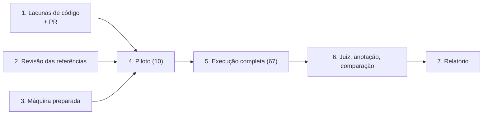

# Plano da comparação do LLM puro com o LLM com RAG (#69)

Estado em 15/11/2026, na branch `feat/69-llm-puro-vs-rag` (ainda sem PR). Comportamento esperado na [spec](spec.md); observabilidade na [spec 29](../29-observabilidade-langfuse/spec.md) e em [docs/semana-3/observabilidade.md](../../docs/semana-3/observabilidade.md).

## 1. Onde estamos em cada critério de pronto

| Critério da issue | Situação | O que falta |
| --- | --- | --- |
| Spec e cenários em `specs/` | Feito: `spec.md` e `cenarios.feature` (9 cenários) | Os **passos BDD** dos 9 cenários não existem em `tests/bdd/` (o AGENTS.md pede) |
| Modo "LLM puro" na avaliação | Feito: `avaliar-respostas --modo puro`, prompt `miau-ricio/resposta_sem_base` | — |
| Cada chamada ao LLM no Langfuse, sem dados pessoais, e tudo roda sem as chaves | Feito: geração com modelo, prompt e versão, tokens e latência; mascaramento da RN30; sem chaves, nada é enviado | Rodar a avaliação com `LANGFUSE_AMBIENTE=avaliacao`, para não misturar com o uso local |
| Perguntas com resposta de referência, revisadas por uma pessoa | Parcial: `perguntas_rag_v3.json` tem 67 perguntas e 54 referências (as 10 sem resposta e as 3 de preço não têm) | **Revisão humana** das 54 referências; o próprio arquivo diz "Revisar antes de rodar a matriz" |
| ROUGE-1, ROUGE-L, cosseno, Hit@k e latência por pergunta e por execução, no arquivo e no Langfuse | Código feito (`metricas_de_texto.py`, `avaliacao_respostas.py`, `experimento_langfuse.py`) | **Nada rodou ainda**: o Langfuse não tem nenhum dataset nem run, e `data/avaliacao/v3/` não existe |
| Piloto de 10 perguntas e execução completa (67) por modelo e modo | Não começou | Máquina preparada, modelos baixados, base indexada, piloto, decisão sobre os de 27B, execução completa |
| Relatório em `docs/semana-3/` | Não começou | Método, resultados, limites e recomendação de LLM |
| Decisões em `docs/decisoes.md` | Parcial: temperatura 0 e semente 42 (10/11), juiz com Gemini e amostra (15/11), prompts no Langfuse (15/11) | Biblioteca do Langfuse (SDK 5), lista de modelos do experimento, ROUGE implementado no projeto (sem biblioteca), cosseno com o e5, amostra da anotação humana |

## 2. O que o Langfuse atende hoje e o que falta nele

### Já atende

| Necessidade da #69 | Como o Langfuse atende | Onde está |
| --- | --- | --- |
| Registrar cada chamada ao LLM | Geração com modelo, parâmetros, tokens, latência e o prompt vinculado à versão | `RegistroDeGeracoes` |
| Registrar a busca | Observação *retriever* com os trechos e os scores | `RepositorioObservado` |
| Mesmo conjunto de perguntas para todas as execuções | Dataset `miau-ricio-perguntas_rag_v3`, com a referência como saída esperada | `sincronizar_dataset` |
| Uma execução por modelo e modo | Um *run* do dataset por execução, com a configuração no metadado | `rodar_experimento` |
| Métricas por pergunta e média por execução | ROUGE-1, ROUGE-L, cosseno, Hit@k, latência, comportamento e fonte esperada como scores; o Langfuse calcula as médias por run | `avaliacoes_do_resultado` |
| Comparar execuções lado a lado | Tela de comparação de runs do mesmo dataset | interface do Langfuse |
| Mesmo prompt em todas as execuções | Prompt management: a execução lê a mesma versão e grava a versão usada | `PromptsDoLangfuse`, `versoes_dos_prompts` |
| Dados pessoais | Mascaramento antes do envio (RN30); as perguntas da avaliação são fictícias | `mascaramento.py` |

### Falta configurar ou implementar

| Necessidade | Por que falta | O que fazer |
| --- | --- | --- |
| **Juiz (fidelidade e relevância) nas execuções** | A regra atual só pega a observação `miau-ricio.pergunta` da API, nos ambientes `producao` e `local`. As execuções da avaliação são *experiment items*, com outro nome e outro ambiente | Nova regra para experimentos (`isExperimentItemRootSpan = true`, ambiente `avaliacao`, amostra 1,0) |
| **Trechos para o juiz de fidelidade** | A saída de cada item do experimento traz o texto e as métricas, mas não os trechos usados; o juiz não lê as observações filhas | Pôr os trechos usados na saída da tarefa (`saida_da_tarefa`) |
| **Fidelidade só no modo RAG** | No modo puro não há trechos: a fidelidade não se aplica | Duas regras: fidelidade só nos runs `rag-*`; relevância nos dois modos |
| **Anotação humana de uma amostra** | Não há fila de anotação (*annotation queue*) nem as escalas da anotação | Criar as escalas (*score configs*) e a fila pela API, e sortear a amostra |
| **Ambiente separado** | A avaliação usa o `LANGFUSE_AMBIENTE` do `.env` (hoje `local`) | `avaliar-respostas` grava sempre em `avaliacao` |

### O que não é papel do Langfuse

- Rodar os modelos: os LLMs rodam no Ollama da máquina, e o Langfuse só registra.
- Calcular ROUGE, cosseno e Hit@k: são contas do código (RN01), que o Langfuse só recebe.
- Decidir se os modelos de 27B cabem na máquina: é o piloto que decide.
- Escrever o relatório e a recomendação de LLM.
- Custo: o Ollama local não tem custo por token; o relatório compara tokens e latência.

## 3. Plano de implementação

Fases em ordem. A fase 1 é código (uma pessoa); a fase 2 pode andar em paralelo com ela; as fases 3 a 6 dependem das anteriores.

### Fase 1: fechar as lacunas de código (antes de rodar)

| # | Tarefa | Arquivos | Pronto quando |
| --- | --- | --- | --- |
| 1.1 | Passos BDD dos 9 cenários da spec 69 | `tests/bdd/test_llm_puro_vs_rag.py` | `pytest tests/bdd` passa com os 9 cenários |
| 1.2 | `avaliar-respostas` grava no ambiente `avaliacao` | `receitas/cli.py` | O run aparece no Langfuse com `environment = avaliacao` |
| 1.3 | Saída de cada item com os trechos usados (título e começo do texto) | `experimento_langfuse.py` (`saida_da_tarefa`), `avaliacao_respostas.py` | A saída do item no Langfuse tem `trechos` no modo RAG |
| 1.4 | Regras do juiz para experimentos: fidelidade (só `rag`) e relevância (os dois modos), amostra 1,0 | `avaliadores_langfuse.py`, comando `criar-avaliadores` | As duas regras aparecem em **Evaluators > Rules** |
| 1.5 | Escalas e fila da anotação humana; comando que sorteia a amostra (estratificada por categoria e modo) e põe os itens na fila | `compartilhado/infraestrutura/anotacao_langfuse.py`, comando `criar-fila-de-anotacao` | A fila tem os itens sorteados, com as escalas da anotação |
| 1.6 | Opção `--ids` em `avaliar-respostas`, para o piloto usar perguntas escolhidas (o `--limite` pega as primeiras do arquivo, que são quase todas de receita) | `receitas/cli.py` | `--ids r01 e01` avalia só essas duas |
| 1.7 | Registrar as decisões: SDK do Langfuse, modelos do experimento, ROUGE sem biblioteca, cosseno com o e5, tamanho e critério da amostra humana | `docs/decisoes.md` | Cada linha com justificativa (pedir à pessoa que decidiu) |
| 1.8 | PR da branch, fechando #69, #29 e #28 (`Refs #25`) | — | CI verde e merge na `main` |

Proposta para a anotação humana (1.5), a confirmar com a equipe:

| Escala | Tipo | Valores |
| --- | --- | --- |
| `humano_correcao` | categórica | correta, parcialmente correta, errada |
| `humano_fidelidade` | booleana | só afirma o que está nos trechos (só RAG) |
| `humano_utilidade` | numérica | 1 a 5 |

Amostra: 2 perguntas por categoria com resposta (11 categorias) × 2 modos × o melhor e o pior modelo da execução completa, cerca de 88 itens.

### Fase 2: revisar as respostas de referência (pessoa da equipe)

1. Para cada uma das 54 perguntas com `resposta_referencia` em `data/avaliacao/perguntas_rag_v3.json`, conferir contra os trechos do gabarito (`esperados`):
   - a referência só afirma o que está nos trechos;
   - os números (quantidades, tempos, temperaturas) batem com a fonte;
   - o texto responde à pergunta, em 1 a 3 frases, no tom do Miau-ricio.
2. Corrigir no próprio arquivo e registrar no metadado quem revisou e quando (`revisado_por`, `revisado_em`), tirando o aviso "Revisar antes de rodar a matriz".
3. Abrir um PR só com o arquivo. Rodar a matriz depois do merge, porque o dataset no Langfuse é sincronizado a partir do arquivo.

### Fase 3: preparar a máquina (Mac M4)

```bash
docker compose up -d qdrant
ollama pull qwen2.5:7b
ollama pull qwen3.5:9b
ollama pull gemma3:12b
ollama pull qwen3.5:27b
ollama pull gemma3:27b
poetry run python -m economia.receitas.cli indexar --recriar
```

No `.env`: `MODELO_EMBEDDINGS=e5`, `LANGFUSE_AMBIENTE=avaliacao` (até a tarefa 1.2 existir) e as chaves do Langfuse. Conferir que os prompts estão acessíveis com `poetry run pytest -m langfuse`.

### Fase 4: piloto de 10 perguntas

Objetivo: decidir se os modelos de 27B cabem e medir o tempo de cada execução. Usar 10 perguntas, uma de cada categoria: `r01` (receita), `e01` (receita entre idiomas), `c01` (conservação), `g01` (Guia Alimentar), `n01` (nutrição), `i01` (alimentação infantil), `h01` (segurança alimentar), `b01` (robustez), `s01` (sem resposta) e `$01` (preço). Depende da tarefa 1.6:

```bash
for llm in qwen2.5:7b qwen3.5:9b gemma3:12b qwen3.5:27b gemma3:27b; do
  for modo in rag puro; do
    poetry run python -m economia.receitas.cli avaliar-respostas \
      --modo "$modo" --llm "$llm" --perguntas data/avaliacao/perguntas_rag_v3.json \
      --ids r01 e01 c01 g01 n01 i01 h01 b01 s01 '$01' \
      --saida "data/avaliacao/v3/piloto-$modo-${llm/:/-}.json"
  done
done
```

Critério para um modelo de 27B entrar na execução completa (proposta, a registrar como decisão): sem erro de memória, com o Mac utilizável durante a execução, e com latência média de até 3 vezes a do `gemma3:12b`. Registrar o tempo de cada execução, para estimar a execução completa.

### Fase 5: execução completa (67 perguntas)

O mesmo laço, sem `--ids`, só com os modelos aprovados no piloto, gravando em `data/avaliacao/v3/<modo>-<llm>.json`. São até 10 execuções; rodar uma por vez (o Ollama atende um pedido de cada vez) e, se possível, de noite.

Ao fim de cada execução, o comando mostra o link do run no Langfuse. Conferir que o run tem os scores e que o juiz avaliou os itens (fase 1.4).

### Fase 6: juiz, anotação e comparação

1. Esperar o juiz terminar nos runs. Os evaluators usam o `gemini-3.6-flash`; se ele ficar lento, ver a seção 5 de `docs/semana-3/observabilidade.md`.
2. Rodar `criar-fila-de-anotacao` e fazer a anotação humana na interface do Langfuse (**Annotation Queues**), dividindo os itens entre a equipe.
3. Comparar as execuções:

   ```bash
   poetry run python -m economia.receitas.cli comparar-execucoes \
     data/avaliacao/v3/puro-qwen2.5-7b.json data/avaliacao/v3/rag-qwen2.5-7b.json
   ```

   E, no Langfuse, a comparação dos runs do dataset `miau-ricio-perguntas_rag_v3`.

### Fase 7: relatório

`docs/semana-3/llm-puro-vs-rag.md`, com:

1. **Método:** perguntas, modelos (digest e quantização gravados em cada execução), o que fica fixo, as métricas e os seus limites (ROUGE penaliza paráfrase; cosseno do e5 varia pouco; nenhuma métrica confere números).
2. **Resultados:** tabela por modelo e modo (comportamento, fonte citada, ROUGE-1, ROUGE-L, cosseno, Hit@k, fidelidade, relevância, latência, tokens), por categoria, e a concordância entre o juiz e a anotação humana.
3. **Ganho do RAG:** diferença puro × RAG por modelo, com exemplos de perguntas em que o puro inventou e o RAG citou a fonte.
4. **Limites:** tamanho da amostra, uma máquina só, juiz de outro provedor, perguntas fictícias.
5. **Recomendação:** LLM e prompt padrão do produto, como proposta para a equipe decidir (a spec deixa a troca fora do escopo).

Links dos runs do Langfuse no relatório. Registrar a decisão final em `docs/decisoes.md`.

## 4. Ordem sugerida e dependências



## 5. Riscos

- **Tempo de máquina:** 10 execuções de 67 perguntas com modelos locais podem levar horas cada; o piloto dá a estimativa real.
- **Modelos de 27B:** podem não caber em 24 GB com o e5 e o Qdrant abertos.
- **Juiz no plano gratuito do Gemini:** limite de requisições; com amostra 1,0 nas execuções, são até 670 avaliações de fidelidade e 670 de relevância. Se estourar, reduzir a amostra das regras de experimento.
- **Referências ainda não revisadas:** rodar antes da fase 2 invalida ROUGE e cosseno.
