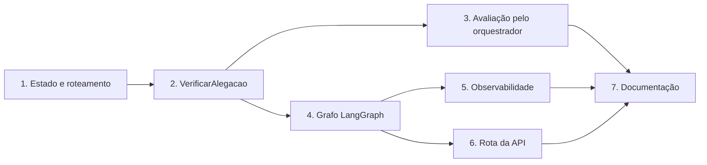

# Plano de implementação: orquestrador da verificação (#82)

Plano para a [spec](spec.md). A base é o trabalho do Paulo na #79: o laço de `verificacao/aplicacao/avaliacao.py` (`avaliar_caso`) já faz o roteamento, o dobro do limite e a contagem de retornos que o orquestrador precisa. Os números vêm da avaliação de 24/11 (`data/avaliacao/verificacao/`). O plano tira o laço da avaliação e o leva para um caso de uso, sem mudar os agentes.

## Antes de começar

| Item | Quem | Por quê |
| --- | --- | --- |
| Revisar a spec e os cenários | Equipe | O AGENTS.md pede revisão antes de implementar |
| Mover o rótulo `production` do `verificacao/analise` para a v2 | Paulo | A melhor rodada (87% de acurácia) usou a v2 |
| Decidir o limiar na busca do fluxo (ponto 2 da revisão) | Pedro Lucas e Isabel | A rota da #75 usa o limiar, e a avaliação da #79 não usa |

## Etapas

Cada etapa termina com os testes passando e vira um commit. As etapas 1 a 3 não dependem do LangGraph.

### 1. Estado e roteamento (camada `aplicacao`)

**Arquivo:** `src/economia/verificacao/aplicacao/orquestracao.py`

- `EstadoDaVerificacao`: a alegação, o perfil, o limite, as evidências, a análise, a validação, os motivos, os retornos, o histórico e o veredito. São os campos da seção 4 da arquitetura, mais os `motivos`, que o laço do Paulo guarda à parte.
- `EtapaDaVerificacao`: o agente, a entrada, a saída e os segundos.
- `ParametrosDaOrquestracao`: o limite inicial (5), o teto (10) e o máximo de retornos (2).
- `proximo_no(estado, parametros) -> No`: função pura com as regras 1 e 4 da spec.
- `preparar_retorno(estado, parametros) -> EstadoDaVerificacao`: aplica as regras 2 e 3. No Research, dobra o limite até o teto e limpa os motivos. No Analysis, mantém as evidências e passa os motivos.

**Testes:** `tests/verificacao/test_orquestracao.py` (aprovado, os dois destinos, o teto, o limite de retornos, Validation sem destino), sem LLM.

### 2. Caso de uso `VerificarAlegacao`

**Arquivo:** o mesmo módulo, ou `aplicacao/verificar_alegacao.py`.

- Recebe `pesquisar` (o `Pesquisar` da avaliação), `AnalisarAlegacao`, `ValidarAnalise` e `ComunicarVeredito`, e um `ObservadorDeEtapas` opcional, como na avaliação.
- `executar(alegacao, perfil) -> ResultadoDaVerificacao` roda os nós até o Communication. Cada nó registra uma `EtapaDaVerificacao` com o tempo, pelo relógio injetado (como o `relogio` da avaliação).
- **Primeira versão sem o LangGraph:** um laço sobre `proximo_no`. Assim os cenários 1 a 6 já passam, e a etapa 3 só troca o motor.

**Testes:** os passos BDD dos cenários 1 a 6 em `tests/bdd/test_orquestrador_verificacao.py`, com os dublês de `tests/verificacao/conftest.py` (`LLMRoteirizado` e `fazer_evidencias`) e um pesquisador falso que guarda os limites pedidos.

### 3. Avaliação pelo orquestrador

**Arquivo:** `verificacao/aplicacao/avaliacao.py`

- `avaliar_caso` passa a chamar o `VerificarAlegacao` e lê do histórico os retornos, os destinos e os motivos. As métricas e o formato do `resultados_*.json` ficam iguais, para comparar com as rodadas do Paulo.
- O Communication entra no fluxo da avaliação e grava a mensagem do veredito por caso. Isso resolve o risco "avaliação do texto" da spec 83.
- `--limite-maximo` continua na CLI, agora com o padrão de 10.

**Testes:** `tests/verificacao/test_avaliacao.py` e `test_cli.py` passando sem mudar o que conferem. Uma rodada nova com o `qwen2.5:7b` deve dar números próximos aos de `resultados_v1_teto10_prompt-v2.json`.

### 4. Grafo LangGraph (camada `infraestrutura`)

**Arquivo:** `src/economia/verificacao/infraestrutura/grafo_langgraph.py`

- `poetry add langgraph`, com a versão fixada no `pyproject.toml`. A decisão é de 03/11/2026, e não é preciso registrar outra.
- Um nó por agente, todos chamando os mesmos métodos do caso de uso. As arestas condicionais usam `proximo_no`, a mesma função da etapa 1.
- O `VerificarAlegacao` recebe o motor por injeção: o laço da etapa 2 nos testes e o grafo na API. O domínio e a aplicação não importam o LangGraph.

**Testes:** os mesmos cenários BDD rodando com o grafo (parametrizados pelo motor) e um teste de que a camada `aplicacao` não importa `langgraph`, no padrão de `test_independencia_dos_contextos.py`.

### 5. Observabilidade

**Arquivo:** `verificacao/infraestrutura/observabilidade_langfuse.py`

- Um trace `verificacao.alegacao` por verificação e um span por nó (`verificacao.research`, `verificacao.analysis` etc.), com o `ObservadorLangfuse` do Paulo. O método `caso` hoje recebe um `CasoDeVerificacao`; ele ganha uma versão para uma alegação avulsa, sem a classificação esperada.
- As gerações do LLM entram pelo `RegistroDeGeracoes`, ligadas à versão do prompt.
- O span do Validation leva os motivos e o destino no metadado, para o retorno aparecer no trace (seção 7 da arquitetura).
- Mascaramento pela função `mask` do cliente (RN30). Uma falha do Langfuse não interrompe a verificação.

**Testes:** com um cliente falso do Langfuse, como os testes de observabilidade que já existem. **Evidência:** dois traces reais, um aprovado direto e um com retorno, para a #72.

### 6. Rota `POST /api/v1/verificacoes`

**Arquivos:** `src/economia/api/verificacoes.py` (roteador com `RotaComProblemDetails`, de `api/evidencias.py`), `api/modelos.py`, `api/dependencias.py` e `api/app.py` (`include_router`).

- `obter_verificar_alegacao()` em `dependencias.py`, com `lru_cache`, monta o grafo com o e5, o Qdrant, o Ollama e os prompts `production` do Langfuse, pelas mesmas fábricas da CLI.
- Os modelos Pydantic da requisição e da resposta estão na spec. O histórico leva ids e scores, não o texto dos trechos.
- Os erros do LLM e do Qdrant viram 503, como em `perguntar` (`api/app.py`).

**Testes:** `tests/api/test_verificacoes.py` com a dependência substituída (`app.dependency_overrides`) e os passos BDD dos cenários 7 a 9.

### 7. Documentação e fechamento

- `docs/arquitetura/modelo-de-dominio.md`: `EstadoDaVerificacao` e `EtapaDaVerificacao` como propostos.
- `docs/semana-4/arquitetura-agentes.md`: na seção 3, o orquestrador como implementado. Na seção 5.5, a rota nova. Na seção 11, os pontos 1, 4 e 5 resolvidos.
- `docs/decisoes.md`: o teto de 10 trechos e a busca sem limiar no fluxo, com a justificativa de quem decidiu.
- Spec com o status **Implementada**, e o PR com `Closes #82` e `Refs #72`.

## Ordem e paralelismo

- Depois da etapa 2, a 3 (avaliação, com o Paulo) e a 4 (grafo) podem andar juntas.
- A rota (etapa 6) destrava a interface da demo da #72.

## Riscos do plano

- **A etapa 3 muda o código da avaliação do Paulo.** Se a equipe preferir, ela fica para depois do PR, e o orquestrador nasce ao lado do laço da avaliação. O custo é ter as regras de retorno em dois lugares até lá.
- **A versão do LangGraph** precisa funcionar com o Python do projeto (`>=3.11`; o ambiente local usa o 3.14). Se não houver versão compatível, a etapa 4 fica bloqueada, e o laço da etapa 2 atende a API até lá.
- **O tempo de resposta da rota** (24 s em média) pode passar do tempo limite do proxy na VM. Isso precisa ser conferido antes da demo.
